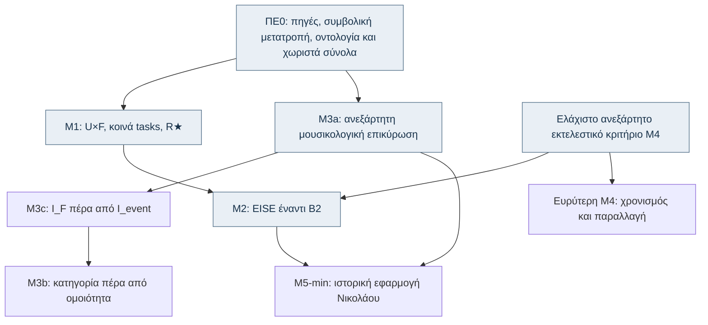

# Η μουσική θέση ως υπολογιστική μονάδα — Εγχειρίδιο συνάντησης Μακρή

**Προσωπικό αποθετήριο μελέτης | Βάση: ερευνητική πρόταση v8.71a | 15 Οκτωβρίου 2026**

> [!NOTE]
> Αυτό είναι ένα **πρακτικό αναγνωστήριο** για την ερευνητική πρόταση, όχι το πρωτεύον ερευνητικό αποθετήριο, ούτε αρχείο επιβεβαιωμένων αποτελεσμάτων. Προορίζεται για γρήγορη επανάληψη από κινητό, προφορική άσκηση και καταγραφή ερωτήσεων του επιβλέποντα. Κράτησέ το **private** μέχρι να αποφασιστεί τι μπορεί να δημοσιοποιηθεί.

---

> [⚡ 90″ Pitch](study/00_90_seconds.md) · [🗺️ Αρχιτεκτονική](study/01_architecture.md) · [🎤 Mock Interview](practice/mock_interview.md) · [📖 Γλωσσάρι](study/06_glossary.md) · [📱 Οδηγός Κινητού](MOBILE_STUDY_GUIDE.md)

---

## 📱 Γρήγορη αρχή & Οργάνωση Μελέτης (10–15 λεπτά)

### 🚀 1. Άμεση Επανάληψη (1–3 λεπτά)
1. [**Η διατριβή σε 90 δευτερόλεπτα**](study/00_90_seconds.md) — Το elevator pitch, η σταθερή πενταμερής απάντηση σε κάθε ερώτηση & τα 3 σημεία έμφασης.

### 🗺️ 2. Αρχιτεκτονική & Εξαρτήσεις (5 λεπτά)
2. [**Χάρτης M1–M5 και εξαρτήσεων**](study/01_architecture.md) — Πίνακας σταδίων ΠΕ0–M5, είσοδοι/έξοδοι, σχέσεις εξάρτησης και 3 στρώματα εποπτείας (`C_StA`, `C_occ`, `C_exp`).

### 🔬 3. Πειραματικοί Άξονες (5 λεπτά έκαστο)
3. [**M1: U×F και R★**](study/02_M1_representation.md) — Μονάδες $u_1, u_2, u_3$, κλίμακες $N/T/M/L$ (12 συνθήκες), κανόνας επιλογής $R^\star$, $g_{min}$, αβεβαιότητα $\mathcal{R}^\star$.
4. [**M2: EISE, B2 και ιστορική εξήγηση**](study/03_M2_EISE.md) — Semi-Markov CRF, $z_{id}$ έναντι $h_t$, σύγκριση B0/B1/B2/EISE, μέτρηση $\Delta_{hist}$ και τα 3 πιθανά αποτελέσματα.
5. [**M3a, M3c, M3b: άνθρωποι και επικύρωση**](study/04_M3_human.md) — M3a (ανεξάρτητοι ειδικοί), M3c ($I_F$, $I_{event}$, PPM, $H_{pred}$), M3b (ακουστική κατηγοριοποίηση $H_{cat}$).
6. [**M4–M5: εκτέλεση και χαρακτηρισμός έργου**](study/05_M4_M5.md) — M4 ελάχιστο εκτελεστικό κριτήριο ($A(z)$ έναντι $\Gamma(z)$), M5-min ($D_{fam}$, $D_{within}$, σώμα αναφοράς $\Omega$, εφαρμογή Νικολάου Σμύρνης).
7. [**Μικρό γλωσσάρι**](study/06_glossary.md) — Οι 40 βασικοί όροι και ορισμοί για άμεση αναφορά.

### 🎙️ 4. Προφορική Εξάσκηση & Αυτοαξιολόγηση (10–15 λεπτά)
8. [**Προφορική εξέταση: 25 δύσκολες ερωτήσεις**](practice/mock_interview.md) — Διαδραστικές πτυσσόμενες κάρτες για προφορική άσκηση 30–60″ από κινητό.
9. [**Κάρτες Anki Flashcards (TSV)**](practice/anki_flashcards.tsv) — 40 ψηφιακές κάρτες έτοιμες για άμεση εισαγωγή σε AnkiMobile / AnkiDroid ([Οδηγίες χρήσης](practice/README.md)).

### ⚖️ 5. Στρατηγική Συνάντησης & Σημειώσεις
10. [**Εκκρεμείς αποφάσεις που δεν πρέπει να βαφτίζονται γεγονότα**](notes/decisions_and_risks.md) — Ανοικτά θέματα προς συζήτηση, πύλες εφικτότητας & κανόνες GREEN/AMBER/RED.
11. [**Τι αποτελεί δημοσιεύσιμη συμβολή;**](notes/publication_and_scope.md) — Βασικός πυρήνας, πιθανοί δρόμοι δημοσίευσης και ερώτημα προς τον επιβλέποντα.
12. [**Σημειώσεις συνάντησης**](templates/meeting_notes.md) — Έντυπο λήψης πρακτικού κατά ή αμέσως μετά τη συνάντηση.

### 📱 6. Καθημερινή Μελέτη από Κινητό
- [**📱 Οδηγός Καθημερινής Χρήσης από Κινητό (Mobile Study Guide)**](MOBILE_STUDY_GUIDE.md) — Βήμα-βήμα οδηγίες για GitHub Mobile, AnkiDroid/AnkiMobile, Offline PDF και 15-λεπτη καθημερινή ρουτίνα.

### 📄 7. Εκτυπώσιμο Εγχειρίδιο
- **Εκτυπώσιμο εγχειρίδιο:** [23σέλιδο PDF Συνάντησης](book/Makris_Study_Handbook_v8_71a.pdf) (ή [εναλλακτικό αρχείο](book/Makris_PhD_Study_Handbook_v8_71a_23pages.pdf)) · [LaTeX πηγή](book/Makris_Study_Handbook_v8_71a.tex)

---

## Το έργο σε μία εικόνα

Τα βέλη παρουσιάζουν **επιστημονικές εξαρτήσεις**, όχι υποχρεωτικά αυστηρή χρονική διαδοχή. Η M3a μπορεί να εξελίσσεται παράλληλα με την M2. Η M3c προηγείται της M3b στην ανθρώπινη συλλογή.

---

## Μνημονικός κανόνας

> **Θέση → οικογένεια → εξηγητική σχέση → ελεγχόμενη αναπαράσταση → ανεξάρτητη επικύρωση → προφίλ έργου.**

- Η απόκλιση από ένα δηλωμένο σώμα αναφοράς **δεν** ισοδυναμεί με «λάθος» ή αισθητική υποβάθμιση.
- Η ιστορική σχέση **δεν** προκύπτει μόνο από μελωδική ομοιότητα.
- Η σύγχρονη εκτέλεση **δεν** ανασυνθέτει αυτομάτως το ιστορικό άκουσμα.

---

## Τι περιλαμβάνει το αποθετήριο

- `book/`: Το εκτυπώσιμο 23σέλιδο εγχειρίδιο (`Makris_Study_Handbook_v8_71a.pdf`) και η πηγή LaTeX.
- `study/`: Επανάληψη ανά πείραμα και θεματικό άξονα (`00` έως `06`).
- `practice/`: Προφορικές ερωτήσεις προσομοίωσης (`mock_interview.md`) και κάρτες TSV για Anki (`anki_flashcards.tsv`).
- `notes/`: Εκκρεμή ζητήματα ανοιχτά για συζήτηση και δημοσιεύσιμες συμβολές.
- `templates/`: Έντυπο λήψης πρακτικού συνάντησης (`meeting_notes.md`).
- `SOURCES.md`: Προέλευση, όρια και εκδοχές της πρότασης v8.71a.
- `MOBILE_STUDY_GUIDE.md`: Οδηγός καθημερινής χρήσης από smartphone.

---

## Όρια & Δήλωση μη δημοσιοποίησης

Το αποθετήριο **δεν περιλαμβάνει** τα πρωτότυπα μουσικά δεδομένα, ηχογραφήσεις, την πλήρη ερευνητική πρόταση ή μη δημόσιες πηγές. Δεν πρέπει να χρησιμοποιηθεί ως corpus και δεν υπάρχουν εδώ δεδομένα που αποδεικνύουν αποτελέσματα M1–M5.
