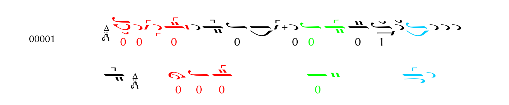

# Μουσικά παραδείγματα και παραλλαγή θέσης

[Σύνοψη](../start/overview.md) · [Μουσικολογική τεκμηρίωση](../musicology/index.md) · [M2](../full/06-eise.md) · [ATL-INV](../current/inverse-problem.md)

## Παράδειγμα Α — Καταγεγραμμένες παραλλαγές ενός μελωδικού τύπου

**Πηγή:** St. Anthony’s Greek Orthodox Monastery, Papadic Formulae, τέταρτος ήχος Άγια, έντυπη σ. 1501 / σελίδα PDF 501 του εξετασθέντος αντιγράφου. Η κατηγορία αρχίζει στην προηγούμενη σελίδα: Medial Cadences on Di, C) Accented on Last Syllable, Di–Di. Η εικόνα μεταφέρεται από το Σχήμα 1 της πρότασης και διατηρεί τα χρώματα της πηγής.

Το `00001` κωδικοποιεί πέντε συλλαβές: τέσσερις άτονες και μία τονισμένη. Το υπόμνημα του καταλόγου χρησιμοποιεί τα χρώματα για εναλλακτικές γραφές του ίδιου μελωδικού τύπου. Η κάτω γραμμή δίνει εναλλακτικές για τα αντίστοιχα έγχρωμα τμήματα. Ο αναγνώστης μπορεί να παρατηρήσει τη σταθερή πλαισίωση και τις τοπικές διαφοροποιήσεις πριν εξετάσει αναλυτικά τη μουσική οργάνωση.

### Τι εξετάζει η πρόταση

Η οικογενειακή αναγνώριση χρησιμοποιεί δηλωμένες μουσικές σχέσεις και κριτήρια εφαρμογής. Η καταλογογραφική σχέση καταγράφεται ως ένα τεκμήριο. Η πλήρης οικογενειακή κρίση και η τεκμηρίωση ιστορικής συν-εξήγησης ακολουθούν τις χωριστές διαδικασίες του πρωτοκόλλου.

| Σχέση | Τεκμηρίωση που απαιτείται | Ρόλος |
|---|---|---|
| Καταλογογραφική παραλλαγή | Εγγραφή και συμβάσεις του καταλόγου | Αφετηρία εξέτασης υποψήφιου μελωδικού τύπου |
| Κοινή οικογένεια | Ενεργή προδιαγραφή οικογένειας και ανεξάρτητη οικογενειακή κρίση | Επιλέξιμη οικογενειακή εποπτεία |
| Παράλληλη εξήγηση κοινού χωρίου | Συγκεκριμένο έργο, χωρίο, πηγές, εξηγητές και ιστορική σχέση | Ιστορική ακμή για την EISE, μετά την οικογενειακή επιλεξιμότητα |

[Παράδειγμα στο αρχικό κείμενο](../full/01-introduction.md#r004) · [Πλήρες PDF της πρότασης](../../sources/proposal-v871e-candidate.pdf#page=7) · [Βιβλιογραφική εγγραφή καταλόγου](../bibliography/entries/b126.md)

## Παράδειγμα Β — Μετροφωνική ισοδυναμία και αντίστροφη ανάκτηση

Ο επόμενος πίνακας είναι **σχηματική εξήγηση του ερευνητικού προβλήματος**, όχι αποτύπωση συγκεκριμένου παλαιού χειρογράφου ή πραγματικού ζεύγους εξηγήσεων.

| Παλαιά γραπτή επιλογή $H$ | Κοινή μετροφωνική πληροφορία $M$ | Πρόσθετο ιστορικό ερώτημα |
|---|---|---|
| Ολίγον, σε επιλέξιμο περιβάλλον | Άνοδος μίας φωνής | Διακρίνει η αναλυτική ανάπτυξη την επιλογή του σημείου; |
| Πεταστή, στο αντίστοιχο περιβάλλον | Άνοδος μίας φωνής | Πόσο αλλάζει η πρόβλεψη της γραπτής επιλογής όταν διαβάζουμε την εξήγηση; |
| Παρουσία ή απουσία άφωνης μεγάλης υπόστασης | Η διαστηματική πορεία μπορεί να μένει ίδια | Διατηρεί η αναλυτική μορφή ένα διαγνωστικό ίχνος της υπόστασης; |

Το απλό μοντέλο αναφοράς γνωρίζει τη μετροφωνία και το περιβάλλον. Η [ATL-INV](../current/inverse-problem.md) προσθέτει την πραγματική αναλυτική εξήγηση, συγκρίνει επίσης τον προκαθορισμένο κανόνα εξήγησης και, στα διπλά χωρία, μια δεύτερη αναλυτική πηγή. Η ετικέτα προέρχεται από ανεξάρτητη ανάγνωση του συγκεκριμένου παλαιού μάρτυρα. Το [μουσικολογικό υπόβαθρο](../musicology/06-old-notation.md) εξηγεί γιατί η ίδια μετροφωνία μπορεί να αντιστοιχεί σε διαφορετική γραφή.

## Πρώτη προτεραιότητα: ένα πραγματικό ιστορικό χωρίο

Η επόμενη προσθήκη είναι ένα κοινό χωρίο με **παλαιό μάρτυρα και επιβεβαιωμένες εξηγήσεις του Γρηγορίου και του Χουρμουζίου**. Η παρουσίαση θα σημειώνει την παλαιά γραπτή διάκριση που αποτελεί στόχο και τις αντίστοιχες περιοχές στις δύο εξηγήσεις.

| Τεκμήριο | Στοιχεία που θα συνοδεύουν το παράδειγμα |
|---|---|
| Παλαιός μάρτυρας | Συλλογή, κωδικός, φύλλο ή σελίδα, έργο, χωρίο και ανεξάρτητη ανάγνωση της ετικέτας. |
| Κάθε εξήγηση | Πηγή, εξηγητής, ακριβής θέση, χρονολόγηση και τεκμηρίωση ότι αφορά το ίδιο χωρίο. |
| Στοίχιση | Συλλαβικό σημείο αναφοράς, όρια, αντιστοιχίσεις και αβεβαιότητες. |
| Εικόνες | Προέλευση, όροι αναπαραγωγής και λεζάντες. |

Η ταυτότητα του μάρτυρα που διαβάζεται και η σχέση του με το πρότυπο κάθε εξηγητή καταγράφονται χωριστά. Στο παρόν αναγνωστήριο το παράδειγμα παραμένει προς τεκμηρίωση.

## Επόμενα παραδείγματα προς τεκμηρίωση

| Ανάγκη | Ερευνητική χρήση | Κατάσταση |
|---|---|---|
| Δύο πραγματώσεις κοινής οικογένειας με μεγάλη επιφανειακή διαφορά | Δύσκολο θετικό | Επιλογή χωρίου και έλεγχος προδιαγραφής οικογένειας |
| Παράλληλες εξηγήσεις ίδιου χωρίου | Ιστορική σχέση της EISE | Απαιτούνται επαληθευμένες πηγές και ταυτότητα χωρίου |
| Συγγενής επιφάνεια και διαφορετική οικογενειακή κρίση | Δύσκολο αρνητικό | Έλεγχος πρωτοτύπου· σχετική αφετηρία Καραγκούνης 2003, σ. 788 |
| Εναλλακτικά αποδεκτά όρια | Μερική επισημείωση | Καταγεγραμμένες ανεξάρτητες κρίσεις |
| Παλαιός μάρτυρας με μία ή δύο επιβεβαιωμένες εξηγήσεις | Πραγματικό εικονογραφημένο παράδειγμα ATL-INV | Αυτοψία, δικαιώματα απεικόνισης, χωριστή ανάγνωση και στοίχιση |

Η κατάσταση κάθε παραδείγματος εμφανίζεται μαζί με την εικόνα και την πηγή του. Έτσι η εποπτική χρήση και η αποδεικτική ισχύς του παραμένουν ελέγξιμες.

---

[Σχολιασμός αυτής της ενότητας](https://github.com/GeorgeSpy/byz-position-phd-study/issues/new?template=proposal-feedback.yml&title=%CE%A0%CE%B1%CF%81%CE%B1%CF%84%CE%AE%CF%81%CE%B7%CF%83%CE%B7%3A+%CE%9C%CE%BF%CF%85%CF%83%CE%B9%CE%BA%CE%AC+%CF%80%CE%B1%CF%81%CE%B1%CE%B4%CE%B5%CE%AF%CE%B3%CE%BC%CE%B1%CF%84%CE%B1+%CE%BA%CE%B1%CE%B9+%CF%80%CE%B1%CF%81%CE%B1%CE%BB%CE%BB%CE%B1%CE%B3%CE%AE+%CE%B8%CE%AD%CF%83%CE%B7%CF%82&location=https%3A%2F%2Fgithub.com%2FGeorgeSpy%2Fbyz-position-phd-study%2Fblob%2F47306feef68a62a232506f74dae05e066f9a51cb%2Fdocs%2Fexamples%2Findex.md) · [Σημειωματάριο παρατηρήσεων](../review/feedback.md)
