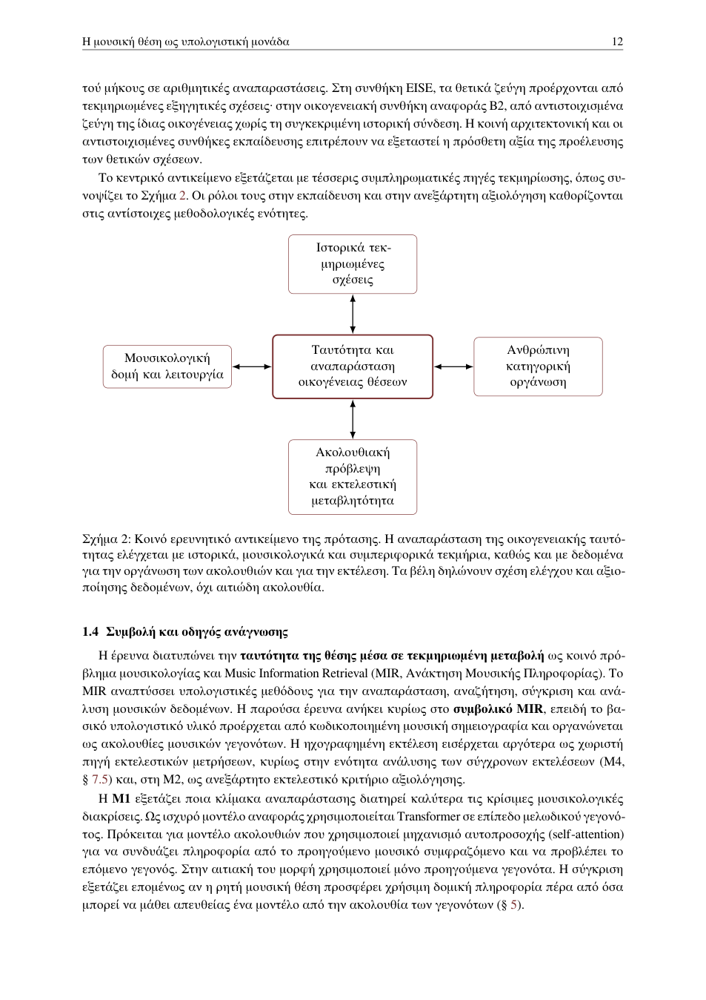

# 1 · Εισαγωγή και κεντρική συνεισφορά

[Αναλυτικός χάρτης](../full/index.md) · [Σύνοψη](../start/overview.md) · [Βιβλιογραφία](../bibliography/index.md)

Μεταγραφή προγενέστερου αναλυτικού κειμένου. [Πρωτότυπο PDF](../../sources/proposal-v871e-candidate.pdf) · [Προέλευση κειμένου](../reference.md).

**Σε αυτή την ενότητα**

- [1.1 · Η μουσική θέση και η ταυτότητα μέσα στη μεταβολή](#r003)
- [1.2 · Όροι και κλίμακες ανάλυσης](#r006)
- [1.3 · Από την ιστορική μετάδοση στην ελεγχόμενη εποπτεία](#r011)
- [1.4 · Συμβολή και οδηγός ανάγνωσης](#r013)

Στη βυζαντινή ψαλτική επανέρχονται μελωδικοί σχηματισμοί που μεταβάλλονται από έργο σε έργο και διατηρούν αναγνωρίσιμα στοιχεία της μουσικής τους ταυτότητας. Η παράδοση περιγράφει τέτοιους σχηματισμούς με την έννοια της **μουσικής θέσης**. Η παρούσα έρευνα εξετάζει πώς μπορεί ένα υπολογιστικό σύστημα να αναγνωρίζει αυτή την ταυτότητα μέσα στην παραλλαγή: δύο αισθητά διαφορετικές αποδόσεις μπορεί να αποτελούν πραγματώσεις της ίδιας θέσης, ενώ δύο όμοια αποσπάσματα μπορεί να αντιστοιχούν σε διαφορετικές θέσεις. Για να ελεγχθεί αυτό το ερώτημα, η έρευνα συγκρίνει διαφορετικές δομικές κλίμακες αναπαράστασης του μέλους και χρησιμοποιεί μουσικολογικά, ανθρώπινα και εκτελεστικά δεδομένα με διακριτούς ρόλους στην εκπαίδευση και στην αξιολόγηση.

## 1.1 · Η μουσική θέση και η ταυτότητα μέσα στη μεταβολή

Το κύριο συμβολικό σώμα χρησιμοποιεί τη **Νέα Μέθοδο**, το αναλυτικό σύστημα νευματικής σημειογραφίας που καθιερώθηκε το 1814 από τους λεγόμενους **Τρεις Διδασκάλους**: τον Χρύσανθο τον εκ Μαδύτων, τον Γρηγόριο Πρωτοψάλτη και τον Χουρμούζιο Χαρτοφύλακα. Η γραφή είναι σχεσιακή: τα νεύματα δηλώνουν κυρίως μελωδική κίνηση σε σχέση με το προηγούμενο σημείο και συνδυάζονται με χρονικές, ποιοτικές και τροπικές πληροφορίες.

Η θέση διαθέτει ιστορική και μορφολογική θεμελίωση ως οργανωμένος μελικός σχηματισμός. Ο **Μανουήλ Χρυσάφης**, λαμπαδάριος και θεωρητικός της ψαλτικής του 15ου αιώνα, συνδέει τη θέση με τη συνένωση σημείων που συγκροτούν μέλος (*Περὶ τῶν ἐνθεωρουμένων τῇ ψαλτικῇ τέχνῃ*, έκδ. D. E. Conomos, 1985b, σσ. 40–41). Ο **Κωνσταντίνος Χ. Καραγκούνης**, ερευνητής της ιστορίας, της μορφολογίας και της εξήγησης του παπαδικού μέλους, μελέτησε συστηματικά στη διδακτορική του διατριβή *Η Παράδοση και Εξήγηση του Μέλους των Χερουβικών της Βυζαντινής και μετα-Βυζαντινής Μελοποιίας* (2003) τις ονομασμένες θέσεις και τη μελοποιητική τους χρήση (ιδίως σσ. 714–715· πρβλ. Στάθης, 1987, σσ. 343–344). Ο **Αντώνιος Ε. Αλυγιζάκης**, στη μελέτη *Η οκταηχία στην ελληνική λειτουργική υμνογραφία* (Θεσσαλονίκη: Πουρναράς, 1985, σσ. 81–82), περιγράφει τις θέσεις ως επαναχρησιμοποιούμενα μελικά πρότυπα που συμμετέχουν στη συγκρότηση φράσεων και ολοκληρωμένων μελών.[^1] Οι ιστορικές περιγραφές τεκμηριώνουν την οργανωμένη και επαναχρησιμοποιούμενη θέση, ενώ ο υπολογιστικός προσδιορισμός των ορίων και των σχέσεων μεταξύ πραγματώσεων αποτελεί αντικείμενο ελέγχου της παρούσας έρευνας. Στο εξεταζόμενο σώμα, κάθε **εμφάνιση** αντιστοιχεί σε συγκεκριμένο χωρίο έργου και πηγής και κάθε **πραγμάτωση** στη μορφή που αποκτά εκεί ο τύπος. Οι πραγματώσεις συγκροτούν υποψήφιες **οικογένειες θέσεων**, των οποίων η συνοχή δοκιμάζεται με τύπο-ειδικές διαγνωστικές σχέσεις και ανεξάρτητες μουσικολογικές κρίσεις.

Χρήσιμες δοκιμασίες των ορίων αυτής της ταυτότητας προσφέρει η διατριβή του Κ. Χ. Καραγκούνη (2003). Στη σ. 788 συγγενής μετροφωνική επιφάνεια —δηλαδή συγγενής βασική κίνηση κατά την ανάγνωση των ποσοτικών σημείων— μπορεί να αντιστοιχεί σε διαφορετικές ιστορικές θέσεις όταν συνεκτιμώνται άλλα γνωρίσματα. Στις σσ. 810–812 καταγράφονται θέσεις με ιδιαίτερα τροπικά συμφραζόμενα· στη σ. 811 η παρακλητική παρουσιάζει ειδικά σταθερότητα στον εξεταζόμενο τρόπο μεταγραφής. Οι περιπτώσεις αιτιολογούν τη διάκριση μελωδικής ομοιότητας, ιστορικού ονόματος και οικογενειακής ένταξης, με χωριστή αξιολόγηση κάθε εμφάνισης.

Ο **Ιωάννης Αρβανίτης**, στη διδακτορική του διατριβή *Ο ρυθμός των εκκλησιαστικών μελών μέσα από την παλαιογραφική έρευνα και την εξήγηση της παλαιάς σημειογραφίας* (Ιόνιο Πανεπιστήμιο, 2010, τ. Α΄, §5.2, σσ. 136–142), εξετάζει τη θέση ως αρχή μελικής ομοιότητας παρά τις διαφοροποιήσεις σημειογραφικής γραφής, λεκτικού τονισμού και συλλαβικής κατανομής. Το ΠΕ0 μετατρέπει τις παρατηρήσεις σε υποψήφιες δοκιμασίες συλλαβικής προσαρμογής, κλίμακας, ένθεσης και χρονικής οργάνωσης. Η ειδική ρυθμική του θεώρηση αφορά κυρίως ειρμολογικό και στιχηραρικό ρεπερτόριο· η εφαρμογή της στα παπαδικά Χερουβικά και Κοινωνικά αποτελεί χωριστό εμπειρικό ζήτημα.

Ο **Nicolae Gheorghiță**, μουσικολόγος με έρευνα στη σημειογραφία και στην ιστορική εξήγηση, μελετά στο άρθρο *Observations on the Technique of Transcription (Exegesis) into the New Method of Analytical Music Notation of the Sunday Koinonikon of the 18th Century* (2010, σσ. 9–26· αναδημοσίευση σε βιβλίο του ίδιου έτους, κεφ. XIV, σσ. 225–248) σαράντα δύο Κυριακάτικα Κοινωνικά μέσα από επαναλαμβανόμενες θέσεις, τη διαδοχή και τη λειτουργία τους. Πρόκειται για μία εργασία σε δύο σελιδοποιήσεις. Διακρίνει ως παράγοντες της πραγμάτωσης τη βαθμίδα, το γένος, το μελοποιητικό ιδίωμα και, στο συγκεκριμένο παλαιογραφικό περιβάλλον, το χρώμα χειρονομικού σημείου. Αυτές οι παρατηρήσεις τεκμηριώνουν υποψήφιους κανόνες περιβάλλοντος ανά τύπο και δεν μετατρέπονται αυτομάτως σε πλήρες λεξιλόγιο οικογενειών ή υποχρεωτικά διαγνωστικά γνωρίσματα. Ο **Κωνσταντίνος Ι. Φωτόπουλος**, στη μελέτη του για τη μελοποιία και τη σύγχρονη προβληματική της (2009), προσθέτει χρήσιμες κειμενικές και συνθετικές παραμέτρους.

Το Σχήμα [1](01-introduction.md#r004) δίνει ένα άμεσο οπτικό παράδειγμα του είδους της δομημένης παραλλαγής που καλείται να χειριστεί η αναπαράσταση.

**Μελωδικός τύπος και παραλλαγές σε κοινό προσωδιακό πρότυπο.** Η ακολουθία **00001** κωδικοποιεί πρότυπο πέντε συλλαβών, όπου **0** δηλώνει άτονη και **1** τονισμένη συλλαβή· δεν αποτελεί αναγνωριστικό μουσικής θέσης. Οι έγχρωμες γραφές δηλώνουν καταγεγραμμένες παραλλαγές του ίδιου μελωδικού τύπου. Το παράδειγμα εισάγει οπτικά το πρόβλημα της οικογενειακής ταυτότητας υπό δομημένη παραλλαγή· η τελική οικογενειακή απόδοση παραμένει αντικείμενο μουσικολογικής τεκμηρίωσης και ανεξάρτητου ελέγχου. Πηγή: St. Anthony’s Greek Orthodox Monastery, *Papadic Formulae*.

#### Μικρό παράδειγμα: από την πηγή στην οικογενειακή κρίση.

Δύο πραγματώσεις μπορεί να έχουν συγγενή μετροφωνική επιφάνεια αλλά να αντιστοιχούν σε διαφορετικές ονομασμένες θέσεις (ενδεικτικό ιστορικό υλικό: Καραγκούνης, 2003, σ. 788). Αντίστροφα, διαφορές συλλαβικής κατανομής ή τονισμού μπορεί να συνυπάρχουν με αναγνωρίσιμη μελική οργάνωση (Αρβανίτης, 2010, σσ. 136–142). Το ΠΕ0 εξετάζει παρόμοιες περιπτώσεις με τον εξής προκαθορισμένο κανόνα:

| **Παρατηρούμενο τεκμήριο**      | **Ελεγχόμενη οικογενειακή κρίση**                                                                                              |
|:--------------------------------|:-------------------------------------------------------------------------------------------------------------------------------|
| Κοινή βασική μελωδική κίνηση    | Έλεγχος των τύπο-ειδικών διαγνωστικών σχέσεων και των ιστορικά μαρτυρημένων διαφορών, όχι αυτόματη απόδοση κοινής οικογένειας. |
| Διαφορετική συλλαβική εφαρμογή  | Έλεγχος αν η υπογραφή επιτρέπει την προσαρμογή στο συγκεκριμένο περιβάλλον, χωρίς προαποφασισμένο αποκλεισμό.                  |
| Ανεπαρκές ή αντιφατικό τεκμήριο | Κρίση `unresolved` αντί αυθαίρετου `member` ή `non_member`.                                                                    |

Ο πίνακας περιγράφει τον *τρόπο κρίσης*, όχι νέες επισημειώσεις των αναφερόμενων ιστορικών παραδειγμάτων. Οι αντίστοιχες υπογραφές οριστικοποιούνται στο υλικό ανάπτυξης και ελέγχονται από διαφορετικούς ειδικούς σε ανεξάρτητες εμφανίσεις.

## 1.2 · Όροι και κλίμακες ανάλυσης

Η ίδια μουσική πηγή μπορεί να περιγραφεί σε διαφορετικές κλίμακες. Ένα γραφικό σημείο συμβάλλει στην ανάγνωση ενός μελωδικού γεγονότος· συνδυασμοί νευμάτων σχηματίζουν μεγαλύτερες μονάδες· οι θέσεις οργανώνονται σε σχέση με φραστικές ενότητες και πλήρη έργα. Τα όρια φράσεων και θέσεων σχετίζονται, αλλά δεν συμπίπτουν αναγκαστικά, και μια νέα φραστική ενότητα μπορεί να αρχίζει πριν ολοκληρωθεί μια θέση. Η πρώτη μεθοδολογική ενότητα (M1, § [5](05-m1.md#r032)) συγκρίνει διαφορετικές κωδικοποιήσεις εισόδου και, σε χωριστές δομικές συγκρίσεις, εξετάζει τη ρητή αναπαράσταση των θέσεων έναντι αναπαραστάσεων σε επίπεδο μελωδικού γεγονότος και αλγοριθμικά επαγόμενων τμημάτων.

Η περιγραφή περιλαμβάνει και τη σχέση *μέρους–όλου*: ένα κοινό μελωδικό υποτμήμα μπορεί να ανήκει σε μεγαλύτερους, διαφορετικά οργανωμένους σχηματισμούς. Η ένθεση τεκμηριώνεται, όπου υπάρχει, σε συγκεκριμένη αναλυτική κλίμακα· η τοπική σύμπτωση δεν οδηγεί από μόνη της σε κοινό `family_id`. Πολλαπλές κλίμακες, σύνθετες θέσεις και πραγματικές επικαλύψεις κρίνονται ως διακριτές περιπτώσεις και δεν εξομοιώνονται αυτόματα.

Η συνδετική λειτουργία δεν ταυτίζεται με μη αναγνωρισμένο υλικό ανάμεσα σε θέσεις. Μια τεκμηριωμένη θέση μπορεί να λειτουργεί ως σύνδεσμος ανάμεσα σε μεγαλύτερες μελωδικές μορφές. Στο μητρώο καταγράφεται τότε ως θέση με `functional_role=connector`. Μόνο το υλικό που δεν έχει τεκμηριωθεί ως εμφάνιση τύπου μπορεί να λάβει την κατάσταση `unassigned_connective_material`. Η διάκριση αποτρέπει την αφαίρεση πραγματικών formulae από το λεξιλόγιο μόνο επειδή έχουν συνδετική λειτουργία (πρβλ. Gheorghiță, 2010, Πίν. 8–9).

#### Πραγμάτωση, εκτέλεση και επιτελεστικό πλαίσιο.

Η **πραγμάτωση** είναι η συγκεκριμένη μουσική μορφή μιας θέσης σε έργο και πηγή. Η **εκτέλεση** είναι η πραγματική φωνητική και χρονική εκφορά αυτής της μουσικής μορφής από ψάλτη ή χορό. Το ευρύτερο **επιτελεστικό πλαίσιο** περιλαμβάνει επιπλέον τη λειτουργική περίσταση, τον χώρο, τους συμμετέχοντες και τις κοινωνικές σχέσεις της ψαλτικής πράξης. Η διάκριση είναι αναλυτική και δεν δημιουργεί νέο πείραμα. Στην πρόταση η οικογενειακή ταυτότητα, η συνθετική πραγμάτωση, η σύγχρονη εκτέλεση και το ευρύτερο λειτουργικό πλαίσιο διατηρούν διαφορετικούς ρόλους. Τα δεδομένα εκτέλεσης χρησιμοποιούνται όπου προβλέπεται στη M2/M4, ενώ το λειτουργικό πλαίσιο καταγράφεται ως μεταδεδομένο ή πειραματική συνθήκη μόνο όταν έχει δηλωθεί ρητά.

Η σχέση της θέσης με τη συλλαβική άρθρωση είναι μη αμφιμονοσήμαντη προς αμφότερες τις κατευθύνσεις. Στις μορφολογικές αναλύσεις του Καραγκούνη, μία εναρκτήρια θέση μπορεί να εκτείνεται στις τρεις πρώτες συλλαβές «Οἱ τὰ Χε-», ενώ σε άλλα σημεία μία συλλαβή αναπτύσσεται σε περισσότερες διαδοχικές θέσεις (Καραγκούνης, 2003, σσ. 207, 209). Η συλλαβή λειτουργεί επομένως ως χωριστό επίπεδο κειμενικής και προσωδιακής πληροφορίας που ευθυγραμμίζεται με τη μουσική δομή, ενώ τα όρια της θέσης προσδιορίζονται μουσικολογικά. Η M1 διατηρεί αυτή τη σχέση στο κοινό ατομικό επίπεδο αναφοράς και εξετάζει τη σύμπτωση ή απόκλιση των ορίων ως μετρήσιμη ιδιότητα της τμηματοποίησης.

Για να διαβάζεται το ερευνητικό σχέδιο χωρίς προϋπάρχουσα γνώση της ορολογίας, οι βασικοί όροι ορίζονται εδώ πριν χρησιμοποιηθούν τεχνικά:

| **Όρος**                              | **Ορισμός στην παρούσα έρευνα**                                                                                                                                                                                                                                                                                                                                                                                                                                                                                                                                                                     |
|:--------------------------------------|:----------------------------------------------------------------------------------------------------------------------------------------------------------------------------------------------------------------------------------------------------------------------------------------------------------------------------------------------------------------------------------------------------------------------------------------------------------------------------------------------------------------------------------------------------------------------------------------------------|
| **Όρος**                              | **Ορισμός στην παρούσα έρευνα**                                                                                                                                                                                                                                                                                                                                                                                                                                                                                                                                                                     |
| Συνέχεια στην επόμενη σελίδα          |                                                                                                                                                                                                                                                                                                                                                                                                                                                                                                                                                                                                     |
| **Μουσική θέση**                      | Ιστορικός μουσικολογικός όρος για οργανωμένο μελικό σχηματισμό μεταβλητής έκτασης. Η θέση μπορεί να επιτελεί εναρκτήρια, αναπτυκτική, συνδετική ή καταληκτική λειτουργία ανάλογα με το είδος, τον τύπο και τη συγκεκριμένη εμφάνιση. Η ιστορική ονομασία ή προέλευση είναι τεκμήριο. Δεν αποτελεί από μόνη της σύγχρονη οικογενειακή ετικέτα.                                                                                                                                                                                                                                                       |
| **Μουσική φράση**                     | Μορφολογική ή μελική ενότητα της μουσικής ροής. Τα όριά της τεκμηριώνονται χωριστά από τα όρια θέσεων. Τα δύο επίπεδα μπορούν να συμπίπτουν ή να αποκλίνουν.                                                                                                                                                                                                                                                                                                                                                                                                                                        |
| **Αναλυτική κλίμακα**                 | Το επίπεδο στο οποίο κρίνεται η μουσική μονάδα. Μπορεί να αφορά αυτοτελή θέση, σύνθετη θέση, ακολουθία θέσεων ή συστατικό μεγαλύτερης μονάδας. Η κλίμακα δηλώνεται πριν από την οικογενειακή κρίση.                                                                                                                                                                                                                                                                                                                                                                                                 |
| **Οικογένεια θέσεων**                 | Σύγχρονη αναλυτική κατηγορία εμφανίσεων με κοινή διαγνωστική μουσική οργάνωση. Η ένταξη κρίνεται σε προκαθορισμένη αναλυτική κλίμακα. Χρησιμοποιείται παγωμένη έκδοση υπογραφής τύπου. Η υπογραφή δηλώνει διαγνωστικές σχέσεις με ρόλο και πεδίο εφαρμογής, επιτρεπτές διαμορφώσεις, κριτήρια αποκλεισμού και τεκμηριωμένα θετικά και δύσκολα αντιπαραδείγματα. Η δυνατότητα περισσότερων επαρκών διαμορφώσεων εξετάζεται ανά τύπο, χωρίς να απαιτείται ένας κοινός πυρήνας αναλλοίωτων για όλα τα μέλη. Κοινή ονομασία, λειτουργία, μετροφωνία ή εξηγητική σχέση δεν αρκούν μόνες τους για ένταξη. |
| **Συμβατότητα περιβάλλοντος**         | Περιγραφική κρίση για τη χρήση μιας θέσης στο συγκεκριμένο τροπικό, κειμενικό και συνθετικό περιβάλλον. Διακρίνεται από την οικογενειακή ταυτότητα. Μόνο συνθήκη που έχει προδηλωθεί ως ταυτοτική διαγνωστική απαίτηση σε μία ενεργή επιτρεπτή διαμόρφωση μπορεί να συμμετέχει στην απόφαση ένταξης· η συνήθης λειτουργία δεν λειτουργεί μόνη της ως ετικέτα.                                                                                                                                                                                                                                       |
| **Πραγμάτωση**                        | Η συγκεκριμένη μουσική μορφή που αποκτά μία θέση σε έργο και πηγή. Περιλαμβάνει μελωδική, χρονική, τροπική και σημειογραφική οργάνωση. Το περιβάλλον καταγράφεται χωριστά.                                                                                                                                                                                                                                                                                                                                                                                                                          |
| **Παραλλαγή πραγματώσεων**            | Μελωδική, σημειογραφική, χρονική ή εκτελεστική διαφοροποίηση μιας πραγματώσεως ενός τύπου· δεν ταυτίζεται με την ιστορική ψαλτική παραλλαγή (φθογγική και τροπική ανάγνωση). Η ένταξή της στην οικογένεια εξετάζεται χωριστά.                                                                                                                                                                                                                                                                                                                                                                       |
| **Παραλλαγή (ψαλτική)**               | Φθογγική και τροπική ανάγνωση με συλλαβές/ονομασίες του συστήματος των ήχων. Συναφής με τη μετροφωνία, αλλά μη ταυτόσημη σε κάθε ιστορική χρήση· διακρίνεται από την πλήρη μελική εκφορά.                                                                                                                                                                                                                                                                                                                                                                                                           |
| **Εμφάνιση**                          | Εντοπισμένη παρουσία μιας πραγμάτωσης σε συγκεκριμένο έργο, πηγή ή εκτέλεση, με σταθερό αναγνωριστικό και τεκμηριωμένα όρια. Όπου περισσότερες οριοθετήσεις είναι μουσικολογικά αποδεκτές, διατηρείται σύνολο επιτρεπτών ζευγών αρχής–τέλους για την ίδια εμφάνιση. Η κοινή συμμετοχή γεγονότων δύο διαφορετικών εμφανίσεων καταγράφεται χωριστά από την αβεβαιότητα των ορίων.                                                                                                                                                                                                                     |
| **Αλυσίδα θέσεων**                    | Τεκμηριωμένη διαδοχή θέσεων ή οικογενειακών ταυτοτήτων μέσα στη μουσική ροή ενός έργου, όπου η σειρά και η συνέχεια μπορούν να προσδιοριστούν αξιόπιστα· διαφορετικό επίπεδο από την εσωτερική παραλλαγή μιας οικογένειας.                                                                                                                                                                                                                                                                                                                                                                          |
| **Εξηγητική σχέση**                   | Σύνδεση παλαιότερης μουσικής καταγραφής με συγκεκριμένη μεταγενέστερη αναλυτικότερη απόδοσή της, τεκμηριωμένη από τις ιστορικές πηγές και τη γραμμή προέλευσης των μαρτύρων. Τεκμηριώνει τη σχέση και την προέλευση συγκεκριμένων αποδόσεων, ενώ η κοινή μουσική ταυτότητα και ο τύπος διαφοροποίησης ελέγχονται χωριστά.                                                                                                                                                                                                                                                                           |
| **Μελωδικό γεγονός**                  | Ελάχιστη μονάδα μελωδικής κίνησης στην υπολογιστική αναπαράσταση, η οποία προκύπτει από την ανάγνωση ενός ή περισσότερων γραφικών σημείων.                                                                                                                                                                                                                                                                                                                                                                                                                                                          |
| **Ενιαίο συμβολικό επίπεδο αναφοράς** | Κοινή, ενιαία μορφή στην οποία μετατρέπονται οι διαφορετικές πηγές ώστε όλα τα μοντέλα να συγκρίνονται πάνω στην ίδια ακολουθία μουσικών γεγονότων, με διατήρηση της σύνδεσης με την αρχική πηγή και τα σημειογραφικά της στοιχεία.                                                                                                                                                                                                                                                                                                                                                                 |
| **Σημειογραφική χρονική αξία**        | Σχετική διάρκεια που προκύπτει από τους χρονικούς χαρακτήρες της Νέας Μεθόδου με δηλωμένο κανόνα ανάγνωσης και κοινή μονάδα. Δεν αποτελεί απόλυτη διάρκεια εκτέλεσης.                                                                                                                                                                                                                                                                                                                                                                                                                               |
| **Αγωγή**                             | Συνολική ή τοπική ταχύτητα εκφοράς των σημειογραφικών χρονικών αξιών στην εκτέλεση· διακρίνεται από τις ίδιες τις σχετικές χρονικές αναλογίες.                                                                                                                                                                                                                                                                                                                                                                                                                                                      |
| **Ρυθμική/μετρική οργάνωση**          | Ερμηνευτική οργάνωση των χρονικών αξιών σε ισχυρότερες και ασθενέστερες φάσεις ή μεγαλύτερες ομάδες. Χρησιμοποιείται μόνο όπου τεκμηριώνεται και δεν συνάγεται αυτόματα από τις διάρκειες ή τις εκδοτικές διαστολές.                                                                                                                                                                                                                                                                                                                                                                                |
| **Ήχος**                              | Τροπικό πλαίσιο με χαρακτηριστική οργάνωση βαθμίδων, κινήσεων και καταλήξεων· δεν ταυτίζεται με απλή κλίμακα. Ο γενικός ήχος του έργου διακρίνεται από την τοπική τροπική λειτουργία και τη γραπτή μαρτυρία.                                                                                                                                                                                                                                                                                                                                                                                        |
| **Τοπική τροπική λειτουργία**         | Αναλυτική κρίση για τον μελικά αναγνωριζόμενο τροπικό χαρακτήρα συγκεκριμένου χωρίου, με τεκμηρίωση βαθμίδων, καταλήξεων, μαρτυριών και αβεβαιότητας. Δεν ταυτίζεται αυτομάτως με οικογενειακή ετικέτα ή με διαστηματική αλλοίωση.                                                                                                                                                                                                                                                                                                                                                                  |
| **Λειτουργικός ρόλος**                | Η μουσική λειτουργία μιας εμφάνισης μέσα στο μέλος, όπως εναρκτήρια, καταληκτική ή μη καταληκτική χρήση· λεπτότερες κατηγορίες χρησιμοποιούνται μόνο όπου ορίζονται ρητά για τις ανάγκες της ανάλυσης.                                                                                                                                                                                                                                                                                                                                                                                              |

#### Κανόνες οικογενειακής ταυτότητας.

Η οικογενειακή κρίση δεν βασίζεται σε ένα μόνο επιφανειακό γνώρισμα. Ίδια ιστορική ονομασία δεν συνεπάγεται κατ’ ανάγκην ίδια οικογένεια. Ίδια μετροφωνική πορεία δεν συνεπάγεται κατ’ ανάγκην ίδιο μέλος. Διαφορετική επιφάνεια δεν συνεπάγεται κατ’ ανάγκην διαφορετική οικογένεια. Κοινή λειτουργία δεν αρκεί για κοινή ταυτότητα. Κοινό υποτμήμα δεν αρκεί για κοινή μεγαλύτερη θέση. Τέλος, μια εξηγητική σχέση δεν δημιουργεί αυτομάτως οικογενειακή ένταξη. Κάθε περίπτωση ελέγχεται απέναντι στην παγωμένη υπογραφή του τύπου.

#### Ιστορική θέση και αναλυτική οικογένεια.

Ο Χρυσάφης (15ος αιώνας· έκδ. Conomos, 1985b, σσ. 40–41) παρέχει ιστορικό θεωρητικό πλαίσιο για τη θέση ως οργανωμένο μελικό σχηματισμό. Ο **Σπυρίδων Αντωνόπουλος**, στη διδακτορική του διατριβή *The Life and Works of Manuel Chrysaphes the Lampadarios, and the Figure of Composer in Late Byzantium* (City University London, 2014 \[υποβλήθηκε 2013\], σσ. 284–286, εικ. 5.36), εξετάζει παραλλαγές αναγνωρίσιμης θέσης. Ο **Christian Troelsgård**, ερευνητής της μεσοβυζαντινής μουσικής σημειογραφίας, στο εγχειρίδιό του *Byzantine Neumes: A New Introduction to the Middle Byzantine Musical Notation* (2011, §32, σ. 47), συσχετίζει συμβατικούς σχηματισμούς με μεγάλα σημάδια, αλλά και διαφοροποιήσεις των σημείων. Η μελέτη του **Αντωνίου Μποτωνάκη**, *Η Σοφωτάτη και Αρίστη Παραλλαγή Ιωάννου Ιερέως του Πλουσιαδηνού* (2014, σσ. 337–373), παρουσιάζει τη μέθοδο του Πλουσιαδηνού, όπου η άσκηση σε μετροφωνία και παραλλαγή συνδέεται με τη διδασκαλία ονομασμένων θέσεων και χαρακτηριστικών εναρκτήριων και καταληκτικών φράσεων. Η ιστορική διδασκαλία θεμελιώνει τη μουσική σημασία της θέσης· η παρούσα πρόταση μετατρέπει τις περιγραφές σε ελέγξιμες υπογραφές. Τα παραδείγματα συγκρότησης υπογραφών χαρακτηρίζονται `definition` και δεν λειτουργούν ως ανεξάρτητη επικύρωση.

Η οντολογία της έρευνας διατηρεί τέσσερα διακριτά επίπεδα: **ιστορική θέση**, **αναλυτική οικογένεια**, **πραγμάτωση** και **εμφάνιση**. Η οικογένεια δεν κληρονομείται μηχανικά από το ιστορικό όνομα ή από μία σχέση προέλευσης. Για κάθε υποψήφιο τύπο τηρείται εκδοχή υπογραφής (`type_signature_version`), η οποία οριστικοποιείται πριν από τον ανεξάρτητο έλεγχο και επικυρώνεται σε έργα που δεν χρησιμοποιήθηκαν για τη συγκρότησή της. Κάθε μεταγενέστερη επέκταση ή αλλαγή του κανόνα δημιουργεί νέα έκδοση. Εναλλακτικές περιγραφές της οικογενειακής ταυτότητας μπορούν να εξετάζονται διερευνητικά χωρίς να αποτελούν νέες επιβεβαιωτικές υποθέσεις. Ειδικά μια περιγραφή που βασίζεται σε τοπικές σχεσιακές ομοιότητες δεν μετατρέπεται σε οικογενειακή κλάση αν δεν έχει ελεγχθεί ότι ο κανόνας της παράγει συνεκτικές κατηγορίες χωρίς τεχνητή επιβολή μεταβατικότητας.

#### Παραλλαγή, μέλος και ειδική χρήση των ενδιάμεσων μαρτυριών.

Η ιστορική ψαλτική *παραλλαγή* αφορά φθογγική και τροπική ανάγνωση, ενώ η *μετροφωνία* ειδικότερα τη σημειογραφικά οριζόμενη διαστηματική κίνηση· οι έννοιες σχετίζονται αλλά δεν συμπίπτουν σε κάθε ιστορική χρήση. Το *μέλος* αναφέρεται στη συγκροτημένη μελωδική εκφορά. Ο **Ιωάννης Πλουσιαδηνός**, θεωρητικός και ψάλτης του 15ου αιώνα, διακρίνει στην *Ἑρμηνεία τῆς Παραλλαγῆς* σχέσεις «ἀπὸ μέλους» και «ἀπὸ παραλλαγῆς» (δημοσιευμένη μεταγραφή: Μποτωνάκης, 2014, σ. 352). Η εκτενέστερη φράση «ἀπὸ παραλλαγῆς καὶ μέλους ὁμοῦ» εμφανίζεται σε άλλη δημοσιευμένη απόδοση του ίδιου θεωρητικού υλικού (Αλυγιζάκης, 1985, σ. 235, σύμφωνα με την αποδελτίωση· πρβλ. Αχιλλέας Γ. Χαλδαιάκης, *Βυζαντινομουσικολογικά*, τ. Γ΄, 2014, σσ. 156–157, υπό επανέλεγχο της συγκεκριμένης σελίδας): η εκδοτική διαφορά καταγράφεται, ενώ εκκρεμεί αυτοψία των κωδίκων Διονυσίου 570 και ΕΒΕ 968. Έτσι ο όρος *παραλλαγή* στην ιστορική θεωρία δεν συγχέεται με την *παραλλαγή* ως διαφοροποιημένη πραγμάτωση ενός τύπου στη σύγχρονη αναλυτική χρήση.

Ο Troelsgård (2011, §67, σ. 69, παράδ. 38) εξετάζει συγκεκριμένα δύο ενδιάμεσες μαρτυρίες: η μαρτυρία πλαγίου του πρώτου αναγνωρίζει *ἀπὸ μέλους* την τυπική καταληκτική συμπεριφορά της προηγούμενης φράσης, ενώ η μαρτυρία τετάρτου *ἀπὸ παραλλαγῆς* προσδιορίζει τη θεωρητική θέση του καταληκτικού και επόμενου αρχικού φθόγγου. Για το συγκεκριμένο χωρίο η μερική τροπική μεταβολή δεν απαιτεί αλλοιώσεις στη μεταγραφή. Η μουσικολόγος **Μαρία Αλεξάνδρου** και ο Christian Troelsgård, στο άρθρο *The Elements of the Papadikê and Modality Features in Byzantine Chant* (2020, σσ. 178–179), εντάσσουν την ίδια διάκριση στη μεταβαλλόμενη θέση και λειτουργία των ενδιαμέσων μαρτυριών, ενώ ο **Συμεών Κανάκης**, στο άρθρο *Addressing the Modality of Church Melodies, According to the Variety in the Choice of the Isokratema. Case Studies* (2021, σ. 255) τη χρησιμοποιεί σε διαφορετικό παράδειγμα για την ερμηνευτική επιλογή τριφωνικής αντί τροχικής οργάνωσης. Έτσι το «ἀπὸ μέλους» σημαίνει τροπική αναγνώριση από τη μελωδική συμπεριφορά, η οποία μπορεί, αλλά δεν υποχρεούται, να συνεπάγεται διαστηματικές αλλαγές.

Αναλυτικά διακρίνονται **(α)** η τεκμηριωμένη σημειογραφική/μετροφωνική κίνηση, **(β)** η μελική πραγματοποίηση, **(γ)** η γραπτή θεωρητική αναφορά της μαρτυρίας και **(δ)** η τοπική τροπική λειτουργία. Το `local_modal_state` αποδίδει την τελευταία με τεκμήριο και αβεβαιότητα, χωριστά από το `global_echos` και από το `family_id`. Η ετικέτα *ἀπὸ μέλους* δεν αποτελεί αυτοτελή σχέση `co_explanation` ούτε απόδειξη διαφορετικής οικογενειακής ταυτότητας. Στην M5 η τροπική λειτουργία ερμηνεύεται μόνο με ανεξάρτητο κριτήριο όταν τροπικές πληροφορίες έχουν χρησιμοποιηθεί προηγουμένως για την ίδια την οικογενειακή απόδοση.

Στην υπολογιστική αλυσίδα, το ενιαίο συμβολικό επίπεδο αναφοράς λειτουργεί ως κοινή γλώσσα ανάμεσα στις διαφορετικές πηγές. Διατηρεί χωριστά όσα παρατηρούνται άμεσα στη σημειογραφία από όσα παράγονται με δηλωμένο υπολογιστικό κανόνα, όπως μια σχετική χρονική αξία ή μια σωρευτική συντεταγμένη. Κάθε τέτοιο πεδίο συνοδεύεται από προέλευση, ώστε να είναι γνωστό από ποια πηγή, ποια σημεία και ποιον κανόνα προέκυψε. Η ίδια σύνδεση επιτρέπει σε ένα αποτέλεσμα του μοντέλου να επιστρέφει στο συγκεκριμένο χωρίο που το παρήγαγε. Οι δοκιμές ανακατασκευής ελέγχουν ότι η μετατροπή προς το κοινό επίπεδο διατηρεί τις πληροφορίες που δηλώνονται ως ανακτήσιμες από την αρχική πηγή.

Η διάκριση των επιπέδων περιγραφής είναι ιδιαίτερα σημαντική και για τον χρόνο, επειδή η ιστορική ρυθμική ορολογία χρησιμοποιεί επίσης τον όρο «θέσις». Στην ιστορική ρυθμική ορολογία οι όροι *θέσις* και *ἄρσις* δηλώνουν διακριτές φάσεις της χρονικής κίνησης. Για να αποφεύγεται η ομωνυμία με τη μελωδική θέση της διατριβής, στο υπόλοιπο κείμενο γίνεται αναφορά στις δύο χρονικές φάσεις· χαρακτηρισμοί ισχυρότερης και ασθενέστερης φάσης χρησιμοποιούνται μόνο όπου στηρίζονται από τη συγκεκριμένη μετρική ερμηνεία. Η σημειογραφική χρονική αξία, η αγωγή και η μετρική ερμηνεία παραμένουν διαφορετικά επίπεδα περιγραφής.

Η θέση εντάσσεται έτσι σε έναν χάρτη δομικών κλιμάκων: $$\begin{aligned}
\text{σημειογραφικά στοιχεία}
&\rightarrow \text{ατομικά μελωδικά γεγονότα}
\rightarrow \text{νευματικοί συνδυασμοί}\\[0.25em]
&\rightarrow \boxed{\text{μουσικές θέσεις}}
\leftrightarrow \text{φραστικές/μορφολογικές ενότητες}
\rightarrow \text{έργο}.
\end{aligned}$$ Η M1 συγκρίνει ρητές θέσεις, αναπαραστάσεις σε επίπεδο μελωδικού γεγονότος και αλγοριθμικά επαγόμενες μονάδες με τις ίδιες δοκιμασίες αξιολόγησης. Η αλγοριθμική ομοιότητα χρησιμεύει στην ανάκτηση και στη γενίκευση· η οικογενειακή ταυτότητα παραμένει χωριστή αναλυτική υπόθεση με δική της τεκμηρίωση.

## 1.3 · Από την ιστορική μετάδοση στην ελεγχόμενη εποπτεία

Η **εξήγηση** αποτελεί ιστορικά τεκμηριωμένη πρακτική αναλυτικότερης σημειογραφικής απόδοσης ενός μέλους, η οποία καλλιεργείται ήδη πριν από τη μεταρρύθμιση του 1814. Ο Απόστολος Κώνστας ο Χίος, σύγχρονος των Τριών Διδασκάλων και ο ίδιος εξηγητής, αποτελεί σημαντικό θεωρητικό μάρτυρα της σχετικής συζήτησης. Το κείμενο του 1820 που σώζεται στον ΕΒΕ 1867 παραπέμπεται μέσω της γ΄ έκδοσης του Στάθη (1993, σ. 90), αλλά η ακριβής έκταση των επιμέρους ισχυρισμών που αποδίδονται στο συγκεκριμένο χωρίο παραμένει αντικείμενο άμεσης αντιπαραβολής της έκδοσης πριν χρησιμοποιηθεί σε ισχυρότερη ιστορική διατύπωση. Στο σώμα της παρούσας έρευνας, οι βασικές αναλυτικές αποδόσεις της Νέας Μεθόδου συνδέονται ιδίως με τον Γρηγόριο Πρωτοψάλτη και τον Χουρμούζιο Χαρτοφύλακα. Η εξηγητική σύνδεση τεκμηριώνει τη σχέση και την προέλευση συγκεκριμένων αποδόσεων, ενώ η κοινή μουσική ταυτότητα, η έκταση της διατήρησης και ο χαρακτήρας της διαφοροποίησης εξετάζονται χωριστά.

Η πρόταση μετατρέπει αυτή την τεκμηριωμένη πληροφορία προέλευσης σε ελεγχόμενο παράγοντα της εκπαίδευσης. Η **ιστορική μετάδοση** είναι η διαδικασία και η σχέση που τεκμηριώνουν οι πηγές· η **εποπτεία που βασίζεται σε τεκμηριωμένες ιστορικές σχέσεις** είναι ο τρόπος με τον οποίο το μαθησιακό πείραμα χρησιμοποιεί αυτές τις επαληθευμένες σχέσεις ως θετικά ζεύγη εκπαίδευσης, δηλαδή ως ζεύγη πραγματώσεων που το μοντέλο εκπαιδεύεται να αναπαριστά ως συγγενείς.

Η δεύτερη μεθοδολογική ενότητα (M2, § [6](06-eise.md#r039)) συγκρίνει δύο τρόπους εκπαίδευσης του Exegesis-Invariant Segmental Encoder (EISE), ενός κωδικοποιητή που μετατρέπει μουσικά τμήματα μεταβλητού μήκους σε αριθμητικές αναπαραστάσεις. Στη συνθήκη EISE, τα θετικά ζεύγη προέρχονται από τεκμηριωμένες εξηγητικές σχέσεις· στην οικογενειακή συνθήκη αναφοράς B2, από αντιστοιχισμένα ζεύγη της ίδιας οικογένειας χωρίς τη συγκεκριμένη ιστορική σύνδεση. Η κοινή αρχιτεκτονική και οι αντιστοιχισμένες συνθήκες εκπαίδευσης επιτρέπουν να εξεταστεί η πρόσθετη αξία της προέλευσης των θετικών σχέσεων.

Το κεντρικό αντικείμενο εξετάζεται με τέσσερις συμπληρωματικές πηγές τεκμηρίωσης, όπως συνοψίζει το Σχήμα [2](01-introduction.md#r012). Οι ρόλοι τους στην εκπαίδευση και στην ανεξάρτητη αξιολόγηση καθορίζονται στις αντίστοιχες μεθοδολογικές ενότητες.

Κοινό ερευνητικό αντικείμενο της πρότασης. Η αναπαράσταση της οικογενειακής ταυτότητας ελέγχεται με ιστορικά, μουσικολογικά και συμπεριφορικά τεκμήρια, καθώς και με δεδομένα για την οργάνωση των ακολουθιών και για την εκτέλεση. Τα βέλη δηλώνουν σχέση ελέγχου και αξιοποίησης δεδομένων, όχι αιτιώδη ακολουθία.

## 1.4 · Συμβολή και οδηγός ανάγνωσης

Η έρευνα διατυπώνει την **ταυτότητα της θέσης μέσα σε τεκμηριωμένη μεταβολή** ως κοινό πρόβλημα μουσικολογίας και Music Information Retrieval (MIR, Ανάκτηση Μουσικής Πληροφορίας). Το MIR αναπτύσσει υπολογιστικές μεθόδους για την αναπαράσταση, αναζήτηση, σύγκριση και ανάλυση μουσικών δεδομένων. Η παρούσα έρευνα ανήκει κυρίως στο **συμβολικό MIR**, επειδή το βασικό υπολογιστικό υλικό προέρχεται από κωδικοποιημένη μουσική σημειογραφία και οργανώνεται ως ακολουθίες μουσικών γεγονότων. Η ηχογραφημένη εκτέλεση εισέρχεται αργότερα ως χωριστή πηγή εκτελεστικών μετρήσεων, κυρίως στην ενότητα ανάλυσης των σύγχρονων εκτελέσεων (M4, § [7.5](07-validation.md#r063)) και, στη M2, ως ανεξάρτητο εκτελεστικό κριτήριο αξιολόγησης.

Η **M1** εξετάζει ποια κλίμακα αναπαράστασης διατηρεί καλύτερα τις κρίσιμες μουσικολογικές διακρίσεις. Ως ισχυρό μοντέλο αναφοράς χρησιμοποιείται Transformer σε επίπεδο μελωδικού γεγονότος. Πρόκειται για μοντέλο ακολουθιών που χρησιμοποιεί μηχανισμό αυτοπροσοχής (self-attention) για να συνδυάζει πληροφορία από το προηγούμενο μουσικό συμφραζόμενο και να προβλέπει το επόμενο γεγονός. Στην αιτιακή του μορφή χρησιμοποιεί μόνο προηγούμενα γεγονότα. Η σύγκριση εξετάζει επομένως αν η ρητή μουσική θέση προσφέρει χρήσιμη δομική πληροφορία πέρα από όσα μπορεί να μάθει απευθείας ένα μοντέλο από την ακολουθία των γεγονότων (§ [5](05-m1.md#r032)).

Η **M2** εξετάζει την προέλευση της πληροφορίας με την οποία μαθαίνεται η συγγένεια μεταξύ πραγματώσεων. Ένας κωδικοποιητής (encoder) μετατρέπει ένα μουσικό τμήμα σε διανυσματική αναπαράσταση που προκύπτει από την εκπαίδευση του μοντέλου. Η συνοπτική διανυσματική αναπαράσταση, ή embedding, τοποθετεί κάθε τμήμα σε έναν χώρο όπου οι σχετικές αποστάσεις μπορούν να χρησιμοποιηθούν για ανάκτηση και αναγνώριση συγγένειας. Η εγγύτητα σε αυτόν τον χώρο αποτελεί ιδιότητα που μαθαίνει το μοντέλο σύμφωνα με το πρωτόκολλο εκπαίδευσης· η μουσικολογική οικογενειακή ταυτότητα και η ιστορική σχέση τεκμηριώνονται με τα χωριστά κριτήρια της έρευνας.

Ο EISE παράγει μία συνοπτική διανυσματική αναπαράσταση για την οικογενειακή ταυτότητα και τοπικές καταστάσεις, δηλαδή αριθμητικές αναπαραστάσεις των επιμέρους γεγονότων του τμήματος. Η πρώτη εκπαιδεύεται ώστε να διατηρεί την κοινή ταυτότητα απέναντι σε τεκμηριωμένες εξηγητικές μεταβολές, ενώ οι δεύτερες προορίζονται για τη μελέτη της συγκεκριμένης πραγμάτωσης. Η διατήρηση αυτής της τοπικής πληροφορίας ελέγχεται εμπειρικά πριν από τις αντίστοιχες αναλύσεις (§ [6](06-eise.md#r039) και Παράρτημα [17.1](../appendices/g.md#r180)).

Η **M3a** παρέχει ανεξάρτητη μουσικολογική επικύρωση των οικογενειών. Η **M3c** εξετάζει την οικογένεια ως επίπεδο μουσικής πρόβλεψης και η **M3b** ως κατηγορία ακρόασης. Η **M4** παρέχει πρώτα το ανεξάρτητο εκτελεστικό κριτήριο αξιολόγησης που χρειάζεται η M2 και, όπου υπάρχει επαρκής κάλυψη, επεκτείνει την ανάλυση της σύγχρονης εκτέλεσης.

Η **M5** αποτελεί την ιστορική εφαρμογή του επικυρωμένου πλαισίου σε πλήρη έργα. Η σύγκριση με τεκμηριωμένα σώματα αναφοράς εντοπίζει χωριστά τη συγγένεια και τη διαφοροποίηση στην επιλογή οικογενειών θέσεων, στη διαδοχή τους, στη δομική ή κειμενική τοποθέτησή τους και στον τρόπο πραγμάτωσής τους. Η πρώτη πλήρης εφαρμογή αφορά τον Νικόλαο Πρωτοψάλτη Σμύρνης (§ [9](09-nikolaos.md#r077)).

Το **ΠΕ0** είναι το αρχικό πακέτο εργασίας. Απογράφει πηγές, εμφανίσεις, ιστορικές σχέσεις, δικαιώματα και εκτελεστική κάλυψη. Περιλαμβάνει επίσης μικρό πιλοτικό έλεγχο οικογενειακών υπογραφών. Οι υπογραφές αναθεωρούνται μόνο σε υλικό ανάπτυξης και παγώνουν πριν από ανεξάρτητο έλεγχο αξιοπιστίας. Μόνο μετά τον έλεγχο αυτό παράγονται τα κύρια θετικά ζεύγη B2 και EISE. Το **ΠΕ1** συγκροτεί το κοινό συμβολικό επίπεδο αναφοράς. Η μεθοδολογική ιεραρχία και τα κριτήρια επάρκειας ακολουθούν αφού έχει οριστεί το μουσικό αντικείμενο και ο ρόλος κάθε ενότητας.

[^1]: Η βιβλιογραφική ταυτότητα της έντυπης έκδοσης του 1985 έχει επιβεβαιωθεί. Το Εθνικό Αρχείο Διδακτορικών Διατριβών καταγράφει το έργο ως διατριβή του 1986 (ΕΑΔΔ 0578). Η ακριβής διατύπωση των σσ. 81–82 διασταυρώθηκε από τη σχετική δημοσιευμένη παράθεση του Αχιλλέα Χαλδαιάκη και την παρεχόμενη αποδελτίωση· εκκρεμεί αυτοψία των αντίστοιχων έντυπων σελίδων.

---

[Προηγούμενη:  Περίληψη](00-abstract.md) · [Επόμενη: 2 Βιβλιογραφική θεμελίωση και ερευνητικό κενό](02-literature.md)

Βιβλιογραφικές διαδρομές της ενότητας

Αυτόματος εντοπισμός ονόματος και έτους· η ακριβής χρήση ελέγχεται στο κείμενο.

[Αλυγιζάκης (1985)](../bibliography/entries/b003.md) · [Αρβανίτης (2010)](../bibliography/entries/b004.md) · [Μποτωνάκης (2014)](../bibliography/entries/b008.md) · [Κανάκης (2020)](../bibliography/entries/b009.md) · [Καραγκούνης (2003)](../bibliography/entries/b010.md) · [Φωτόπουλος (2009)](../bibliography/entries/b014.md) · [Στάθης (1987)](../bibliography/entries/b016.md) · [Στάθης (1993)](../bibliography/entries/b018.md) · [Χαλδαιάκης (2014)](../bibliography/entries/b023.md) · [Conomos (1985a)](../bibliography/entries/b045.md) · [Conomos (1985b)](../bibliography/entries/b046.md) · [Gheorghiță (2010)](../bibliography/entries/b060.md) · [Gheorghiță (2010)](../bibliography/entries/b061.md) · [Troelsgård (2011)](../bibliography/entries/b128.md)

---

[Σχολιασμός αυτής της ενότητας](https://github.com/GeorgeSpy/byz-position-phd-study/issues/new?template=proposal-feedback.yml&title=%CE%A0%CE%B1%CF%81%CE%B1%CF%84%CE%AE%CF%81%CE%B7%CF%83%CE%B7%3A+1+%C2%B7+%CE%95%CE%B9%CF%83%CE%B1%CE%B3%CF%89%CE%B3%CE%AE+%CE%BA%CE%B1%CE%B9+%CE%BA%CE%B5%CE%BD%CF%84%CF%81%CE%B9%CE%BA%CE%AE+%CF%83%CF%85%CE%BD%CE%B5%CE%B9%CF%83%CF%86%CE%BF%CF%81%CE%AC&location=https%3A%2F%2Fgithub.com%2FGeorgeSpy%2Fbyz-position-phd-study%2Fblob%2F47306feef68a62a232506f74dae05e066f9a51cb%2Fdocs%2Ffull%2F01-introduction.md) · [Σημειωματάριο παρατηρήσεων](../review/feedback.md)
