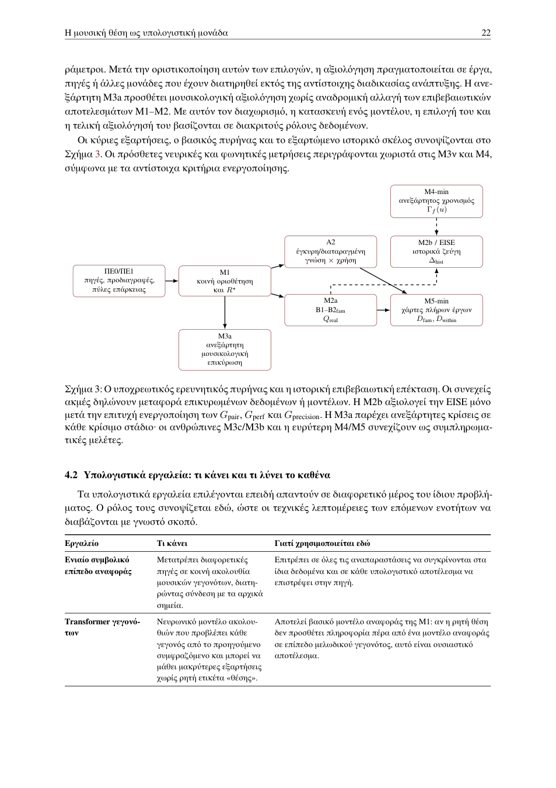

# 4 · Κεντρική μεθοδολογική αρχιτεκτονική

[Αναλυτικός χάρτης](../full/index.md) · [Σύνοψη](../start/overview.md) · [Βιβλιογραφία](../bibliography/index.md)

Κειμενική απόδοση της αναλυτικής ερευνητικής πρότασης (3 Νοεμβρίου 2026), με [ορολογική επιμέλεια](../../TERMINOLOGY_GR.md). [Πρωτότυπο PDF](../../documents/analytical-proposal.pdf) · [Προέλευση κειμένου](../reference.md).

**Σε αυτή την ενότητα**

- [4.1 · Από τις πηγές στη γνωσιακή λειτουργία](#r026)
- [4.2 · Υπολογιστικά εργαλεία: τι κάνει και τι λύνει το καθένα](#r028)
- [4.3 · Ιεραρχία και ελάχιστος πυρήνας](#r029)
- [4.4 · Διαχωρισμός ορισμού, εκπαίδευσης και αξιολόγησης](#r030)
- [4.5 · Κοινές αρχές συγκρισιμότητας και αναπαραγωγιμότητας](#r031)

## 4.1 · Από τις πηγές στη γνωσιακή λειτουργία

Η μεθοδολογία οργανώνεται σε μία ακολουθία εξαρτήσεων. Το αρχικό πακέτο εργασίας ΠΕ0 απογράφει τις πραγματικές πηγές, τα δικαιώματα, τις υποψήφιες οικογενειακές και εξηγητικές σχέσεις, την εκτελεστική κάλυψη και τη δυνατότητα συλλογής δεδομένων από συμμετέχοντες και καθορίζει τους διαχωρισμούς ανάπτυξης και ανεξάρτητης αξιολόγησης. Πριν από τις M1–M2 οριστικοποιείται αποκλειστικά στο υλικό ανάπτυξης το λεξιλόγιο που απαιτείται για την εκπαίδευση και την επιλογή αναπαράστασης. Η Μ1 επιλέγει μία $`R^\star`$ με τον κανόνα J στον προκαθορισμένο κορμό A. Η Α2 και η Μ2a εφαρμόζουν την ίδια είσοδο σε αυτοτελείς συγκρίσεις γνώσης και σχεσιακής εποπτείας. Η Μ2b χρησιμοποιεί κοινό ιστορικό πεδίο για τη σύγκριση $`\mathrm{B2}_{\mathrm{main}}`$–EISE, όταν τεκμηριωθεί η αναγκαία επάρκεια. Η M3a παρέχει ανεξάρτητη μουσικολογική επικύρωση, με τυφλές κρίσεις ειδικών χωρισμένες από την ανάπτυξη και χωρίς αναδρομική αναθεώρηση των επιβεβαιωτικών αποτελεσμάτων M1, Α2 και Μ2b. Η M3c προηγείται της M3b στη συλλογή από τους ίδιους συμμετέχοντες. Η σειρά διατηρεί αυθόρμητη την πρώτη κρίση μουσικής προσδοκίας.

Η ακολουθία αυτή δεν είναι μόνο χρονική· αντιστοιχεί και σε διαφορετικούς ρόλους των δεδομένων. Τα δεδομένα **ανάπτυξης** χρησιμοποιούνται για επιλογές όπως η αναπαράσταση και οι υπερπαράμετροι. Μετά την οριστικοποίηση αυτών των επιλογών, η αξιολόγηση πραγματοποιείται σε έργα, πηγές ή άλλες μονάδες που έχουν διατηρηθεί εκτός της αντίστοιχης διαδικασίας ανάπτυξης. Η ανεξάρτητη M3a προσθέτει μουσικολογική αξιολόγηση χωρίς αναδρομική αλλαγή των επιβεβαιωτικών αποτελεσμάτων M1–M2. Με αυτόν τον διαχωρισμό, η κατασκευή ενός μοντέλου, η επιλογή του και η τελική αξιολόγησή του βασίζονται σε διακριτούς ρόλους δεδομένων.

Οι κύριες εξαρτήσεις, ο βασικός πυρήνας και το εξαρτώμενο ιστορικό σκέλος συνοψίζονται στο Σχήμα [3](04-architecture.md#r027). Οι πρόσθετες νευρικές και φωνητικές μετρήσεις περιγράφονται χωριστά στις M3ν και M4, σύμφωνα με τα αντίστοιχα κριτήρια ενεργοποίησης.

Ο υποχρεωτικός ερευνητικός πυρήνας και η ιστορική επιβεβαιωτική επέκταση. Οι συνεχείς ακμές δηλώνουν μεταφορά επικυρωμένων δεδομένων ή μοντέλων. Η Μ2b αξιολογεί την EISE μόνο μετά την επιτυχή ενεργοποίηση των $`G_{\mathrm{pair}}`$, $`G_{\mathrm{perf}}`$ και $`G_{\mathrm{precision}}`$. Η Μ3a παρέχει ανεξάρτητες κρίσεις σε κάθε κρίσιμο στάδιο· οι ανθρώπινες M3c/M3b και η ευρύτερη Μ4/Μ5 συνεχίζουν ως συμπληρωματικές μελέτες.

## 4.2 · Υπολογιστικά εργαλεία: τι κάνει και τι λύνει το καθένα

Τα υπολογιστικά εργαλεία επιλέγονται επειδή απαντούν σε διαφορετικό μέρος του ίδιου προβλήματος. Ο ρόλος τους συνοψίζεται εδώ, ώστε οι τεχνικές λεπτομέρειες των επόμενων ενοτήτων να διαβάζονται με γνωστό σκοπό.

| **Εργαλείο**                          | **Τι κάνει**                                                                                                                                                                                                                                                                                     | **Γιατί χρησιμοποιείται εδώ**                                                                                                                                                                                                                                                                    |
|:--------------------------------------|:-------------------------------------------------------------------------------------------------------------------------------------------------------------------------------------------------------------------------------------------------------------------------------------------------|:-------------------------------------------------------------------------------------------------------------------------------------------------------------------------------------------------------------------------------------------------------------------------------------------------|
| **Εργαλείο**                          | **Τι κάνει**                                                                                                                                                                                                                                                                                     | **Γιατί χρησιμοποιείται εδώ**                                                                                                                                                                                                                                                                    |
| **Ενιαίο συμβολικό επίπεδο αναφοράς** | Μετατρέπει διαφορετικές πηγές σε κοινή ακολουθία μουσικών γεγονότων, διατηρώντας σύνδεση με τα αρχικά σημεία.                                                                                                                                                                                    | Επιτρέπει σε όλες τις αναπαραστάσεις να συγκρίνονται στα ίδια δεδομένα και σε κάθε υπολογιστικό αποτέλεσμα να επιστρέφει στην πηγή.                                                                                                                                                              |
| **Transformer γεγονότων**             | Νευρωνικό μοντέλο ακολουθιών που προβλέπει κάθε γεγονός από το προηγούμενο συμφραζόμενο και μπορεί να μάθει μακρύτερες εξαρτήσεις χωρίς ρητή ετικέτα «θέσης».                                                                                                                                    | Αποτελεί βασικό μοντέλο αναφοράς της M1: αν η ρητή θέση δεν προσθέτει πληροφορία πέρα από ένα μοντέλο αναφοράς σε επίπεδο μελωδικού γεγονότος, αυτό είναι ουσιαστικό αποτέλεσμα.                                                                                                                 |
| **Επαγόμενη τμηματοποίηση**           | μη παραμετρικός πιθανοτικός μηχανισμός που αναζητεί επαναλαμβανόμενα τμήματα χωρίς να του δίνονται εκ των προτέρων τα όρια των θέσεων. Η κύρια υλοποίηση βασίζεται σε διαδικασία Pitman–Yor, δηλαδή μοντέλο που επιτρέπει το λεξιλόγιο τμημάτων να αυξάνεται όσο αυξάνονται τα δεδομένα.         | Ελέγχει αν οι μονάδες που αναγνωρίζει η παράδοση συμπίπτουν με μονάδες που προκύπτουν μόνο από τη στατιστική επανάληψη. Συγγενής μη παραμετρική πιθανοτική τμηματοποίηση έχει χρησιμοποιηθεί στο γρηγοριανό μέλος (Lanz–Hajič, 2025).                                                            |
| **Κοινή αρχιτεκτονική A / EISE**      | Η A συνδυάζει νευρωνικό κωδικοποιητή και semi-CRF με $`z_{\mathrm{id}}`$ και τοπικές καταστάσεις $`h_t`$. Η EISE είναι η ιστορικά εποπτευόμενη συνθήκη της A.                                                                                                                                        | Η Μ1 επιλέγει $`R^\star`$ στην A· οι B1/B2/EISE συγκρίνονται σε αντιστοιχισμένη υποδομή, με έλεγχο $`Q_{\mathrm{real}}`$.                                                                                                                                                                            |
| **Ημι-Μαρκοβιανό CRF**                | Στη μη επικαλυπτόμενη διαδρομή, μοντέλο τμημάτων που αποφασίζει από κοινού πού αρχίζει και τελειώνει ένα τμήμα μεταβλητού μήκους και σε ποια οικογένεια αποδίδεται.                                                                                                                              | Τα όρια της θέσης είναι μέρος του προβλήματος και η επισημείωση είναι μερική. Η καταλληλότητα της μη επικαλυπτόμενης μορφής εξόδου ελέγχεται στο ΠΕ0 πριν από τη M1.                                                                                                                             |
| **Αντιθετική/μετρική μάθηση**         | Εκπαίδευση με ζεύγη ή ομάδες όπου το μοντέλο μαθαίνει ποιες πραγματώσεις πρέπει να βρίσκονται κοντά και ποιες να διαχωρίζονται.                                                                                                                                                                  | Επιτρέπει να αλλάζει μόνο η προέλευση των θετικών ζευγών ανάμεσα σε B2 και EISE, κρατώντας την υπόλοιπη εκπαίδευση αντιστοιχισμένη.                                                                                                                                                              |
| **Συγκριτές Μ2**                      | $`\mathrm{B0}_{\mathrm{sym}}`$: επιβλεπόμενο συμβολικό semi-CRF· $`\mathrm{B0}_{\mathrm{profile}}`$: άμεσο ιστορικό προφίλ· B1: κοινή νευρωνική βάση· $`\mathrm{B2}_{\mathrm{fam}}`$: οικογενειακά ζεύγη της Μ2a· $`\mathrm{B2}_{\mathrm{main}}`$: αντιστοιχισμένη οικογενειακή βάση Μ2b.                | Οι διαφορετικοί συγκριτές ελέγχουν χωριστά συμβολική αναγνώριση, οικογενειακή μάθηση, διατήρηση πραγμάτωσης και πρόσθετη συμβολή της τεκμηριωμένης ιστορικής σχέσης.                                                                                                                             |
| **PPM**                               | Το Prediction by Partial Matching είναι μοντέλο μεταβλητού μήκους συμφραζομένου: προβλέπει την επόμενη οικογένεια από όσο μακρύ προηγούμενο υποστηρίζουν τα δεδομένα και, όταν το ειδικό συμφραζόμενο είναι αραιό, επιστρέφει σε συντομότερο και καλύτερα υποστηριζόμενο συμφραζόμενο (backoff). | Είναι ερμηνεύσιμο και κατάλληλο για σχετικά μικρά σώματα. Χρησιμοποιείται στη M3c για το πληροφοριακό περιεχόμενο οικογένειας και στη M5 για την προβλεψιμότητα ως προς δηλωμένο σώμα αναφοράς. Η επιλογή συνδέεται με τη βιβλιογραφία πιθανοτικής μουσικής προσδοκίας και IDyOM (Pearce, 2018). |

## 4.3 · Ιεραρχία και ελάχιστος πυρήνας

Η **προεγγραφή (preregistration)** καταγράφει πριν από την κύρια αξιολόγηση τα βασικά εκτιμώμενα μεγέθη, τους κανόνες ανάλυσης, τις απαιτήσεις δεδομένων και τα κριτήρια ενεργοποίησης. Ένα **κριτήριο ενεργοποίησης** ελέγχει αν τα διαθέσιμα δεδομένα έχουν την κάλυψη, την ανεξαρτησία και την αξιοπιστία των μετρήσεων που απαιτεί μια προκαθορισμένη ανάλυση. Το αποτέλεσμα αυτού του ελέγχου καθορίζει ποιο επίπεδο ανάλυσης είναι επιστημονικά υποστηρίξιμο· εφαρμόζεται ανεξάρτητα από το πρόσημο ή την επιθυμητή κατεύθυνση του αποτελέσματος.

Οι τρεις καταστάσεις διαθεσιμότητας του ανεξάρτητου εκτελεστικού κριτηρίου αξιολόγησης ορίζονται πριν από την τελική αξιολόγηση: GREEN σημαίνει επαρκή λεπτομερή αντιστοίχιση ιστορικών και εκτελεστικών δεδομένων, AMBER επαρκή κάλυψη μόνο σε προκαθορισμένη αδρότερη κλίμακα και RED ανεπαρκή κάλυψη ή αξιοπιστία για επιβεβαιωτική εκτελεστική σύγκριση (Παράρτημα [14.5](../appendices/c.md#r110)).

Ο **δεσμευτικός βασικός πυρήνας** συγκροτείται από το ΠΕ0/ΠΕ1, τη Μ1, την Α2, τη Μ2a, τη Μ3a και τη Μ5-min. Το ΠΕ0 προσδιορίζει την επάρκεια πηγών, δικαιωμάτων, οικογενειακών προδιαγραφών και ανεξάρτητων ομάδων· η Μ1 επιλέγει $`R^\star`$ με τον κανόνα J και κοινή αρχιτεκτονική A. Η Α2 ελέγχει την εγκυρότητα και τη λογική χρήση της μουσικολογικής γνώσης. Η Μ2a εξετάζει τη μάθηση οικογενειακής ταυτότητας και τη διατήρηση της πραγμάτωσης. Η Μ3a παρέχει τυφλές μουσικολογικές κρίσεις σε νέα χωρία και η Μ5-min εφαρμόζει το οριστικοποιημένο σύστημα σε πλήρη έργα, με $`D_{\mathrm{fam}}`$ και $`D_{\mathrm{within}}`$, κάλυψη και αβεβαιότητα.

Η **ιστορική Μ2b/EISE** αποτελεί κεντρικό ερευνητικό σκέλος με *εξαρτώμενο επιβεβαιωτικό καθεστώς*. Η απογραφή ιστορικών ζευγών είναι δεσμευτικό παραδοτέο του ΠΕ0. Η επιβεβαιωτική αντίθεση $`\Delta_{\mathrm{hist}}=S_{\mathrm{EISE}}-S_{\mathrm{B2}_{\mathrm{main}}}`$ ενεργοποιείται όταν πληρούνται οι πύλες $`G_{\mathrm{pair}}`$, $`G_{\mathrm{perf}}`$ και $`G_{\mathrm{precision}}`$. Η Μ4-min παρέχει τον ανεξάρτητο κανονικοποιημένο χρονισμό $`\Gamma_f(u)`$, όπου υπάρχουν κατάλληλες εκτελέσεις. Με περιορισμένη κάλυψη η ιστορική μελέτη αναφέρει τα υποστηριζόμενα περιγραφικά μεγέθη και τη συνοδευτική αβεβαιότητα, διατηρώντας ανεξάρτητη την ολοκλήρωση του βασικού πυρήνα.

Η **ανθρώπινη γνωσιακή αξιολόγηση** οργανώνεται στις M3c και M3b, με δύο επιβεβαιωτικές υποθέσεις $`H_{\mathrm{pred}}`$ και $`H_{\mathrm{cat}}`$ όταν ο πιλοτικός σχεδιασμός εξασφαλίσει επαρκές κοινό πεδίο και στατιστική ισχύ. Η M3c προηγείται στη συλλογή της M3b. Οι ευρύτερες M4/M5, οι τεκμηριωμένοι ιστορικοί μετασχηματισμοί, η νευρική M3ν, οι πρόσθετες φωνητικές μετρήσεις και η μεταφορά στο ζναμένιο μέλος αναπτύσσονται σύμφωνα με χωριστές προϋποθέσεις και παραδοτέα.

| **Βαθμίδα**                  | **Ενότητες**                                                                                                                                                  | **Συμπερασματικό καθεστώς**                                                                                                                                                                  | **Όταν λείπει η απαιτούμενη κάλυψη**                                                                                                                               |
|:-----------------------------|:--------------------------------------------------------------------------------------------------------------------------------------------------------------|:---------------------------------------------------------------------------------------------------------------------------------------------------------------------------------------------|:-------------------------------------------------------------------------------------------------------------------------------------------------------------------|
| **Βαθμίδα**                  | **Ενότητες**                                                                                                                                                  | **Συμπερασματικό καθεστώς**                                                                                                                                                                  | **Όταν λείπει η απαιτούμενη κάλυψη**                                                                                                                               |
| Συνέχεια στην επόμενη σελίδα |                                                                                                                                                               |                                                                                                                                                                                              |                                                                                                                                                                    |
| 1\. Βασικός πυρήνας          | ΠΕ0/ΠΕ1, Μ1, Α2, Μ2a, Μ3a, Μ5-min                                                                                                                             | $`R^\star`$, $`\Delta_{\mathrm{know}}`$, $`\Delta_{\mathrm{logic},V}`$, $`\Delta_{\mathrm{famrel}}`$, $`Q_{\mathrm{real}}`$, $`D_{\mathrm{fam}}`$, $`D_{\mathrm{within}}`$· διακριτά καθεστώτα ανά μέγεθος | Οι προκαθορισμένες πύλες του ΠΕ0 περιορίζουν την κλίμακα, τις οικογένειες ή το επιβεβαιωτικό καθεστώς χωρίς να ανατρέπουν τις υποστηριζόμενες ανεξάρτητες μελέτες. |
| 2\. Ανθρώπινη επικύρωση      | M3c, έπειτα M3b                                                                                                                                               | $`H_{\mathrm{pred}}`$, $`H_{\mathrm{cat}}`$· οικογένεια δύο επιβεβαιωτικών ελέγχων με Holm                                                                                                       | Για κάθε υπόθεση δηλώνεται χωριστά αν τα διαθέσιμα δεδομένα επιτρέπουν αξιόπιστη εκτίμηση, σύμφωνα με τα κριτήρια της § [9.3](08-data.md#r073).                    |
| 3\. Ιστορική Μ2b             | $`\mathrm{B2}_{\mathrm{main}}`$–EISE και Μ4-min                                                                                                                 | $`\Delta_{\mathrm{hist}}`$ αμφίπλευρο επιβεβαιωτικό μόνο με $`G_{\mathrm{pair}}`$, $`G_{\mathrm{perf}}`$, $`G_{\mathrm{precision}}`$· $`\Delta_{\mathrm{learn}}`$ διαγνωστικό                          | Με ανεπαρκή ιστορική ή εκτελεστική κάλυψη εφαρμόζεται η προκαθορισμένη αδρότερη/διερευνητική ανάλυση ή καταγράφεται η μη εκτιμησιμότητα.                           |
| 4\. Ενίσχυση                 | $`\Delta_{\mathrm{ctx}}`$, CCGP, ευθυγράμμιση, εμπειρία, ευρύτερη M4, πλήρης M5· συμπληρωματική μελέτη τεκμηριωμένων μετασχηματισμών (§ [7.6](06-eise.md#r049)) | δευτερεύοντα ή διερευνητικά, κατά περίπτωση· η μελέτη μετασχηματισμών δεσμεύεται εφόσον περάσει την πύλη επάρκειας                                                                           | $`D_{\mathrm{seq}}`$, $`D_{\mathrm{func}}`$ και ιστορικές υποομάδες ενεργοποιούνται μόνο με επαρκή κάλυψη και ανεξαρτησία πηγών.                                       |
| 5\. Υπό προϋποθέσεις         | M3ν· δείκτες EGG μέσα στη M4· υποψήφιες παραλλαγές από τη μελέτη μετασχηματισμών και δεύτερο ρεπερτόριο (§ [7.6](06-eise.md#r049))                            | νευρική επέκταση, διερευνητική εκτελεστική ανάλυση, χρήση υποψήφιων παραλλαγών στη μάθηση αναπαραστάσεων και μεταφορά στο ζναμένιο μέλος                                                     | Η επέκταση ενεργοποιείται όταν πληρούνται τα κριτήριά της.                                                                                                         |

Η **υλοποίηση της βαθμίδας 1** ακολουθεί τις πύλες του ΠΕ0 και περιλαμβάνει Μ1, Α2, Μ2a, Μ3a και Μ5-min, με κοινή υποδομή ΠΕ1. Η ιστορική Μ2b υπάγεται στη χωριστή βαθμίδα ενεργοποίησης. Η διαφορά $`\Delta_{\mathrm{hist}}`$ αξιολογείται επιβεβαιωτικά σε λεπτομερές πεδίο GREEN ή στο προκαθορισμένο αδρότερο πεδίο AMBER, εφόσον η επάρκεια των ζευγών και η στατιστική ακρίβεια έχουν επαληθευθεί, ανεξάρτητα από το πρόσημο του αποτελέσματος. Σε RED η διαθέσιμη εκτελεστική σύγκριση αναφέρεται διερευνητικά· όταν λείπει αξιόπιστο ανεξάρτητο κριτήριο αξιολόγησης, δηλώνεται ότι η $`\Delta_{\mathrm{hist}}`$ δεν μπορεί να εκτιμηθεί αξιόπιστα. Το ΠΕ0 καταγράφει έγκαιρα την πραγματική κάλυψη και κατευθύνει τον διαθέσιμο χρόνο στις υποστηριζόμενες συγκρίσεις. Η τεκμηρίωση της διατριβής συνθέτει τα αποτελέσματα που μπορούν να εκτιμηθούν, τις ανεξάρτητες μουσικολογικές κρίσεις και τα σαφώς δηλωμένα όρια των υπόλοιπων συμπερασμάτων. Η βαθμίδα 2 παρέχει τις προγραμματισμένες κύριες γνωσιακές δοκιμές $`H_{\mathrm{pred}}`$ και $`H_{\mathrm{cat}}`$· για κάθε αποτέλεσμα δηλώνεται αν τα διαθέσιμα δεδομένα επιτρέπουν αξιόπιστη εκτίμηση.

Η νευρική M3ν ενεργοποιείται μόνο με γραπτή επιβεβαίωση υποδομής EEG/MEG, κατάλληλης τεχνογνωσίας και χωριστής δεοντολογικής έγκρισης. Η διερευνητική ανάλυση δεικτών φωνητικής επαφής μέσα στη M4 εξαρτάται από την πρόσβαση και την ποιότητα του συγχρονισμένου ηλεκτρογλωττογραφήματος. Η ενεργοποίηση αυτών των επεκτάσεων δεν αποτελεί προϋπόθεση για την εκτίμηση των ήδη ορισμένων κύριων υποθέσεων.

## 4.4 · Διαχωρισμός ορισμού, εκπαίδευσης και αξιολόγησης

Ως **διαρροή πληροφορίας (data leakage)** νοείται κάθε περίπτωση στην οποία πληροφορία από υλικό που προορίζεται για ανεξάρτητη αξιολόγηση επηρεάζει την εκπαίδευση, την επιλογή αναπαράστασης, τη ρύθμιση του μοντέλου ή την κατασκευή των ίδιων ετικετών που αργότερα αξιολογούνται. Στο παρόν υλικό η ανεξαρτησία πρέπει να προστατεύεται σε επίπεδο ολόκληρου έργου, πηγής, ομάδας συγγενών πηγών και τεκμηριωμένης σχέσης. Για παράδειγμα, τμήματα του ίδιου Χερουβικού σε εκπαίδευση και τελική αξιολόγηση θα επέτρεπαν στο μοντέλο να αξιοποιήσει ειδικά γνωρίσματα του έργου αντί να ελεγχθεί η γενίκευσή του σε νέο έργο.

Οι οικογένειες, οι τεκμηριωμένες ιστορικές σχέσεις και τα σύνολα αξιολόγησης διατηρούν σαφή τεκμηριωμένη προέλευση. Τα τρία είδη συνδέσεων μεταξύ πραγματώσεων διατηρούνται χωριστά: το $`E_{\mathrm{sim}}`$ προκύπτει από μελωδική ομοιότητα που υπολογίζει το μοντέλο, το $`E_{\mathrm{fam}}`$ δηλώνει ένταξη στην ίδια οικογένεια και το $`E_{\mathrm{ex}}`$ καταγράφει τεκμηριωμένη ιστορική εξηγητική σχέση (πλήρεις κανόνες στο Παράρτημα [15](../appendices/d.md#r128)). Η τελική ανεξάρτητη επικύρωση από ειδικούς πραγματοποιείται σε υλικό και υποψήφιες ετικέτες που έχουν διαχωριστεί από τη διαδικασία κατασκευής του συνόλου αναφοράς. Το ιστορικό σύνολο ελέγχου της § [5.2](05-m1.md#r035) οριστικοποιείται στο ΠΕ0 και παραμένει εκτός εκπαίδευσης, επιλογής υπερπαραμέτρων και επιλογής αναπαράστασης. Η ανθρώπινη τράπεζα ερεθισμάτων κατασκευάζεται μετά την οριστικοποίηση του επικυρωμένου λεξιλογίου οικογενειών και αναγνωριστικά με ελεγχόμενες εκδόσεις συνδέουν κάθε ερέθισμα με έργο, πηγή, οικογένεια, $`I_F`$, $`I_{\mathrm{event}}`$, επιφανειακές αποστάσεις και ανάθεση συνθήκης.

Η επιλογή μοντέλου της M1 πραγματοποιείται στα δεδομένα ανάπτυξης. Οι αξιολογήσεις της M2 σε υλικό εκτός εκπαίδευσης, το ιστορικό σύνολο ελέγχου και τα ανθρώπινα ερεθίσματα αξιολόγησης δεν χρησιμοποιούνται για επιλογή υπερπαραμέτρων ή αναπαράστασης. Περιπτώσεις του ιστορικού συνόλου μπορούν αργότερα να αποτελέσουν προκαθορισμένο σύνολο υποψήφιων ερεθισμάτων της M3b μόνο βάσει μουσικολογικών ετικετών και κριτηρίων επιφανειακής απόστασης, ποτέ βάσει της επιτυχίας ή αποτυχίας της M1 στις συγκεκριμένες περιπτώσεις. Ο χώρος των ανθρώπινων αναπαραστάσεων της M3b προσαρμόζεται χωρίς ετικέτες οικογένειας και οι υπερπαράμετροί του επιλέγονται με πρόβλεψη τριάδων σε υλικό ανάπτυξης που έχει κρατηθεί εκτός της προσαρμογής του μοντέλου. Το $`I_F`$ της M3c οριστικοποιείται μετά την οριστικοποίηση του λεξιλογίου οικογενειών και ο έλεγχος επάρκειας του μοντέλου διαδοχής οικογενειών (PPM, § [8.2](07-validation.md#r060)) αξιολογείται σε έργα εκτός εκπαίδευσης πριν από την επιλογή των κύριων ανθρώπινων δοκιμών.

## 4.5 · Κοινές αρχές συγκρισιμότητας και αναπαραγωγιμότητας

Κάθε κύρια σύγκριση μεταβάλλει μία σαφώς ορισμένη πηγή πληροφορίας. Η M1 συγκρίνει κλίμακες αναπαράστασης με κοινό στόχο. Η Α2 συγκρίνει το περιεχόμενο και τη λογική χρήση της μουσικολογικής γνώσης, η Μ2a την οικογενειακή σχεσιακή εποπτεία και η Μ2b την ιστορική προέλευση θετικών σχέσεων σε αντιστοιχισμένο περιβάλλον εκπαίδευσης. Η M3b συγκρίνει οικογενειακή ένταξη μέσα σε κοινή περιοχή επιφανειακών αποστάσεων. Η M3c διαχωρίζει τα δύο επίπεδα πρόβλεψης με ερεθίσματα που συνδυάζουν υψηλό $`I_F`$ και χαμηλό $`I_{\mathrm{event}}`$, ή το αντίστροφο. Οι δύο αυτοί αντιδιαγώνιοι συνδυασμοί υποστηρίζουν τη χωριστή εκτίμηση της συμβολής των δύο μεταβλητών, οι οποίες παραμένουν συνεχείς στα στατιστικά μοντέλα. Το $`R`$ αλλάζει μόνο τη μη μουσική ένδειξη λατρευτικού πλαισίου, ενώ ο στόχος και το άμεσο μουσικό πρόθεμα παραμένουν ίδια.

Οι λεπτομερείς κανόνες διαχωρισμών δεδομένων, αντιστοίχισης, ελέγχου πολλαπλότητας, κατασκευής ερεθισμάτων, αντιστάθμισης, προσομοίωσης ισχύος και προεγγραφής δίνονται στα Παραρτήματα [15](../appendices/d.md#r128)–[20](../appendices/i.md#r197).

---

[Προηγούμενη: 3 Ερευνητικό ερώτημα και υποθέσεις](03-questions.md) · [Επόμενη: 5 Σύγκριση αναπαραστάσεων](05-m1.md)

Βιβλιογραφικές διαδρομές της ενότητας

Αυτόματος εντοπισμός ονόματος και έτους· η ακριβής χρήση ελέγχεται στο κείμενο.

[Lanz (2025)](../bibliography/entries/b088.md) · [Pearce (2018)](../bibliography/entries/b109.md)

---

[Σχολιασμός αυτής της ενότητας](https://github.com/GeorgeSpy/byz-position-phd-study/issues/new?template=proposal-feedback.yml&title=%CE%A0%CE%B1%CF%81%CE%B1%CF%84%CE%AE%CF%81%CE%B7%CF%83%CE%B7%3A+4+%C2%B7+%CE%9A%CE%B5%CE%BD%CF%84%CF%81%CE%B9%CE%BA%CE%AE+%CE%BC%CE%B5%CE%B8%CE%BF%CE%B4%CE%BF%CE%BB%CE%BF%CE%B3%CE%B9%CE%BA%CE%AE+%CE%B1%CF%81%CF%87%CE%B9%CF%84%CE%B5%CE%BA%CF%84%CE%BF%CE%BD%CE%B9%CE%BA%CE%AE&location=https%3A%2F%2Fgithub.com%2FGeorgeSpy%2Fbyz-position-phd-study%2Fblob%2F47306feef68a62a232506f74dae05e066f9a51cb%2Fdocs%2Ffull%2F04-architecture.md) · [Σημειωματάριο παρατηρήσεων](../review/feedback.md)
