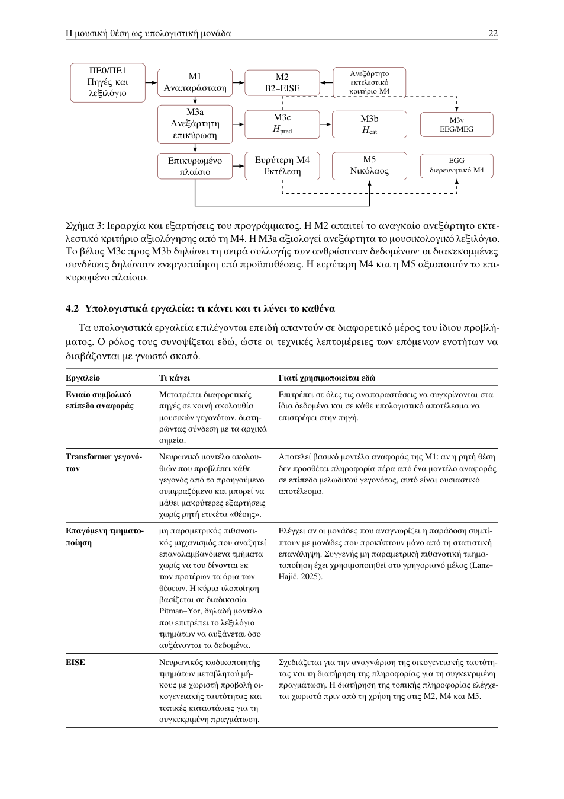

# 4 · Κεντρική μεθοδολογική αρχιτεκτονική

[Αναλυτικός χάρτης](../full/index.md) · [Σύνοψη](../start/overview.md) · [Βιβλιογραφία](../bibliography/index.md)

Μεταγραφή προγενέστερου αναλυτικού κειμένου. [Πρωτότυπο PDF](../../sources/proposal-v871e-candidate.pdf) · [Προέλευση κειμένου](../reference.md).

**Σε αυτή την ενότητα**

- [4.1 · Από τις πηγές στη γνωσιακή λειτουργία](#r026)
- [4.2 · Υπολογιστικά εργαλεία: τι κάνει και τι λύνει το καθένα](#r028)
- [4.3 · Ιεραρχία και ελάχιστος πυρήνας](#r029)
- [4.4 · Διαχωρισμός ορισμού, εκπαίδευσης και αξιολόγησης](#r030)
- [4.5 · Κοινές αρχές συγκρισιμότητας και αναπαραγωγιμότητας](#r031)

## 4.1 · Από τις πηγές στη γνωσιακή λειτουργία

Η μεθοδολογία οργανώνεται σε μία ακολουθία εξαρτήσεων. Το αρχικό πακέτο εργασίας ΠΕ0 απογράφει τις πραγματικές πηγές, τα δικαιώματα, τις υποψήφιες οικογενειακές και εξηγητικές σχέσεις, την εκτελεστική κάλυψη και τη δυνατότητα συλλογής δεδομένων από συμμετέχοντες και καθορίζει τους διαχωρισμούς ανάπτυξης και ανεξάρτητης αξιολόγησης. Πριν από τις M1–M2 οριστικοποιείται αποκλειστικά στο υλικό ανάπτυξης το λεξιλόγιο που απαιτείται για την εκπαίδευση και την επιλογή αναπαράστασης. Η M1 οριστικοποιεί την κλίμακα αναπαράστασης και η M2 εκπαιδεύει και συγκρίνει B2/EISE πάνω στο ίδιο λεξιλόγιο ανάπτυξης. Η M3a παρέχει την ανεξάρτητη μουσικολογική επικύρωση, με τις κρίσεις των ειδικών διαχωρισμένες από την ανάπτυξη και χωρίς ανατροφοδότηση προς τα επιβεβαιωτικά αποτελέσματα των M1–M2. Η M3c προηγείται της M3b στη συλλογή από τους ίδιους συμμετέχοντες. Η σειρά διατηρεί αυθόρμητη την πρώτη κρίση μουσικής προσδοκίας.

Η ακολουθία αυτή δεν είναι μόνο χρονική· αντιστοιχεί και σε διαφορετικούς ρόλους των δεδομένων. Τα δεδομένα **ανάπτυξης** χρησιμοποιούνται για επιλογές όπως η αναπαράσταση και οι υπερπαράμετροι. Μετά την οριστικοποίηση αυτών των επιλογών, η αξιολόγηση πραγματοποιείται σε έργα, πηγές ή άλλες μονάδες που έχουν διατηρηθεί εκτός της αντίστοιχης διαδικασίας ανάπτυξης. Η ανεξάρτητη M3a προσθέτει μουσικολογική αξιολόγηση χωρίς αναδρομική αλλαγή των επιβεβαιωτικών αποτελεσμάτων M1–M2. Με αυτόν τον διαχωρισμό, η κατασκευή ενός μοντέλου, η επιλογή του και η τελική αξιολόγησή του βασίζονται σε διακριτούς ρόλους δεδομένων.

Οι κύριες εξαρτήσεις και οι υπό προϋποθέσεις επεκτάσεις συνοψίζονται στο Σχήμα [3](04-architecture.md#r027). Στο σχήμα, EEG/MEG σημαίνει ηλεκτροεγκεφαλογραφία/μαγνητοεγκεφαλογραφία, δηλαδή καταγραφή νευρικής δραστηριότητας, και EGG σημαίνει ηλεκτρογλωττογραφία, δηλαδή καταγραφή της φωνητικής επαφής. Πρόκειται για διακριτές, υπό προϋποθέσεις επεκτάσεις της M3c και της M4 αντιστοίχως.

Ιεραρχία και εξαρτήσεις του προγράμματος. Η M2 απαιτεί το αναγκαίο ανεξάρτητο εκτελεστικό κριτήριο αξιολόγησης από τη M4. Η M3a αξιολογεί ανεξάρτητα το μουσικολογικό λεξιλόγιο. Το βέλος M3c προς M3b δηλώνει τη σειρά συλλογής των ανθρώπινων δεδομένων· οι διακεκομμένες συνδέσεις δηλώνουν ενεργοποίηση υπό προϋποθέσεις. Η ευρύτερη M4 και η M5 αξιοποιούν το επικυρωμένο πλαίσιο.

## 4.2 · Υπολογιστικά εργαλεία: τι κάνει και τι λύνει το καθένα

Τα υπολογιστικά εργαλεία επιλέγονται επειδή απαντούν σε διαφορετικό μέρος του ίδιου προβλήματος. Ο ρόλος τους συνοψίζεται εδώ, ώστε οι τεχνικές λεπτομέρειες των επόμενων ενοτήτων να διαβάζονται με γνωστό σκοπό.

| **Εργαλείο**                          | **Τι κάνει**                                                                                                                                                                                                                                                                                     | **Γιατί χρησιμοποιείται εδώ**                                                                                                                                                                                                                                                                    |
|:--------------------------------------|:-------------------------------------------------------------------------------------------------------------------------------------------------------------------------------------------------------------------------------------------------------------------------------------------------|:-------------------------------------------------------------------------------------------------------------------------------------------------------------------------------------------------------------------------------------------------------------------------------------------------|
| **Εργαλείο**                          | **Τι κάνει**                                                                                                                                                                                                                                                                                     | **Γιατί χρησιμοποιείται εδώ**                                                                                                                                                                                                                                                                    |
| **Ενιαίο συμβολικό επίπεδο αναφοράς** | Μετατρέπει διαφορετικές πηγές σε κοινή ακολουθία μουσικών γεγονότων, διατηρώντας σύνδεση με τα αρχικά σημεία.                                                                                                                                                                                    | Επιτρέπει σε όλες τις αναπαραστάσεις να συγκρίνονται στα ίδια δεδομένα και σε κάθε υπολογιστικό αποτέλεσμα να επιστρέφει στην πηγή.                                                                                                                                                              |
| **Transformer γεγονότων**             | Νευρωνικό μοντέλο ακολουθιών που προβλέπει κάθε γεγονός από το προηγούμενο συμφραζόμενο και μπορεί να μάθει μακρύτερες εξαρτήσεις χωρίς ρητή ετικέτα «θέσης».                                                                                                                                    | Αποτελεί βασικό μοντέλο αναφοράς της M1: αν η ρητή θέση δεν προσθέτει πληροφορία πέρα από ένα μοντέλο αναφοράς σε επίπεδο μελωδικού γεγονότος, αυτό είναι ουσιαστικό αποτέλεσμα.                                                                                                                 |
| **Επαγόμενη τμηματοποίηση**           | μη παραμετρικός πιθανοτικός μηχανισμός που αναζητεί επαναλαμβανόμενα τμήματα χωρίς να του δίνονται εκ των προτέρων τα όρια των θέσεων. Η κύρια υλοποίηση βασίζεται σε διαδικασία Pitman–Yor, δηλαδή μοντέλο που επιτρέπει το λεξιλόγιο τμημάτων να αυξάνεται όσο αυξάνονται τα δεδομένα.         | Ελέγχει αν οι μονάδες που αναγνωρίζει η παράδοση συμπίπτουν με μονάδες που προκύπτουν μόνο από τη στατιστική επανάληψη. Συγγενής μη παραμετρική πιθανοτική τμηματοποίηση έχει χρησιμοποιηθεί στο γρηγοριανό μέλος (Lanz–Hajič, 2025).                                                            |
| **EISE**                              | Νευρωνικός κωδικοποιητής τμημάτων μεταβλητού μήκους με χωριστή προβολή οικογενειακής ταυτότητας και τοπικές καταστάσεις για τη συγκεκριμένη πραγμάτωση.                                                                                                                                          | Σχεδιάζεται για την αναγνώριση της οικογενειακής ταυτότητας και τη διατήρηση της πληροφορίας για τη συγκεκριμένη πραγμάτωση. Η διατήρηση της τοπικής πληροφορίας ελέγχεται χωριστά πριν από τη χρήση της στις M2, M4 και M5.                                                                     |
| **Ημι-Μαρκοβιανό CRF**                | Στη μη επικαλυπτόμενη διαδρομή, μοντέλο τμημάτων που αποφασίζει από κοινού πού αρχίζει και τελειώνει ένα τμήμα μεταβλητού μήκους και σε ποια οικογένεια αποδίδεται.                                                                                                                              | Τα όρια της θέσης είναι μέρος του προβλήματος και η επισημείωση είναι μερική. Η καταλληλότητα της μη επικαλυπτόμενης μορφής εξόδου ελέγχεται στο ΠΕ0 πριν από τη M1.                                                                                                                             |
| **Αντιθετική/μετρική μάθηση**         | Εκπαίδευση με ζεύγη ή ομάδες όπου το μοντέλο μαθαίνει ποιες πραγματώσεις πρέπει να βρίσκονται κοντά και ποιες να διαχωρίζονται.                                                                                                                                                                  | Επιτρέπει να αλλάζει μόνο η προέλευση των θετικών ζευγών ανάμεσα σε B2 και EISE, κρατώντας την υπόλοιπη εκπαίδευση αντιστοιχισμένη.                                                                                                                                                              |
| **B0/B1/B2**                          | Συνθήκες ελέγχου: άμεση συμβολική περιγραφή χωρίς μάθηση αναπαράστασης (B0), κοινή νευρωνική υποδομή χωρίς τον πρόσθετο σχεσιακό όρο της B2 (B1), και αντιστοιχισμένη εποπτεία με ζεύγη ίδιας οικογένειας (B2).                                                                                  | Διαχωρίζουν τι προέρχεται από την άμεση περιγραφή, τι από την κοινή μαθησιακή υποδομή και τι από την οικογενειακή/ιστορική προέλευση των θετικών σχέσεων. Οι ακριβείς απώλειες και οι αντιστοιχίσεις ορίζονται στην § [6](06-eise.md#r039).                                                      |
| **PPM**                               | Το Prediction by Partial Matching είναι μοντέλο μεταβλητού μήκους συμφραζομένου: προβλέπει την επόμενη οικογένεια από όσο μακρύ προηγούμενο υποστηρίζουν τα δεδομένα και, όταν το ειδικό συμφραζόμενο είναι αραιό, επιστρέφει σε συντομότερο και καλύτερα υποστηριζόμενο συμφραζόμενο (backoff). | Είναι ερμηνεύσιμο και κατάλληλο για σχετικά μικρά σώματα. Χρησιμοποιείται στη M3c για το πληροφοριακό περιεχόμενο οικογένειας και στη M5 για την προβλεψιμότητα ως προς δηλωμένο σώμα αναφοράς. Η επιλογή συνδέεται με τη βιβλιογραφία πιθανοτικής μουσικής προσδοκίας και IDyOM (Pearce, 2018). |

## 4.3 · Ιεραρχία και ελάχιστος πυρήνας

Η **προεγγραφή (preregistration)** καταγράφει πριν από την κύρια αξιολόγηση τα βασικά εκτιμώμενα μεγέθη, τους κανόνες ανάλυσης, τις απαιτήσεις δεδομένων και τα κριτήρια ενεργοποίησης. Ένα **κριτήριο ενεργοποίησης** ελέγχει αν τα διαθέσιμα δεδομένα έχουν την κάλυψη, την ανεξαρτησία και την αξιοπιστία των μετρήσεων που απαιτεί μια προκαθορισμένη ανάλυση. Το αποτέλεσμα αυτού του ελέγχου καθορίζει ποιο επίπεδο ανάλυσης είναι επιστημονικά υποστηρίξιμο· εφαρμόζεται ανεξάρτητα από το πρόσημο ή την επιθυμητή κατεύθυνση του αποτελέσματος.

Οι τρεις καταστάσεις διαθεσιμότητας του ανεξάρτητου εκτελεστικού κριτηρίου αξιολόγησης ορίζονται πριν από την τελική αξιολόγηση: GREEN σημαίνει επαρκή λεπτομερή αντιστοίχιση ιστορικών και εκτελεστικών δεδομένων, AMBER επαρκή κάλυψη μόνο σε προκαθορισμένη αδρότερη κλίμακα και RED ανεπαρκή κάλυψη ή αξιοπιστία για επιβεβαιωτική εκτελεστική σύγκριση (Παράρτημα [13.5](../appendices/c.md#r110)).

Ο **βασικός υπολογιστικός και μουσικολογικός πυρήνας** συγκροτείται από τη σύγκριση αναπαραστάσεων της M1, την αντιστοιχισμένη σύγκριση B2–EISE της M2, την ανεξάρτητη μουσικολογική επικύρωση της M3a και την εξωτερική εκτελεστική τεκμηρίωση που χρειάζεται για τον προκαθορισμένο στόχο της M2. Η τελευταία χρησιμοποιεί το αναγκαίο μέρος των δεδομένων και μετρήσεων της M4. Οι ευρύτερες αναλύσεις της M4 αναπτύσσουν τη μελέτη της εκτελεστικής παραλλαγής στο επίπεδο που επιτρέπει η πραγματική κάλυψη.

Οι **ανθρώπινες μελέτες** παρέχουν το κύριο γνωσιακό επίπεδο επικύρωσης με δύο επιβεβαιωτικές υποθέσεις. Η M3c εξετάζει την πρόσθετη σχέση του πληροφοριακού περιεχομένου σε επίπεδο οικογένειας με την ανθρώπινη μουσική προσδοκία, ενώ η M3b εξετάζει την οργάνωση των πραγματώσεων σε οικογένειες κατά την ακρόαση. Η M3c συλλέγεται πριν από τη M3b, ώστε η τριαδική σύγκριση οικογενειών να μην κατευθύνει την πρώτη κρίση προσδοκίας.

Το $\Delta_{\mathrm{ctx}}$, το CCGP, η ευθυγράμμιση των αναπαραστάσεων μέσα στην ίδια οικογένεια, οι αλληλεπιδράσεις εμπειρίας, η βιωματική απόκριση, οι ευρύτερες αναλύσεις της M4 και η M5 εμπλουτίζουν τη μουσική, γνωσιακή και ιστορική τεκμηρίωση με το ιδιαίτερο καθεστώς κάθε ανάλυσης. Η M5 είναι προγραμματισμένη ιστορική εφαρμογή του επικυρωμένου πλαισίου στον Νικόλαο Πρωτοψάλτη Σμύρνης, με ελάχιστη και πλήρη εκδοχή ανάλογα με την επάρκεια των δεδομένων. Η ελάχιστη εκδοχή **M5-min** παράγει, σε συγκρίσιμο σώμα πλήρων έργων της Νέας Μεθόδου, τουλάχιστον τα $D_{\mathrm{fam}}$ (κατανομή οικογενειών) και $D_{\mathrm{within}}$ (ενδοοικογενειακή διαφοροποίηση) με αβεβαιότητα σε επίπεδο έργου. Η πλήρης εκδοχή προσθέτει τη διαδοχή οικογενειών ($D_{\mathrm{seq}}$) και τη λειτουργική τοποθέτησή τους ($D_{\mathrm{func}}$), όταν πληρούνται τα αντίστοιχα κριτήρια επάρκειας. Η κατανομή αναφοράς σε επίπεδο μελοποιού ενεργοποιείται μόνο όταν το ΠΕ0 τεκμηριώσει επαρκή αριθμό ανεξάρτητων μελοποιών σύμφωνα με το προκαθορισμένο κατώφλι $K_{\min}$. Η δημοσιευμένη περίπτωση Ιωαννίδη (2022) λειτουργεί ως χωριστός εξωτερικός έλεγχος εφαρμογής και δεν αποτελεί προϋπόθεση για την εκτέλεση της M5-min.

| **Βαθμίδα**                  | **Ενότητες**                                                                                                                                          | **Συμπερασματικό καθεστώς**                                                                                                              | **Όταν λείπει η απαιτούμενη κάλυψη**                                                                                                                                                                        |
|:-----------------------------|:------------------------------------------------------------------------------------------------------------------------------------------------------|:-----------------------------------------------------------------------------------------------------------------------------------------|:------------------------------------------------------------------------------------------------------------------------------------------------------------------------------------------------------------|
| **Βαθμίδα**                  | **Ενότητες**                                                                                                                                          | **Συμπερασματικό καθεστώς**                                                                                                              | **Όταν λείπει η απαιτούμενη κάλυψη**                                                                                                                                                                        |
| Συνέχεια στην επόμενη σελίδα |                                                                                                                                                       |                                                                                                                                          |                                                                                                                                                                                                             |
| 1\. Πυρήνας                  | M1, M2, M3a και ελάχιστο ανεξάρτητο εκτελεστικό κριτήριο της M4                                                                                       | $R^\star$· $\Delta_{\mathrm{hist}}$ επιβεβαιωτικό σε GREEN/AMBER· χωριστή $\Delta_{\mathrm{learn}}$· ανεξάρτητη μουσικολογική κρίση      | Το ΠΕ0 ορίζει την κλίμακα στην οποία τα δεδομένα επιτρέπουν αξιόπιστη εκτίμηση· αν δεν υπάρχει ανεξάρτητο κριτήριο αξιολόγησης, δηλώνεται ότι η $\Delta_{\mathrm{hist}}$ δεν μπορεί να εκτιμηθεί αξιόπιστα. |
| 2\. Ανθρώπινη επικύρωση      | M3c, έπειτα M3b                                                                                                                                       | $H_{\mathrm{pred}}$, $H_{\mathrm{cat}}$· οικογένεια δύο επιβεβαιωτικών ελέγχων με Holm                                                   | Για κάθε υπόθεση δηλώνεται χωριστά αν τα διαθέσιμα δεδομένα επιτρέπουν αξιόπιστη εκτίμηση, σύμφωνα με τα κριτήρια της § [8.3](08-data.md#r073).                                                             |
| 3\. M5-min                   | M5a/M5b: επιλογή οικογενειών και ενδοοικογενειακή πραγμάτωση                                                                                          | προκαθορισμένα περιγραφικά μεγέθη· η κατανομή αναφοράς ανά μελοποιό ενεργοποιείται μόνο μετά τον έλεγχο επάρκειας του ΠΕ0                | Με μικρότερο αριθμό επιλέξιμων μελοποιών αναφέρονται μόνο οι διαθέσιμες εκτιμήσεις, η κάλυψη και τα διαστήματα αβεβαιότητας, χωρίς εκατοστημόριο ή θέση σε κατανομή συνθετών.                               |
| 4\. Ενίσχυση                 | $\Delta_{\mathrm{ctx}}$, CCGP, ευθυγράμμιση, εμπειρία, ευρύτερη M4, πλήρης M5· βασική μελέτη τεκμηριωμένων μετασχηματισμών (§ [6.5](06-eise.md#r049)) | δευτερεύοντα ή διερευνητικά, κατά περίπτωση· η μελέτη μετασχηματισμών δεσμεύεται εφόσον περάσει την πύλη επάρκειας                       | $D_{\mathrm{seq}}$, $D_{\mathrm{func}}$ και ιστορικές υποομάδες ενεργοποιούνται μόνο με επαρκή κάλυψη και ανεξαρτησία πηγών.                                                                                |
| 5\. Υπό προϋποθέσεις         | M3ν· δείκτες EGG μέσα στη M4· υποψήφιες παραλλαγές από τη μελέτη μετασχηματισμών και δεύτερο ρεπερτόριο (§ [6.5](06-eise.md#r049))                    | νευρική επέκταση, διερευνητική εκτελεστική ανάλυση, χρήση υποψήφιων παραλλαγών στη μάθηση αναπαραστάσεων και μεταφορά στο ζναμένιο μέλος | Η επέκταση ενεργοποιείται όταν πληρούνται τα κριτήριά της.                                                                                                                                                  |

Η **υλοποίηση της βαθμίδας 1** ακολουθεί την κλίμακα που τεκμηριώνει το ΠΕ0 και περιλαμβάνει τις συγκρίσεις της M1, την ανεξάρτητη μουσικολογική αξιολόγηση της M3a και την αντιστοιχισμένη σύγκριση της M2. Η διαφορά $\Delta_{\mathrm{hist}}$ αξιολογείται επιβεβαιωτικά σε GREEN ή AMBER, ανεξάρτητα από το πρόσημο του αποτελέσματος. Σε RED η διαθέσιμη εκτελεστική σύγκριση αναφέρεται διερευνητικά· όταν λείπει αξιόπιστο ανεξάρτητο κριτήριο αξιολόγησης, δηλώνεται ότι η $\Delta_{\mathrm{hist}}$ δεν μπορεί να εκτιμηθεί αξιόπιστα. Το ΠΕ0 καταγράφει έγκαιρα την πραγματική κάλυψη και κατευθύνει τον διαθέσιμο χρόνο στις υποστηριζόμενες συγκρίσεις. Η τεκμηρίωση της διατριβής συνθέτει τα αποτελέσματα που μπορούν να εκτιμηθούν, τις ανεξάρτητες μουσικολογικές κρίσεις και τα σαφώς δηλωμένα όρια των υπόλοιπων συμπερασμάτων. Η βαθμίδα 2 παρέχει τις προγραμματισμένες κύριες γνωσιακές δοκιμές $H_{\mathrm{pred}}$ και $H_{\mathrm{cat}}$· για κάθε αποτέλεσμα δηλώνεται αν τα διαθέσιμα δεδομένα επιτρέπουν αξιόπιστη εκτίμηση.

Η νευρική M3ν ενεργοποιείται μόνο με γραπτή επιβεβαίωση υποδομής EEG/MEG, κατάλληλης τεχνογνωσίας και χωριστής δεοντολογικής έγκρισης. Η διερευνητική ανάλυση δεικτών φωνητικής επαφής μέσα στη M4 εξαρτάται από την πρόσβαση και την ποιότητα του συγχρονισμένου ηλεκτρογλωττογραφήματος. Η ενεργοποίηση αυτών των επεκτάσεων δεν αποτελεί προϋπόθεση για την εκτίμηση των ήδη ορισμένων κύριων υποθέσεων.

## 4.4 · Διαχωρισμός ορισμού, εκπαίδευσης και αξιολόγησης

Ως **διαρροή πληροφορίας (data leakage)** νοείται κάθε περίπτωση στην οποία πληροφορία από υλικό που προορίζεται για ανεξάρτητη αξιολόγηση επηρεάζει την εκπαίδευση, την επιλογή αναπαράστασης, τη ρύθμιση του μοντέλου ή την κατασκευή των ίδιων ετικετών που αργότερα αξιολογούνται. Στο παρόν υλικό η ανεξαρτησία πρέπει να προστατεύεται σε επίπεδο ολόκληρου έργου, πηγής, ομάδας συγγενών πηγών και τεκμηριωμένης σχέσης. Για παράδειγμα, τμήματα του ίδιου Χερουβικού σε εκπαίδευση και τελική αξιολόγηση θα επέτρεπαν στο μοντέλο να αξιοποιήσει ειδικά γνωρίσματα του έργου αντί να ελεγχθεί η γενίκευσή του σε νέο έργο.

Οι οικογένειες, οι τεκμηριωμένες ιστορικές σχέσεις και τα σύνολα αξιολόγησης διατηρούν σαφή τεκμηριωμένη προέλευση. Τα τρία είδη συνδέσεων μεταξύ πραγματώσεων διατηρούνται χωριστά: το $E_{\mathrm{sim}}$ προκύπτει από μελωδική ομοιότητα που υπολογίζει το μοντέλο, το $E_{\mathrm{fam}}$ δηλώνει ένταξη στην ίδια οικογένεια και το $E_{\mathrm{ex}}$ καταγράφει τεκμηριωμένη ιστορική εξηγητική σχέση (πλήρεις κανόνες στο Παράρτημα [14](../appendices/d.md#r128)). Η τελική ανεξάρτητη επικύρωση από ειδικούς πραγματοποιείται σε υλικό και υποψήφιες ετικέτες που έχουν διαχωριστεί από τη διαδικασία κατασκευής του συνόλου αναφοράς. Το ιστορικό σύνολο ελέγχου της § [5.2](05-m1.md#r035) οριστικοποιείται στο ΠΕ0 και παραμένει εκτός εκπαίδευσης, επιλογής υπερπαραμέτρων και επιλογής αναπαράστασης. Η ανθρώπινη τράπεζα ερεθισμάτων κατασκευάζεται μετά την οριστικοποίηση του επικυρωμένου λεξιλογίου οικογενειών και αναγνωριστικά με ελεγχόμενες εκδόσεις συνδέουν κάθε ερέθισμα με έργο, πηγή, οικογένεια, $I_F$, $I_{\mathrm{event}}$, επιφανειακές αποστάσεις και ανάθεση συνθήκης.

Η επιλογή μοντέλου της M1 πραγματοποιείται στα δεδομένα ανάπτυξης. Οι αξιολογήσεις της M2 σε υλικό εκτός εκπαίδευσης, το ιστορικό σύνολο ελέγχου και τα ανθρώπινα ερεθίσματα αξιολόγησης δεν χρησιμοποιούνται για επιλογή υπερπαραμέτρων ή αναπαράστασης. Περιπτώσεις του ιστορικού συνόλου μπορούν αργότερα να αποτελέσουν προκαθορισμένο σύνολο υποψήφιων ερεθισμάτων της M3b μόνο βάσει μουσικολογικών ετικετών και κριτηρίων επιφανειακής απόστασης, ποτέ βάσει της επιτυχίας ή αποτυχίας της M1 στις συγκεκριμένες περιπτώσεις. Ο χώρος των ανθρώπινων αναπαραστάσεων της M3b προσαρμόζεται χωρίς ετικέτες οικογένειας και οι υπερπαράμετροί του επιλέγονται με πρόβλεψη τριάδων σε υλικό ανάπτυξης που έχει κρατηθεί εκτός της προσαρμογής του μοντέλου. Το $I_F$ της M3c οριστικοποιείται μετά την οριστικοποίηση του λεξιλογίου οικογενειών και ο έλεγχος επάρκειας του μοντέλου διαδοχής οικογενειών (PPM, § [7.2](07-validation.md#r060)) αξιολογείται σε έργα εκτός εκπαίδευσης πριν από την επιλογή των κύριων ανθρώπινων δοκιμών.

## 4.5 · Κοινές αρχές συγκρισιμότητας και αναπαραγωγιμότητας

Κάθε κύρια αντίθεση αλλάζει μία σαφώς ορισμένη πηγή πληροφορίας. Η M1 συγκρίνει κλίμακες αναπαράστασης με κοινό στόχο. Η M2 συγκρίνει προέλευση θετικών σχέσεων με αντιστοιχισμένο περιβάλλον εκπαίδευσης. Η M3b συγκρίνει οικογενειακή ένταξη μέσα σε κοινή περιοχή επιφανειακών αποστάσεων. Η M3c διαχωρίζει τα δύο επίπεδα πρόβλεψης με ερεθίσματα που συνδυάζουν υψηλό $I_F$ και χαμηλό $I_{\mathrm{event}}$, ή το αντίστροφο. Οι δύο αυτοί αντιδιαγώνιοι συνδυασμοί υποστηρίζουν τη χωριστή εκτίμηση της συμβολής των δύο μεταβλητών, οι οποίες παραμένουν συνεχείς στα στατιστικά μοντέλα. Το $R$ αλλάζει μόνο τη μη μουσική ένδειξη λατρευτικού πλαισίου, ενώ ο στόχος και το άμεσο μουσικό πρόθεμα παραμένουν ίδια.

Οι λεπτομερείς κανόνες διαχωρισμών δεδομένων, αντιστοίχισης, ελέγχου πολλαπλότητας, κατασκευής ερεθισμάτων, αντιστάθμισης, προσομοίωσης ισχύος και προεγγραφής δίνονται στα Παραρτήματα [14](../appendices/d.md#r128)–[19](../appendices/i.md#r197).

---

[Προηγούμενη: 3 Ερευνητικό ερώτημα και υποθέσεις](03-questions.md) · [Επόμενη: 5 Σύγκριση αναπαραστάσεων](05-m1.md)

Βιβλιογραφικές διαδρομές της ενότητας

Αυτόματος εντοπισμός ονόματος και έτους· η ακριβής χρήση ελέγχεται στο κείμενο.

[Lanz (2025)](../bibliography/entries/b088.md) · [Pearce (2018)](../bibliography/entries/b109.md)

