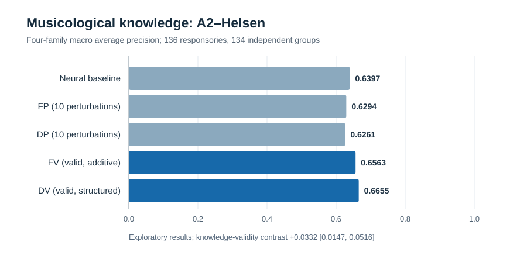
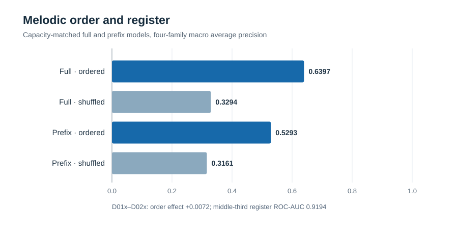

# Μουσικολογική γνώση και αναγνώριση μελωδικών οικογενειών: πειραματική μελέτη Α2–Helsen

<!-- language-switch:start -->
**Γλώσσα / Language:** **Ελληνικά** · [English](../../../../en/docs/research/byzcorpus/a2-helsen/README.md)
<!-- language-switch:end -->

[ByzCorpus](../README.md) · [Εκτενής μελέτη NHPYLM–Helsen](../nhpylm-helsen-extended-experiments.md) · [Ερευνητικός σχεδιασμός Α2](../../a2-knowledge-design.md) · [Τεχνικό πρωτόκολλο Α2](../../../appendices/k.md)

**Ερευνητικό αντικείμενο:** αναγνώριση μελωδικών τύπων και αξιολόγηση μουσικολογικά τεκμηριωμένων προδιαγραφών στην εκκλησιαστική μονοφωνία. **Κατάσταση:** ολοκληρωμένη διερευνητική υπολογιστική σειρά με εσωτερική αξιολόγηση· ανεξάρτητη μουσικολογική κρίση και εξωτερική επιβεβαίωση προγραμματίζονται χωριστά.

## 1. Ερευνητικό ερώτημα

Η μελέτη εξετάζει δύο αλληλένδετα ερωτήματα: (α) ποια πληροφοριακή αξία έχουν οι έγκυρες μουσικολογικές σχέσεις για την αναγνώριση οικογενειών μελωδικών στοιχείων και (β) ποια επιπρόσθετη επίδραση προκύπτει όταν αυτές οι σχέσεις οργανώνονται με ρητούς λογικούς κανόνες. Η διερεύνηση συνδυάζει την πρωτογενή ανάλυση της Helsen (2008), στατιστικούς μελωδικούς δείκτες και νευρωνική πρόβλεψη πλήρων στοιχείων.

Η εργασία αποτελεί **συγκριτική εφαρμογή του υπολογιστικού πρωτοκόλλου Α2** σε γρηγοριανό υλικό. Η τελική διδακτορική εφαρμογή της Α2 αφορά οικογένειες βυζαντινών μουσικών θέσεων του ByzCorpus. Η αναφορά συμπληρώνει τη [μελέτη NHPYLM–Helsen](../nhpylm-helsen-extended-experiments.md), η οποία εξετάζει την κατάτμηση και τη σχέση στατιστικών υποτμημάτων με τα πλήρη μουσικολογικά στοιχεία.

## 2. Σώμα, κατηγορίες και διαχωρισμοί

Το σώμα περιλαμβάνει **136 ρεσπονσόρια Α΄ τρόπου**, **134 ομάδες συγγενών μελωδιών**, **19.838 φθογγικά γεγονότα** και **1.037 πλήρη, αναλυτικά επισημειωμένα μελωδικά στοιχεία** από το Paris, BnF, lat. 12044. Οι αναλυτικές ετικέτες προέρχονται από το παράρτημα της Helsen και οι ακολουθίες φθόγγων από το CantusCorpus v0.2. Η αξιολόγηση χρησιμοποιεί τρεις πτυχές χωρίς κοινές μελωδικές ομάδες μεταξύ εκπαίδευσης, ανάπτυξης και ελέγχου.

Από τους 367 καταγεγραμμένους πρωτογενείς κωδικούς, οι 69 αντιστοιχούν σε ονομασμένους τύπους με 660 εμφανίσεις. Οι υπόλοιποι 298 περιγραφικοί κωδικοί καλύπτουν 377 εμφανίσεις. Ο αριθμός **134** δηλώνει ομάδες ανεξάρτητων μελωδιών για τον διαχωρισμό και **δεν δηλώνει πλήθος οικογενειών**. Το πρώτο αυστηρό πείραμα επικεντρώνεται στους `D01x`, `D02x`, `H01i` και `c01`, που διαθέτουν επαρκή παρουσία στις τρεις πτυχές.

Οι `D01x` και `D02x` έχουν κοινή τελική λειτουργία και στόχο τον D. Η Helsen καταγράφει κοινή καταληκτική φιγούρα `F–E–F–E–D` στους δύο τύπους (Helsen 2008, Πίν. 59, σ. 289). Η διάκρισή τους αποτελεί ειδική δοκιμασία της εσωτερικής μελωδικής ταυτότητας.

Η παλαιότερη [σειρά συγκρίσεων 123 ρεσπονσορίων](../segmentation-and-family-recognition/05-gregorian-benchmark.md) έχει διαφορετικό πειραματικό πληθυσμό και παραμένει χωριστή από τα αποτελέσματα της παρούσας μελέτης.

## 3. Μεθοδολογία

### 3.1 Μουσικολογικά τεκμηριωμένες και μαθημένες προδιαγραφές

Η `V_source` συγκροτεί προδιαγραφές από τη μουσικολογική ανάλυση και τα παραδείγματα πενταγράμμου της Helsen. Κάθε οικογένεια περιγράφεται με απαιτούμενες σχέσεις (`R`), εναλλακτικούς συνδυασμούς (`A`) και αποκλεισμούς (`E`). Η `V_train` είναι χωριστή διερευνητική εκδοχή, στην οποία η επιλογή επιπλέον διαγνωστικών γνωρισμάτων γίνεται στις ομάδες εκπαίδευσης της αντίστοιχης πτυχής.

Για κάθε υποψήφιο στοιχείο, οι έννοιες καταγράφονται ως παρούσες, απούσες ή μη παρατηρήσιμες (`1/0/?`). Ο λογικός τελεστής ελέγχει τη συνολική προδιαγραφή και υπολογίζει ποινή παραβίασης. Ελεγχόμενες μεταθέσεις της αντιστοίχισης εννοιών παράγουν δέκα εναλλακτικές προδιαγραφές ανά πτυχή, με πιστοποιητικά γραμμικού προγραμματισμού για τη μη ισοδυναμία των οικογενειών βαθμολόγησης.

### 3.2 Παραγοντικός σχεδιασμός

| | Προσθετική σύνθεση F | Δομημένη σύνθεση D |
|---|---|---|
| Έγκυρη προδιαγραφή V | FV | DV |
| Ελεγχόμενη τροποποίηση P | FP | DP |

Στην ίδια παγωμένη νευρωνική βάση, η F χρησιμοποιεί προσθετική σύνοψη των σχέσεων, ενώ η D εισάγει πρόσθετο όρο λογικής παραβίασης. Το κύριο εκτιμώμενο μέγεθος εγκυρότητας είναι

```math
\Delta_{\mathrm{know}}=\frac{(DV-DP)+(FV-FP)}{2},
```

και η άμεση αντίθεση λογικής σύνθεσης είναι `DV − FV`. Η αρχική Α2 χρησιμοποιεί ως κύρια μετρική την **macro Average Precision** της οικογενειακής αναγνώρισης σε δεδομένα μουσικολογικά όρια. Η πλήρης πρόβλεψη ορίων και οικογένειας με semi-CRF αξιολογείται ως διακριτό, συμπληρωματικό αποτέλεσμα.

Στο γρηγοριανό πείραμα, οι κεφαλές γνώσης εκπαιδεύτηκαν σε γνωστά όρια στοιχείων, ενώ ο πλήρης semi-CRF χρησιμοποιήθηκε σε χωριστή αξιολόγηση αποκωδικοποίησης πάνω σε κοινές αποθηκευμένες βαθμολογίες υποψήφιων στοιχείων. Η κύρια Α2 του Παραρτήματος Κ προβλέπει επιπλέον εκπαίδευση με πιθανοφάνεια πλήρους ακολουθίας και σύγκριση με το ισχυρό μοντέλο `B★`.

Οι νευρωνικές βάσεις εκπαιδεύτηκαν σε GPU με αντιστοιχισμένα δεδομένα και πέντε επαναλήψεις ανά πτυχή. Οι έλεγχοι μελωδικής σειράς και περιοχών περιλαμβάνουν αρχιτεκτονικές παρόμοιου πλήθους παραμέτρων, καθώς και ρητή διατήρηση κενού στις δοκιμές απόκρυψης φθόγγων.

## 4. Κύρια ευρήματα

### 4.1 Πληροφοριακή αξία της μουσικολογικής γνώσης



| Συνθήκη `V_source` | Macro AP, τέσσερις οικογένειες |
|---|---:|
| Νευρωνική βάση χωρίς προδιαγραφή | 0,6397 |
| FP, μέσος δέκα τροποποιήσεων | 0,6294 |
| DP, μέσος δέκα τροποποιήσεων | 0,6261 |
| FV | 0,6563 |
| DV | **0,6655** |

Η κύρια αντίθεση εγκυρότητας είναι **+0,0332 macro AP**, με 95% ομαδικό διάστημα jackknife **[+0,0147, +0,0516]**. Η πρόσθετη επίδραση της λογικής σύνθεσης στο ίδιο καθήκον είναι **+0,0093**, με διάστημα **[−0,0030, +0,0216]**. Οι τιμές αποτιμούν τα αντίστοιχα εκτιμώμενα μεγέθη στην υπάρχουσα εσωτερική αξιολόγηση.

### 4.2 Ακριβής αναγνώριση πλήρους στοιχείου και οικογένειας

Κατά την πλήρη αποκωδικοποίηση semi-CRF, το F1 ακριβούς αντιστοίχισης των τεσσάρων στοχευμένων οικογενειών αυξάνεται από **0,4517 (FV)** σε **0,4781 (DV)**: διαφορά **+0,0264**, με 95% διάστημα **[+0,0083, +0,0444]**. Η συνολική κοινή αναγνώριση όλων των οικογενειών μεταβάλλεται από **0,2282** σε **0,2290**. Η σύγκριση αναδεικνύει ιδιαίτερη επίδραση της δομημένης γνώσης στην επιλεκτική αναγνώριση των τεσσάρων στοχευμένων τύπων.

### 4.3 Μελωδική σειρά και τονική περιοχή



Η αντιστοιχισμένη σύγκριση διατεταγμένου BiGRU με BiGRU εκπαιδευμένο σε αναδιατεταγμένες μελωδίες δίνει **+0,3103 macro AP** στην τετραταξική αναγνώριση, με 95% διάστημα **[+0,2406, +0,3800]**. Στο ζεύγος `D01x–D02x`, η αντίστοιχη διαφορά είναι **+0,0072** με διάστημα **[−0,0361, +0,0505]**.

Ο απλός δείκτης της μέσης φθογγικής περιοχής του κεντρικού τρίτου επιτυγχάνει **ROC-AUC 0,9194** για το `D01x–D02x`. Οι έλεγχοι απόκρυψης με διατήρηση του κενού αναδεικνύουν την αξία της μελωδικής περιοχής, ενώ διορθώνουν την υπερεκτίμηση που δημιουργούσε η τεχνητή συνένωση φθόγγων από τις δύο πλευρές μιας αφαιρεμένης περιοχής. Η διαφορά μεταξύ `D01x` και `D02x` είναι ιδιαίτερα συμβατή με την τονική περιοχή της εσωτερικής ανάπτυξης· η γενική αναγνώριση τεσσάρων τύπων αξιοποιεί έντονα και τη σειρά των φθόγγων.

### 4.4 Παραλλαγές και εφαρμοσιμότητα των προδιαγραφών

Η αρχική `V_source` εμφανίζει **19 λογικές παραβιάσεις σε 139 πραγματικές εμφανίσεις** των τεσσάρων οικογενειών: **9/31 `D02x`**, **7/43 `D01x`**, **3/40 `H01i`** και **0/25 `c01`**. Το πρωτόκολλο ανεξάρτητης μουσικολογικής κρίσης εξετάζει αυτές τις 19 περιπτώσεις μαζί με έξι περιπτώσεις ελέγχου. Οι σχετικές αποφάσεις εκκρεμούν. Η αναθεώρηση των προδιαγραφών θα βασιστεί στην κρίση των ειδικών και στην αντιστοίχιση με την πρωτογενή πηγή.

## 5. Στατιστικό καθεστώς και αναπαραγωγιμότητα

Όλες οι παραπάνω μετρήσεις προέρχονται από τη **διερευνητική σειρά των ίδιων 136 ρεσπονσορίων**, με τρεις ομαδικά χωριστές πτυχές. Οι οικογένειες και αρκετοί διαγνωστικοί έλεγχοι οριστικοποιήθηκαν κατά την εξέλιξη αυτής της σειράς. Ο σχεδιασμός ανεξάρτητης επιβεβαίωσης προβλέπει νέο μουσικό υλικό, προηγούμενη οριστικοποίηση των προδιαγραφών και ξεχωριστή βαθμονόμηση των στατιστικών ελέγχων.

Οι δημοσιοποιήσιμες συγκεντρωτικές τιμές συνοδεύονται από [πίνακα αποτελεσμάτων](results-summary.csv). Η ερευνητική τεκμηρίωση δίνει τις συνθήκες, την προέλευση των μετρικών και τους αριθμητικούς ελέγχους. Τα πρωτογενή αρχεία μελωδιών, οι αναλυτικές επισημειώσεις της Helsen, οι ταυτότητες ανά έργο, τα ιδιωτικά δελτία ειδικών και τα checkpoints διατηρούνται σε χωριστό αρχείο με βάση τα ισχύοντα δικαιώματα και το πρωτόκολλο αξιολόγησης. Η επανεκτέλεση των νευρωνικών εκπαιδεύσεων απαιτεί πρόσβαση στις νόμιμες αρχικές πηγές και στις αντίστοιχες επισημειώσεις.

## 6. Σχέση με την κύρια Α2 και το ByzCorpus

Το πειραματικό πλαίσιο συνδέει τη **διαγνωστική αξία των μουσικών σχέσεων**, την **ανεκτή παραλλαγή μιας οικογένειας** και τη **δομημένη πρόβλεψη πλήρων μελωδικών μονάδων**. Η μεταφορά του στις βυζαντινές θέσεις προϋποθέτει πραγματική κωδικοποίηση νευματικών και μελωδικών γεγονότων, πηγοκριτική τεκμηρίωση οικογενειών και ανεξάρτητη επισημείωση. Η κύρια Α2 παραμένει οργανωμένη σύμφωνα με το [ισχύον τεχνικό πρωτόκολλο](../../../appendices/k.md), με αυτοτελείς πειραματικές προδιαγραφές για το ByzCorpus.

## Βασικές πηγές

- Helsen, Katherine Eve (2008). *The Great Responsories of the Divine Office: Aspects of Structure and Transmission*. [DOI](https://doi.org/10.5283/epub.10769).
- Cambouropoulos, E. (2001). *Melodic Cue Abstraction, Similarity, and Category Formation: A Formal Model*. *Music Perception*, 18(3), 347–370.
- Lanz, V., & Hajič, J., Jr. (2025). *Gregorian Melody, Modality, and Memory: Segmenting Chant with Bayesian Nonparametrics*. [Zenodo](https://doi.org/10.5281/zenodo.17811449).
- [Συγκεντρωμένη βιβλιογραφία του ερευνητικού σώματος](../nhpylm-helsen-bibliography.md).