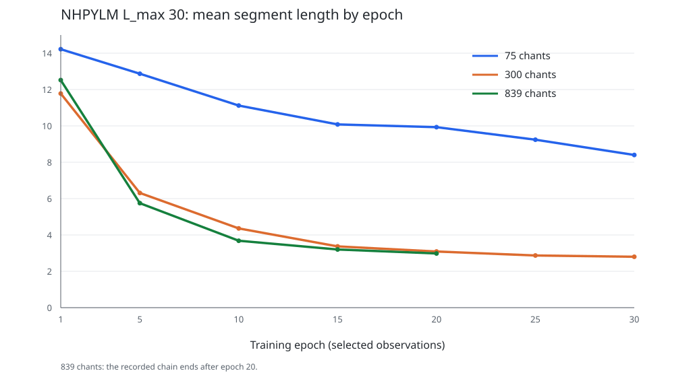

# Μελωδική Κατάτμηση και Κλίμακα Μουσικολογικών Μονάδων: Πειραματική Αξιολόγηση NHPYLM, Εποπτευόμενων Νευρωνικών Μοντέλων και Ημι-Μαρκοβιανών Αρχιτεκτονικών

**Εκτενής ερευνητική μελέτη του ByzCorpus · Γρηγοριανή συγκριτική αξιολόγηση και σχεδιασμός μεταφοράς στη Μ1-X**

---

**Τεχνική ερευνητική αναφορά:**  (18 Νοεμβρίου 2026). Το παρόν κείμενο συγκεντρώνει τα ολοκληρωμένα πειράματα στο γρηγοριανό μέλος και τις προδιαγραφές για τη μεταφορά τους στη βυζαντινή ψαλτική. Κάθε επιμέρους κύκλος πειραμάτων παρουσιάζεται με τους δικούς του διαχωρισμούς δεδομένων και τις αντίστοιχες μετρικές αξιολόγησης.

**Σχετική τεκμηρίωση:** [Νεότερη μαθηματική μελέτη NHPYLM–Helsen](nhpylm-helsen-mathematical-study.md) · [Γρηγοριανή πιλοτική μελέτη](gregorian-nhpylm-helsen-pilot.md) · [ByzCorpus](README.md) · [Μ1-X](../m1-x-design.md) · [Κριτικά σχολιασμένη βιβλιογραφία](nhpylm-helsen-bibliography.md) · [English edition of this experimental study](../../../en/docs/research/byzcorpus/nhpylm-helsen-extended-experiments.md).

**Συμπληρωματική μαθηματική ανάλυση (21 Νοεμβρίου 2026).** Η [αναλυτική μελέτη της κλίμακας και της λεξιλογικής επαναχρησιμοποίησης](nhpylm-helsen-mathematical-study.md) επεκτείνει την παρούσα πειραματική σειρά με πλήρεις επανεκπαιδεύσεις learned–pin19, ακριβή αποκωδικοποίηση MAP και παραγοντικό έλεγχο 2×2. Καταγράφει επίσης τη διόρθωση της αριθμητικής Poisson, την αποσύνθεση των πιθανοτικών όρων στις 839 μελωδίες και τις συγκρίσεις πλήρους στοιχείου και οικογένειας. Οι αρχικοί πίνακες διατηρούν τη δική τους πειραματική συνθήκη και μονάδα αξιολόγησης.

## Περιεχόμενα

[Ερευνητικό ερώτημα](#r1) · [Δεδομένα](#r2) · [Μετρικές](#r3) · [Repetenda](#r4) · [Υλοποίηση](#r5) · [Έλεγχος μήκους](#r6) · [Σχέση με Helsen](#r7) · [BiLSTM](#r8) · [Κλιμάκωση](#r9) · [L30 έναντι L7](#r10) · [Παραλλαγή και MDL](#r11) · [Semi-CRF/LASM](#r12) · [Προσαρμοζόμενο μήκος](#r13) · [Μελέτες περίπτωσης](#r14) · [ByzCorpus/Μ1-X](#r15) · [Πίνακες και κριτήρια](#r16) · [Ερμηνεία και νέα αρχιτεκτονική](#r17) · [Βιβλιογραφία](nhpylm-helsen-bibliography.md).

**Τεκμηρίωση και αναπαραγωγή.** Τα αριθμητικά δεδομένα προέρχονται από τους καταγεγραμμένους πίνακες των πειραμάτων. Η δημόσια αναφορά περιλαμβάνει τη μεθοδολογία, τις εντολές αναπαραγωγής και τα συγκεντρωτικά αποτελέσματα. Τα πρωτογενή αρχεία τρίτων, οι επισημειώσεις που υπόκεινται σε πνευματικά δικαιώματα και τα ανεπεξέργαστα πειραματικά πακέτα δημοσιοποιούνται μόνο κατόπιν ελέγχου αδειών και προέλευσης. Η αξιολόγηση στο γρηγοριανό μέλος αποτελεί ολοκληρωμένη πιλοτική μελέτη, ενώ τα πειράματα στη βυζαντινή ψαλτική περιγράφονται ως προδιαγεγραμμένος σχεδιασμός της επόμενης φάσης.

## 1. Ερευνητικό Ερώτημα και Συνοπτικά Συμπεράσματα

Η παρούσα μελέτη διερευνά τη σχέση ανάμεσα στη μη εποπτευόμενη στατιστική τμηματοποίηση μελωδικών ακολουθιών και στην οριοθέτηση ολοκληρωμένων μουσικολογικών μονάδων (μελωδικών τύπων / θέσεων). Αφετηρία της διερεύνησης αποτέλεσε η παρατήρηση ότι η εφαρμογή του μοντέλου **NHPYLM** (Nested Hierarchical Pitman–Yor Language Model) στο γρηγοριανό μέλος από τους [Lanz και Hajič (2025)](https://doi.org/10.5281/zenodo.17811449) χρησιμοποιεί ως προεπιλεγμένη υπερπαράμετρο το ανώτατο μήκος τμήματος **$L_{\max} = 7$ φθόγγων**, ενώ τα αναλυτικά μελωδικά στοιχεία (φράσεις-τύποι / *centones*) της [K. Helsen (2008)](https://doi.org/10.5283/epub.10769) στα Μεγάλα Ρεσπονσόρια έχουν μέσο μήκος **19,1 φθόγγους** (το 99% των στοιχείων υπερβαίνει τους 7 φθόγγους).

Τα κεντρικά ερωτήματα που εξετάστηκαν πειραματικά είναι:
1. Εάν η απόκλιση κλίμακας μεταξύ NHPYLM και μουσικολογικών στοιχείων οφείλεται στον τεχνητό περιορισμό $L_{\max}=7$, στο μέγεθος του μη επισημειωμένου συνόλου εκπαίδευσης (training pool) ή στον αριθμό των εποχών δειγματοληψίας Gibbs.
2. Πώς ευθυγραμμίζονται τα επαγόμενα στατιστικά τμήματα με τα όρια της Helsen σε σχέση με τυχαία όρια ίδιας πυκνότητας, τοπικά μελωδικά κριτήρια (μεγάλα διαστήματα) και εποπτευόμενα νευρωνικά μοντέλα (BiLSTM).
3. Εάν η πληροφορία της μη εποπτευόμενης υπο-κατάτμησης βελτιώνει την εποπτευόμενη πρόβλεψη ορίων και την αναγνώριση πλήρων μουσικολογικών στοιχείων (μέσω καναλιών εισόδου ή όρων συμβατότητας ορίων LASM σε ημι-Μαρκοβιανά μοντέλα CRF).

### Βασικά Πειραματικά Ευρήματα

* **Ο NHPYLM διατηρεί προτίμηση για μικρά στατιστικά τμήματα και όταν το μέγιστο επιτρεπόμενο μήκος αυξάνεται από 7 σε 30 φθόγγους:****
  * Σε μικρό σύνολο εκπαίδευσης (75 μελωδίες, 30 εποχές), η αύξηση του $L_{\max}$ σε `7 / 12 / 20 / 30` (μετά την επιδιόρθωση σφάλματος υπερχείλισης 32-bit ακεραίου στο $13!$ της κατανομής Poisson) έδωσε μέσα μήκη τμημάτων **2,04 / 3,27 / 6,08 / 6,72 φθόγγους**, αντίστοιχα. Ακόμη και με $L_{\max}=30$, κανένα τμήμα εκπαίδευσης δεν ξεπέρασε τους 20 φθόγγους.
  * Όταν αυξάνεται το μέγεθος του σώματος εκπαίδευσης για το $L_{\max}=30$ (από 75 σε 300 και 839 μελωδίες), το μέσο μήκος τμήματος **μειώνεται δραστικά**: από **7,80** φθόγγους (75 μελωδίες, εποχή 30) σε **2,54** φθόγγους (300 μελωδίες, εποχή 30) και **2,77 / 2,66** φθόγγους (839 μελωδίες, εποχή 20, seeds 0/1).
  * Στην εποχή 20 της πλήρους δεξαμενής (839 μελωδίες), ο λόγος μέσου μήκους **$L_{30}/L_7$ συγκλίνει στο 1,08–1,09** (έναντι 1,52–1,53 στην εποχή 10). Τα μεγάλα τμήματα που εμφανίζονται στα μικρά σώματα ($N=75$) συνοδεύονται από έντονη **απομνημόνευση (overfitting)**, με μεγάλο χάσμα γενίκευσης (0,46 bits/φθόγγο εντός δείγματος έναντι 2,29 bits/φθόγγο εκτός δείγματος).
  * Περισσότερες εποχές εκπαίδευσης (200 αντί 30 εποχών στο $L_{\max}=7$) οδηγούν σε **λεπτότερη κατάτμηση** σε όλες τις κλίμακες σώματος (π.χ. μείωση μέσου μήκους από 2,48 σε 2,22 φθόγγους στις 839 μελωδίες και από 1,99 σε 1,49 στις 75 μελωδίες), ενώ οι βαθμολογίες ανά φθόγγο μεταβάλλονται ανάλογα με την εκπαιδευτική συνθήκη.
* **Τα στατιστικά τμήματα λειτουργούν ως δομική υποδιαίρεση (refinement) των μουσικολογικών στοιχείων:**
  * Στις αρχικές εκπαιδεύσεις NHPYLM της παρούσας σειράς, η αναγνώριση ολόκληρου στοιχείου Helsen είχε μέγιστο F1 πλήρους στοιχείου **0,040**. Η νεότερη επανεκπαίδευση με ελεγχόμενη λ≈19 εξετάζεται χωριστά στη [μαθηματική μελέτη](nhpylm-helsen-mathematical-study.md).
  * Ωστόσο, με $L_{\max}=7$, το **66%–74%** των στοιχείων της Helsen αποτελούν **ακριβείς ενώσεις (exact unions)** συνεχόμενων στατιστικών τμημάτων του NHPYLM, έναντι 26%–39% για τυχαία όρια ίδιας πυκνότητας και 29%–33% για τοπικό κριτήριο μεγάλων διαστημάτων ($p = 0,0002$ στις αντίστοιχες 5.000 μεταθέσεις· οι επαναλαμβανόμενες συνθήκες δεν λογίζονται ως ανεξάρτητα πειράματα).
* **Εποπτευόμενο Baseline (BiLSTM) και συνδυασμός με NHPYLM:**
  * Ένα απλό εποπτευόμενο **BiLSTM** (με είσοδο αποκλειστικά τονικό ύψος και διάστημα, χωρίς κείμενο) επιτυγχάνει **Boundary F1 = 0,562** (95% CI: `[0,531, 0,595]` σε 3 ομαδικές πτυχές × 3 seeds), προβλέποντας κατά μέσο όρο 5,8 όρια ανά μέλος (έναντι 6,6 της Helsen).
  * Η απευθείας τροφοδότηση των διακριτών ορίων ή των μηκών του NHPYLM ως πρόσθετου καναλιού στο BiLSTM δεν προσφέρει σταθερό κέρδος έναντι ανακατεμένων (shuffled) ελέγχων ίδιας πυκνότητας (όλες οι διαφορές βρίσκονται εντός του θορύβου μεταξύ διαφορετικών seeds του NHPYLM, ±0,021).
* **Ημι-Μαρκοβιανά Μοντέλα Πλήρους Στοιχείου (F, LASM, RM) και Μελωδική Παραλλαγή:**
  * Στα 1.037 στοιχεία της Helsen, μόνο το **~13%** επαναλαμβάνεται αυτούσιο ως ακριβής συμβολοσειρά φθόγγων. Δύο στοιχεία με την ίδια μουσικολογική ετικέτα έχουν μέση κανονικοποιημένη απόσταση επεξεργασίας (edit distance) **0,39**, έναντι **0,70** μεταξύ στοιχείων διαφορετικής ετικέτας ίδιου μήκους. Αυτό συμφωνεί με την παρατηρούμενη προτίμηση του μοντέλου για ακριβώς επαναλαμβανόμενα τμήματα και με το γεγονός ότι ένας απλός κώδικας λεξικού συμπιέζει καλύτερα σε κλίμακα 2–3 φθόγγων (2,6–3,4 bits/φθόγγο) απ' ό,τι σε κλίμακα 19 φθόγγων (4,7 bits/φθόγγο).
  * Το νευρωνικό ημι-Μαρκοβιανό μοντέλο πλήρους στοιχείου (**F / segmental semi-CRF**) επιτυγχάνει F1 πλήρους στοιχείου **0,391** (μόνο μέλος, Boundary F1 **0,587**) και **0,696** (μέλος + κείμενο, Boundary F1 **0,828**). Η προσθήκη του όρου συμβατότητας υποτμημάτων **LASM ($L_{\max}=7$)** συνδέεται με αύξηση του F1 πλήρους στοιχείου χωρίς κείμενο στο **0,410** (+0,019, 95% CI `[−0,006, +0,045]`, Boundary F1 **0,606**) έναντι 0,394 της προσαρμοζόμενης (adaptive) παραλλαγής. Η κοινή πρόβλεψη στοιχείου και ετικέτας αξιολογείται χωριστά.

---

## 2. Δεδομένα, Στοίχιση Helsen–CantusCorpus και Πρωτόκολλο Αξιολόγησης

### 2.1 Κύριο Σώμα Αξιολόγησης (136 Ρεσπονσόρια)
* **Πηγές:** Το αναλυτικό παράρτημα της διδακτορικής διατριβής της Katherine Eve Helsen, *The Great Responsories of the Divine Office* (2008), σε στοίχιση με τις συμβολικές μεταγραφές Volpiano του **CantusCorpus v0.2**.
* **Χειρόγραφο & Τρόπος:** Paris, BnF, lat. 12044 (ρεσπονσόρια 1ου τρόπου).
* **Μέγεθος & Κριτήρια Επιλεξιμότητας:** Από τις υποψήφιες εγγραφές, εφαρμόστηκε αυστηρό φίλτρο ταύτισης μέσω κωδικού CAO ή κανονικοποιημένου *incipit*, με απαίτηση κανονικοποιημένης μελωδικής απόστασης επεξεργασίας $\le 0,05$ και μονοσήμαντης προβολής κάθε εσωτερικού ορίου σε όλες τις βέλτιστες ευθυγραμμίσεις (εξαιρέθηκαν 13 εγγραφές χωρίς αντιστοίχιση στον 1ο τρόπο, 48 με απόσταση $>0,05$ και 17 με αμφίσημη προβολή ορίου).
* **Τελικό Σύνολο (`helsen.json`, SHA-256 `0867ee2a...`):** **136 μέλη**, κατανεμημένα σε **134 μελωδικές ομάδες**, με **1.037 πλήρη στοιχεία** και **901 εσωτερικά όρια** (μέσο 6,6 όρια ανά μέλος).
* **Κατανομή Μηκών Helsen:** Μέσο μήκος **19,1 φθόγγοι**, διάμεσος **19**, μέγιστο **45** φθόγγοι. Το **99%** των στοιχείων έχει μήκος $>7$ φθόγγους, το **89%** $>12$, το **40%** $>20$ και το **3%** $>30$.

### 2.2 Διαχωρισμός Ομαδικών Πτυχών (Grouped Cross-Validation)
Για την αποτροπή διαρροής πληροφορίας (data leakage) μεταξύ συγγενών μελωδιών, οι διαχωρισμοί `train / dev / test` έγιναν αυστηρά σε επίπεδο **μελωδικών ομάδων**:

| Πτυχή (Fold) | Επισημειωμένα μέλη (Train / Dev / Test) | Εσωτερικά όρια Test | Πλήρης δεξαμενή NHPYLM (Μη επισημειωμένα + Train) |
| :---: | :---: | :---: | :---: |
| **Fold 0** | 67 / 23 / 46 | 279 | 839 μελωδίες (113.404 φθόγγοι) |
| **Fold 1** | 68 / 23 / 45 | 312 | 842 μελωδίες (112.495 φθόγγοι) |
| **Fold 2** | 67 / 24 / 45 | 310 | 839 μελωδίες (112.733 φθόγγοι) |

* **Εμφωλευμένα υποσύνολα κλιμάκωσης ($75 \subset 300 \subset 769$):** Για τον αυστηρό έλεγχο της επίδρασης του μεγέθους του σώματος (Πείραμα 3), κατασκευάστηκε σταθερή εμφωλευμένη ακολουθία 75 (10.582 φθόγγοι), 300 (39.676 φθόγγοι) και 769 (102.718 φθόγγοι) αμιγώς μη επισημειωμένων μελωδιών (χωρίς καμία από τις 136 επισημειωμένες μελωδίες). Η πλήρης δεξαμενή της Πτυχής 0 (839 μελωδίες) περιλαμβάνει επιπλέον τις 70 μελωδίες των ομάδων εκπαίδευσης (train) της πτυχής, αποκλείοντας πλήρως κάθε ομάδα dev και test.
* **Αρχικό υποσύνολο 75 μελωδιών (Πείραμα 1):** Οι πρώτες συγκρίσεις $L_{\max} \in \{7, 12, 20, 30\}$ εκτελέστηκαν σε σταθερό σύνολο 75 μη επισημειωμένων μελωδιών (10.286 φθόγγοι), ξένο προς όλες τις επισημειωμένες ομάδες.
* **Πρώιμο σύνολο 123 μελών (Πείραμα 5):** Οι αρχικές δοκιμές των αρχιτεκτονικών F/C/LASM πραγματοποιήθηκαν σε προγενέστερη στοίχιση 123 ρεσπονσορίων (121 ομάδες, 793 εσωτερικά όρια), πριν από την επέκταση στα 136 μέλη.

---

## 3. Ορισμοί Μετρικών και Μεθοδολογικές Διακρίσεις

Έστω ακολουθία φθόγγων $x_1, \dots, x_T$, σύνολο πραγματικών (gold) εσωτερικών ορίων $G \subseteq \{1, \dots, T-1\}$ και σύνολο προβλεπόμενων ορίων $B \subseteq \{1, \dots, T-1\}$:

* **Boundary Precision / Recall / F1:** Υπολογίζονται επί των εσωτερικών διακένων με ακριβή ταύτιση (exact match): $\text{P} = \frac{|B \cap G|}{|B|}$, $\text{R} = \frac{|B \cap G|}{|G|}$, $\text{F1} = \frac{2\text{PR}}{\text{P}+\text{R}}$.
* **Έλεγχος Τύχης Ίδιας Πυκνότητας (Same-Density Chance Control):** Τοποθέτηση ισάριθμων ορίων ($|B|$ ανά μέλος) σε τυχαίες θέσεις (αναλυτική αναμενόμενη τιμή και έλεγχος 5.000 μεταθέσεων). Η **ανύψωση (lift)** ορίζεται ως ο λόγος της παρατηρούμενης ανάκλησης προς την αναμενόμενη από τύχη.
* **Τοπικό Μελωδικό Κριτήριο Ίδιας Πυκνότητας (Local Interval Cue):** Τοποθέτηση ισάριθμων ορίων ($|B|$ ανά μέλος) στα διάκενα με το μεγαλύτερο απόλυτο μελωδικό διάστημα, χωρίς καμία πληροφορία κειμένου.
* **Διαγνωστική Ανάκληση σε Αντιστοιχισμένη Πυκνότητα (Matched-Density Recall):** Επιλογή σε κάθε μέλος τόσων υποψήφιων τομών όσες και οι πραγματικές τομές της Helsen ($|G|$), μετρώντας το ποσοστό σύμπτωσης. Αποτελεί διαγνωστικό μέτρο ποιότητας κατάταξης (ranking) και όχι αυτόνομο κανόνα πρόβλεψης.
* **Κανόνας Αραίωσης Επιλεγμένος στο Dev (Dev-Thinned F1):** Κανόνας φιλτραρίσματος των ορίων NHPYLM (π.χ. διατήρηση ορίου μόνο εάν το προηγούμενο στατιστικό τμήμα έχει μήκος $\ge m$), όπου η παράμετρος $m$ επιλέγεται αποκλειστικά στο σύνολο `dev` κάθε πτυχής και αξιολογείται στο `test`.
* **Ακέραιο Στοιχείο ως Ακριβής Ένωση (Exact Union):** Το ποσοστό των πλήρων στοιχείων $[a, b)$ της Helsen των οποίων και τα δύο άκρα ανήκουν στο σύνολο των ορίων του NHPYLM ($a \in B \cup \{0\}$ και $b \in B \cup \{T\}$), δηλαδή μπορούν να ανασυντεθούν ακριβώς από την ένωση συνεχόμενων στατιστικών υποτμημάτων.
* **F1 Πλήρους Στοιχείου (Span / Element F1):** Αυστηρή μετρική όπου ένα προβλεπόμενο τμήμα $[a, b)$ θεωρείται σωστό αν και μόνο αν ταυτίζονται ταυτόχρονα **και η αρχή $a$ και το τέλος $b$** με πραγματικό στοιχείο της Helsen.
* **Κοινό F1 Στοιχείου–Οικογένειας (Joint Span+Family F1):** Απαιτεί ταυτόχρονη ταύτιση αρχής $a$, τέλους $b$ και οικογενειακής ετικέτας $f$.
* **Bits ανά Φθόγγο (Bits per Tone):** Ορίζεται ως $-\frac{1}{N_{\text{notes}}} \log_2 P_{\text{Viterbi}}(\mathbf{x})$, μετρώντας την ικανότητα συμπίεσης/πρόβλεψης της μελωδίας τόσο εντός δείγματος (training pool) όσο και εκτός δείγματος (unseen test works), ανεξάρτητα από τον αριθμό των παραγόμενων τμημάτων.

---

## 4. Προκαταρκτική Πιλοτική Μελέτη: Εντοπισμός της Repetenda και Λεκτική Άρθρωση

Σε προκαταρκτική πιλοτική δοκιμή επί 995 πλήρων ρεσπονσορίων του CantusCorpus (εκ των οποίων 887 περιείχαν ακριβώς μία εσωτερική διαστολή *repetenda*), εξετάστηκε αν το NHPYLM ($L_{\max}=7$, 200 εποχές, 2 ομαδικές πτυχές) τοποθετεί στατιστικό όριο στο σημείο της δομικής τομής της *repetenda*:

| Μετρική (Προκαταρκτική Πιλοτική Μελέτη Repetenda) | Τιμή |
| :--- | :---: |
| Αξιολογημένα ρεσπονσόρια / μελωδικές ομάδες | 887 / 879 |
| Ακριβής ταύτιση ορίου στη *repetenda* ($h_S$) | **0,8929** (95% CI: `[0,8725, 0,9126]`) |
| Τυχαία αναδιάταξη ίδιων μηκών ($h_R$) | 0,4997 (95% CI: `[0,4921, 0,5075]`) |
| Καθαρό πλεονέκτημα έναντι τύχης ($d_R = h_S - h_R$) | **+0,3932** (95% CI: `[0,3711, 0,4146]`) |
| Ταύτιση με ανοχή $\pm 1$ διάκενο | **0,9876** |
| Ταύτιση σε λοιπά τέλη λέξεων ($w_S$) | 0,7367 (διαφορά $+0,1562$) |
| Μέσο μήκος τμήματος / Μονόφθογγα τμήματα | 1,967 φθόγγοι / 60,79% |

Σε παράλληλο διαγνωστικό έλεγχο επί των στοιχείων της Helsen διαπιστώθηκε ότι το **99,4% των ορίων των μελωδικών στοιχείων της Helsen συμπίπτει με τέλος λέξης**. Αυτή η ισχυρή σύζευξη μελωδικού στοιχείου και λεκτικής άρθρωσης στο γρηγοριανό ρεπερτόριο καθιστά απαραίτητο οι υπολογιστικές δοκιμές μελωδικής τμηματοποίησης να εκτελούνται σε συνθήκη **melody-only** (χωρίς πληροφορία τέλους λέξης), ώστε τα μοντέλα να αξιολογούνται στην ικανότητά τους να αναγνωρίζουν μελωδική δομή και όχι απλώς λεκτικά όρια.

---

## 5. Υλοποίηση NHPYLM, Αναπαραγωγιμότητα και Αριθμητική Διόρθωση Poisson

### 5.1 Αριθμητική Διόρθωση Υπερχείλισης (Integer Overflow) στην Κατανομή Poisson
Στην [αρχική υλοποίηση Cython της βιβλιοθήκης](https://github.com/lanzv/nhpylm) `lanzv/nhpylm` (commit `f928c78`, αρχείο `nhpylm/random_utils.pyx`), η συνάρτηση της κατανομής Poisson υπολόγιζε το παραγοντικό $k!$ μέσω προσημασμένου ακεραίου 32-bit (`int`). Επειδή το $13! = 6.227.020.800$ υπερβαίνει το όριο του 32-bit ακεραίου ($2.147.483.647$), για $k \ge 13$ ο ενδιάμεσος ακέραιος υπολογισμός του παραγοντικού υπερέβαινε το εύρος αναπαράστασης (το $13!$ υπολογιζόταν εσφαλμένα ως $1.932.053.504$), αλλοιώνοντας τη διόρθωση μήκους Poisson για όλα τα πειράματα με $L_{\max} > 12$.

Η συνάρτηση αντικαταστάθηκε με υπολογισμό στον λογαριθμικό χώρο μέσω της συνάρτησης Γάμμα (`lgamma`):
$$\log p(k; \lambda) = -\lambda + k \log(\lambda) - \ln \Gamma(k+1), \quad p(k; \lambda) = \exp(\log p(k; \lambda))$$

* **Επαλήθευση:** Σε 310 ελέγχους ($k \in \{0, \dots, 30\} \times 10$ τιμές του $\lambda$), η νέα υλοποίηση έδωσε μηδενική απόκλιση (bit-identical συμπεριφορά) για $k \le 12$ και μέγιστο σχετικό σφάλμα $6,15 \times 10^{-7}$ έναντι αναφοράς υψηλής ακρίβειας για $k \in [13, 30]$.

### 5.2 Ντετερμινιστική Αναπαραγωγιμότητα και Υπολογιστικό Κόστος
Εντοπίστηκαν και επιλύθηκαν δύο τεχνικά ζητήματα αναπαραγωγιμότητας στην αρχική βιβλιοθήκη:
1. **Εξάρτηση από το `PYTHONHASHSEED`:** Η μετατροπή `set` σε `list` κατά την κατασκευή του λεξιλογίου εξαρτιόταν από το hash seed της Python (προκαλώντας διακύμανση μέσου μήκους από 2,15 σε 2,44 φθόγγους για το ίδιο random seed). Σε όλα τα πειράματα κλιμάκωσης κλειδώθηκε το `PYTHONHASHSEED=0`.
2. **Συνεχής αλυσίδα MCMC:** Επειδή η μέθοδος `NHPYLMModel.train()` επαναρχικοποιεί το αντικείμενο `NPYLM` σε κάθε κλήση, υλοποιήθηκε εξειδικευμένος runner που διατηρεί ενιαία την αλυσίδα Gibbs και καταγράφει στιγμιότυπα (snapshots) στις ενδιάμεσες εποχές, διατηρώντας αμετάβλητη την κατάσταση της γεννήτριας τυχαίων αριθμών. Η bit-προς-bit ταύτιση επαληθεύτηκε σε ανεξάρτητες επανεκτελέσεις (`RERUN_L7_s0`, `RERUN_L7_s1`) καθώς και μεταξύ εκδόσεων Python **3.11, 3.12 και 3.13**.

| Μετρική Υπολογιστικού Κόστους | $L_{\max} = 7$ | $L_{\max} = 30$ |
| :--- | :---: | :---: |
| Χρόνος ανά εποχή / 1.000 φθόγγους | ~0,40 s | ~18,3 s |
| Χρόνος ανά εποχή (839 μελωδίες / 113.404 φθόγγοι) | ~46–53 s | ~2.170 s (~36 λεπτά) |
| Εκπαίδευση 30 εποχών (839 μελωδίες) | ~25 λεπτά | ~19 ώρες |
| Εκπαίδευση 200 εποχών (839 μελωδίες) | ~2,7 ώρες | ~119 ώρες (εκτίμηση) |
| Σχετικό υπολογιστικό κόστος / Μνήμη RAM | $1\times$ (~60 MB) | $\sim 45\times$ (~60 MB) |

---

## 6. Πείραμα 1: Επίδραση του Ανώτατου Μήκους Τμήματος ($L_{\max} \in \{7, 12, 20, 30\}$)

Στην πρώτη ελεγχόμενη σειρά πειραμάτων, το NHPYLM εκπαιδεύτηκε από την αρχή σε κοινό σύνολο 75 μη επισημειωμένων μελωδιών (10.286 φθόγγοι) με τις τυπικές υπερπαραμέτρους ($d=0,5, \theta=2,0, \alpha_\lambda=6,0, \beta_\lambda=1,2$) για $L_{\max} \in \{7, 12, 20, 30\}$ και αξιολογήθηκε στις 3 πτυχές των 136 επισημειωμένων μελών:

| $L_{\max}$ | Εποχές | Εκτελέσεις (Fold × Seed) | Μέσο Μήκος Τμήματος (± SD) | Προβλ. Όρια / Μέλος (Helsen: 6,6) | Precision | Recall | Boundary F1 | F1 Τύχης |
| :---: | :---: | :---: | :---: | :---: | :---: | :---: | :---: | :---: |
| **7** | 30 | 9 (3×3) | 2,041 ± 0,232 | 71,4 | 0,076 | 0,812 | 0,139 | 0,084 |
| **7** | 200 | 3 (3×1) | 1,360 ± 0,019 | 106,3 | 0,058 | 0,935 | 0,110 | 0,086 |
| **12** | 30 | 9 (3×3) | 3,273 ± 0,907 | 46,3 | 0,099 | 0,675 | 0,171 | 0,079 |
| **20** | 30 | 6 (3×2) | 6,079 ± 0,089 | 23,0 | 0,116 | 0,404 | 0,181 | 0,071 |
| **30** | 30 | 3 (3×1) | 6,715 ± 0,132 | 20,7 | 0,151 | 0,473 | 0,229 | 0,069 |

### Βασικές Παρατηρήσεις
1. **Ασυμπτωτική συγκράτηση του μήκους:** Ακόμη και όταν επιτρέπονται τμήματα έως 30 φθόγγους ($L_{\max}=30$), το μέσο μήκος σταματά στους **6,72 φθόγγους** (σχεδόν το 1/3 του μέσου μήκους των 19,1 φθόγγων της Helsen), ενώ κανένα τμήμα στην εκπαίδευση δεν ξεπερνά τους 20 φθόγγους.
2. **Επίδραση της πυκνότητας στο F1:** Η αύξηση του Boundary F1 από 0,139 ($L_{\max}=7$) σε 0,229 ($L_{\max}=30$) οφείλεται κυρίως στη μείωση της υπερ-κατάτμησης (από 71,4 σε 20,7 όρια ανά μέλος).
3. **Υπερ-κατάτμηση στις 200 εποχές:** Στις 75 μελωδίες, η παράταση της εκπαίδευσης από 30 σε 200 εποχές ($L_{\max}=7$) μειώνει το perplexity εκπαίδευσης (από 11,9 σε 7,1), αλλά συρρικνώνει το μέσο μήκος από **2,14 σε 1,36 φθόγγους** (83% μονόφθογγα τμήματα).
4. **Ιστορικές μετρήσεις perplexity ανά τμήμα:** Στα 136 αθέατα μέλη, το perplexity ανά τμήμα αυξάνεται απότομα με το $L_{\max}$ (από **27** στο $L_{\max}=7$, σε **1.184** στο $L_{\max}=12$, **17.221** στο $L_{\max}=20$ και **38.139** στο $L_{\max}=30$). Οι τιμές αυτές καταγράφονται για την πληρότητα του ιστορικού. Επειδή ο διαφορετικός αριθμός και το μήκος των τμημάτων μεταβάλλουν τη μονάδα κανονικοποίησης, η κύρια σύγκριση μεταξύ διαφορετικών ρυθμίσεων βασίζεται στα bits ανά φθόγγο επί των ίδιων έργων.

---

## 7. Σχέση Στατιστικών Υποτμημάτων και Μουσικολογικών Στοιχείων Helsen

Εφόσον τα τμήματα του NHPYLM βρίσκονται σε μικρότερη κλίμακα από τα στοιχεία της Helsen, εξετάστηκε αν αποτελούν **δομικές υποδιαιρέσεις (refinement)** των στοιχείων σε όλα τα 136 επισημειωμένα μέλη:

| $L_{\max}$ | Εποχές | Seed | Όρια NHPYLM ανά όριο Helsen | Ανάκληση (Τύχη) | Lift έναντι Τύχης `[95% CI]` | Lift Τοπικού Κριτηρίου `[95% CI]` | Διαφορά Ανάκλησης: NHPYLM − Τοπικό `[95% CI]` | Ακέραια Στοιχεία (Exact Unions): NHPYLM / Τοπικό / Τύχη |
| :---: | :---: | :---: | :---: | :---: | :---: | :---: | :---: | :---: |
| **7** | 30 | 0 | 10,14 | 0,785 (0,463) | 1,69 `[1,63, 1,76]` | 1,03 `[0,96, 1,10]` | **+0,309** `[+0,268, +0,347]` | **0,662** / 0,299 / 0,281 |
| **7** | 30 | 1 | 9,67 | 0,815 (0,442) | 1,84 `[1,78, 1,91]` | 1,06 `[0,99, 1,14]` | **+0,346** `[+0,307, +0,384]` | **0,706** / 0,292 / 0,260 |
| **7** | 30 | 2 | 12,52 | 0,837 (0,573) | 1,46 `[1,40, 1,52]` | 0,88 `[0,82, 0,94]` | **+0,334** `[+0,293, +0,376]` | **0,736** / 0,327 / 0,394 |
| **7** | 200 | 0 | 16,04 | 0,935 (0,734) | 1,27 `[1,25, 1,30]` | 0,78 `[0,73, 0,83]` | **+0,361** `[+0,325, +0,397]` | **0,887** / 0,399 / 0,594 |
| **12** | 30 | 0 | 4,78 | 0,537 (0,218) | 2,46 `[2,31, 2,64]` | 1,82 `[1,67, 1,98]` | **+0,141** `[+0,104, +0,179]` | **0,339** / 0,220 / 0,092 |
| **12** | 30 | 1 | 7,72 | 0,738 (0,353) | 2,09 `[2,00, 2,18]` | 1,24 `[1,14, 1,34]` | **+0,301** `[+0,263, +0,337]` | **0,595** / 0,258 / 0,186 |
| **12** | 30 | 2 | 8,46 | 0,748 (0,387) | 1,93 `[1,85, 2,02]` | 1,17 `[1,09, 1,26]` | **+0,296** `[+0,256, +0,337]` | **0,612** / 0,274 / 0,212 |
| **20** | 30 | 0 | 3,47 | 0,398 (0,159) | 2,51 `[2,31, 2,72]` | 2,24 `[2,05, 2,44]` | **+0,043** `[+0,003, +0,083]` | **0,202** / 0,184 / 0,060 |
| **20** | 30 | 1 | 3,47 | 0,412 (0,159) | 2,60 `[2,41, 2,79]` | 2,23 `[2,02, 2,44]` | **+0,059** `[+0,024, +0,096]` | **0,218** / 0,184 / 0,060 |
| **30** | 30 | 0 | 3,13 | 0,473 (0,143) | 3,31 `[3,09, 3,54]` | 2,40 `[2,18, 2,62]` | **+0,130** `[+0,097, +0,165]` | **0,274** / 0,175 / 0,052 |

* Στις καταγεγραμμένες γραμμές ο έλεγχος 5.000 μεταθέσεων έδωσε $p = 0,0002$ ανά συνθήκη. Οι πολλαπλές εποχές και οι επαναλαμβανόμενες παρατηρήσεις ανήκουν σε συσχετισμένες αλυσίδες· η γενίκευση τεκμηριώνεται κυρίως μέσω ομαδοποιημένων διαχωρισμών (grouped splits) και διαφορών ανά ανεξάρτητο μέλος.
* Με κανόνα αραίωσης επιλεγμένο αποκλειστικά στο `dev` (διατήρηση ορίου μόνο μετά από στατιστικό τμήμα μήκους $\ge m$, συνήθως $m \in [4, 7]$), η πυκνότητα του NHPYLM ($L_{\max}=7$) προσεγγίζει τη Helsen (5,5 όρια/μέλος) και το Boundary F1 ανέρχεται σε **0,311 ± 0,025** (έναντι 0,040 της τύχης).

---

## 8. Πείραμα 2: Εποπτευόμενο Baseline (BiLSTM) και Ενσωμάτωση Χαρακτηριστικών NHPYLM

### 8.1 Απόδοση Εποπτευόμενου BiLSTM (Melody-Only)
Εκπαιδεύτηκε αμφίδρομο LSTM (32 κρυφές μονάδες ανά κατεύθυνση, Adam $\text{lr}=0,002$, έως 35 εποχές, στάθμιση θετικής κλάσης βάσει αναλογίας διακένων στο train, επιλογή εποχής και κατωφλίου απόφασης στο `dev`), χρησιμοποιώντας αποκλειστικά το τονικό ύψος και το διάστημα από τον προηγούμενο φθόγγο:

| Πτυχή (Fold) | Seed | Μέλη (Train/Dev/Test) | Επιλεγμένη Εποχή | Κατώφλι | TP | FP | FN | Precision | Recall | Test Boundary F1 |
| :---: | :---: | :---: | :---: | :---: | :---: | :---: | :---: | :---: | :---: | :---: |
| **0** | 0 | 67 / 23 / 46 | 23 | 0,85 | 168 | 105 | 111 | 0,615 | 0,602 | **0,609** |
| **0** | 1 | 67 / 23 / 46 | 35 | 0,75 | 165 | 118 | 114 | 0,583 | 0,591 | **0,587** |
| **0** | 2 | 67 / 23 / 46 | 16 | 0,90 | 150 | 92 | 129 | 0,620 | 0,538 | **0,576** |
| **1** | 0 | 68 / 23 / 45 | 28 | 0,90 | 150 | 83 | 162 | 0,644 | 0,481 | **0,550** |
| **1** | 1 | 68 / 23 / 45 | 32 | 0,90 | 156 | 86 | 156 | 0,645 | 0,500 | **0,563** |
| **1** | 2 | 68 / 23 / 45 | 17 | 0,90 | 165 | 114 | 147 | 0,591 | 0,529 | **0,558** |
| **2** | 0 | 67 / 24 / 45 | 32 | 0,85 | 162 | 120 | 148 | 0,574 | 0,523 | **0,547** |
| **2** | 1 | 67 / 24 / 45 | 16 | 0,85 | 155 | 117 | 155 | 0,570 | 0,500 | **0,533** |
| **2** | 2 | 67 / 24 / 45 | 28 | 0,90 | 153 | 107 | 157 | 0,588 | 0,494 | **0,537** |
| **Σύνολο** | **9 runs** | **136 test works** | — | — | **1.424** | **942** | **1.279** | **0,602** | **0,527** | **0,562** `[0,531, 0,595]` |

### 8.2 Προσθήκη Καναλιών NHPYLM στο BiLSTM έναντι Ανακατεμένων Ελέγχων (Shuffled Controls)
Εξετάστηκε αν η παροχή των προβλέψεων του NHPYLM (είτε ως δυαδικός δείκτης ορίου είτε ως κανονικοποιημένο μήκος τμήματος $k / L_{\max}$) βελτιώνει το BiLSTM σε σχέση με ανακατεμένο (shuffled) κανάλι ίδιας πυκνότητας/κατανομής:

| Ρύθμιση NHPYLM & Κανάλι Εισόδου | F1 με Πραγματικό Κανάλι | F1 με Ανακατεμένο Έλεγχο | Διαφορά (Πραγματικό − Έλεγχος) `[95% CI]` |
| :--- | :---: | :---: | :---: |
| **$L_{\max}=7$**, θέσεις ορίων | 0,558 | 0,558 | +0,001 `[−0,015, +0,017]` |
| **$L_{\max}=7$**, μήκη τμημάτων | 0,562 | 0,561 | +0,002 `[−0,014, +0,018]` |
| **$L_{\max}=12$**, θέσεις ορίων | 0,557 | 0,558 | −0,002 `[−0,017, +0,011]` |
| **$L_{\max}=12$**, μήκη τμημάτων | 0,570 | 0,564 | +0,007 `[−0,008, +0,021]` |
| **$L_{\max}=20$**, θέσεις ορίων | 0,567 | 0,569 | −0,001 `[−0,017, +0,014]` |
| **$L_{\max}=20$**, μήκη τμημάτων (NHPYLM seed 0) | 0,574 | 0,558 | **+0,015** `[+0,005, +0,026]` (9/9 runs) |
| **$L_{\max}=20$**, μήκη τμημάτων (NHPYLM seed 1) | 0,554 | 0,574 | **−0,021** `[−0,033, −0,008]` (0/9 runs) |
| **$L_{\max}=30$**, θέσεις ορίων | 0,551 | 0,556 | −0,005 `[−0,020, +0,009]` |
| **$L_{\max}=30$**, μήκη τμημάτων | 0,562 | 0,569 | −0,006 `[−0,019, +0,006]` |

**Συμπέρασμα:** Η μοναδική θετική διαφορά που εμφανίστηκε αρχικά στο $L_{\max}=20$ με μήκη τμημάτων (+0,015 στο seed 0) αντιστράφηκε πλήρως όταν χρησιμοποιήθηκε δεύτερη ανεξάρτητη εκπαίδευση του NHPYLM (−0,021 στο seed 1). Έναντι του απλού BiLSTM χωρίς πρόσθετο κανάλι (0,562), όλες οι παραλλαγές βρίσκονται εντός του διαστήματος `[−0,011, +0,011]` και όλα τα 95% CIs περιέχουν το μηδέν.

---

## 9. Πείραμα 3: Κλιμάκωση Μεγέθους Σώματος ($N \in \{75, 300, 769, 839\}$) και Διάρκειας Εκπαίδευσης

Για να διαπιστωθεί αν το μικρό μήκος τμημάτων του NHPYLM οφείλεται στο περιορισμένο δείγμα των 75 μελωδιών, εκτελέστηκαν συστηματικές εκπαιδεύσεις με κλειδωμένο `PYTHONHASHSEED=0` στα εμφωλευμένα σύνολα $75 \subset 300 \subset 769$ και στις πλήρεις δεξαμενές των τριών πτυχών (839–842 μελωδίες), από 10 έως 200 εποχές:

### 9.1 Κλιμάκωση για $L_{\max} = 7$ (Αξιολόγηση στα 46 μέλη Test της Πτυχής 0)

| Σύνολο Εκπαίδευσης / Seed | Εποχές | Μέσο Μήκος Test | Διάμεσος | Μονόφθογγα | Boundary F1 | Ανάκληση Ίδιας Πυκνότητας | Ακέραια Στοιχεία (Unions) | Bits/Φθόγγο Test |
| :--- | :---: | :---: | :---: | :---: | :---: | :---: | :---: | :---: |
| **75 εμφωλ.** (seed 0) | 30 | 1,99 | 2 | 0,47 | 0,132 | 0,237 | 0,66 | 2,221 |
| **75 εμφωλ.** (seed 0) | 200 | 1,49 | 1 | 0,75 | 0,120 | 0,237 | 0,91 | 2,076 |
| **300 εμφωλ.** (seed 0) | 30 | 1,93 | 1 | 0,61 | 0,136 | 0,290 | 0,74 | 2,004 |
| **300 εμφωλ.** (seed 0) | 200 | 1,77 | 1 | 0,65 | 0,126 | 0,283 | 0,74 | 1,970 |
| **769 εμφωλ.** (seed 0) | 30 | 2,22 | 2 | 0,48 | 0,148 | 0,183 | 0,70 | 1,874 |
| **769 εμφωλ.** (seed 0) | 200 | 2,02 | 1 | 0,55 | 0,141 | 0,190 | 0,73 | 1,877 |
| **839 Πτυχή 0** (seed 0) | 30 | 2,48 | 2 | 0,42 | 0,165 | 0,247 | 0,69 | 1,785 |
| **839 Πτυχή 0** (seed 0) | 200 | 2,22 | 1 | 0,53 | 0,153 | 0,244 | 0,71 | 1,764 |
| **839 Πτυχή 0** (seed 1) | 30 | 2,33 | 1 | 0,51 | 0,158 | 0,294 | 0,70 | 1,789 |
| **842 Πτυχή 1** (seed 0, Test Fold 1) | 30 / 200 | 2,22 / 2,01 | 1 / 1 | 0,55 / 0,61 | 0,155 / 0,147 | 0,304 / 0,324 | 0,70 / 0,76 | 1,826 / 1,818 |
| **839 Πτυχή 2** (seed 0, Test Fold 2) | 30 / 200 | 2,41 / 2,11 | 2 / 1 | 0,38 / 0,52 | 0,150 / 0,152 | 0,239 / 0,265 | 0,62 / 0,78 | 1,896 / 1,889 |

* **Αξιολόγηση Κριτηρίων Κ1 & Κ2:** Με προκαθορισμένο κατώφλι θορύβου τους **0,50 φθόγγους**, η αύξηση του μεγέθους σώματος από 75 σε 839 μελωδίες στο $L_{\max}=7$ προκαλεί οριακή μόνο αύξηση (+0,49 φθόγγοι στις 30 εποχές), ενώ η αύξηση των εποχών από 30 σε 200 προκαλεί σταθερή μείωση του μήκους σε όλες τις πτυχές (−0,26 στην Πτυχή 0, −0,21 στην Πτυχή 1, −0,30 στην Πτυχή 2).

### 9.2 Κλιμάκωση για $L_{\max} = 30$ (Αντιστροφή Κλίμακας με την Αύξηση του Σώματος)

*Σχήμα 1. Μέσο μήκος δειγματοληπτημένων τμημάτων στην εκπαιδευτική αλυσίδα για 75, 300 και 839 μελωδίες (seed 0). Το διάγραμμα αποτυπώνει επιλεγμένες εποχές της εκπαιδευτικής αλυσίδας, ενώ οι αντίστοιχες κατατμήσεις των 46 μελών ελέγχου παρουσιάζονται στον παρακάτω πίνακα. Η εκτέλεση των 839 μελωδιών διακόπηκε στην εποχή 20.*

| Σύνολο Εκπαίδευσης ($L_{\max}=30$) | Εποχή 10: Μέσο Μήκος Test | Εποχή 20: Μέσο Μήκος Test | Εποχή 30: Μέσο Μήκος Test | Bits/Φθόγγο (Train / Test) στην τελευταία εποχή |
| :--- | :---: | :---: | :---: | :---: |
| **75 εμφωλευμένες** (seed 0) | 10,98 | 9,69 | **7,80** | 0,458 / 2,290 |
| **300 εμφωλευμένες** (seed 0) | 6,83 | 3,30 | **2,54** | 1,150 / 2,058 |
| **839 Πτυχή 0** (seed 0) | 4,22 | **2,77** | *(εκκρεμεί)* | 1,193 / 1,832 (επ. 20) |
| **839 Πτυχή 0** (seed 1) | 4,17 | **2,66** | *(εκκρεμεί)* | 1,203 / 1,811 (επ. 20) |

**Κεντρικό Εύρημα:** Στο $L_{\max}=30$, η αύξηση του εκπαιδευτικού σώματος **δεν αυξάνει** το μήκος των τμημάτων, αλλά το **μειώνει δραστικά** (από 7,80 φθόγγους στις 75 μελωδίες σε 2,54 φθόγγους στις 300 μελωδίες κατά την εποχή 30, και σε 2,66–2,77 φθόγγους στις 839 μελωδίες κατά την εποχή 20). Στις 300 μελωδίες, καθώς το μέσο μήκος υποχωρεί από 6,83 (εποχή 10) σε 2,54 (εποχή 30), η διαγνωστική ανάκληση ίδιας πυκνότητας βελτιώνεται από **0,172 σε 0,323** και τα bits/φθόγγο στο test πέφτουν από **2,115 σε 2,058**.

---

## 10. Πείραμα 4: Ζευγαρωτή Σύγκριση $L_{\max}=30$ έναντι $L_{\max}=7$ και Ανάλυση Γενίκευσης (Bits/Φθόγγο)

Στα 46 μέλη test της Πτυχής 0 (εκπαίδευση στις 839 μελωδίες), η ζευγαρωτή αντιπαραβολή $L_{\max}=30$ και $L_{\max}=7$ στους δύο ανεξάρτητους σπόρους (seeds 0 και 1) δείχνει τη σύγκλιση των δύο μοντέλων καθώς προχωρά η δειγματοληψία:

| Μετρική (Πτυχή 0, $N=839$) | Εποχή 10 (L30 / L7, Seed 0) | Εποχή 20 (L30 / L7, Seed 0) | Εποχή 10 (L30 / L7, Seed 1) | Εποχή 20 (L30 / L7, Seed 1) |
| :--- | :---: | :---: | :---: | :---: |
| **Μέσο μήκος τμήματος (Test)** | 4,22 / 2,76 (λόγος **1,53**) | 2,77 / 2,56 (λόγος **1,08**) | 4,17 / 2,74 (λόγος **1,52**) | 2,66 / 2,43 (λόγος **1,09**) |
| **Ζευγαρωτή διαφορά μήκους ανά μέλος** | +1,745 `[+1,42, +2,08]` | +0,290 `[+0,12, +0,47]` | +1,816 `[+1,43, +2,23]` | +0,311 `[+0,15, +0,47]` |
| **Διάμεσο μήκος / Μονόφθογγα** | 2,0 vs 2,0 / 0,39 vs 0,34 | 1,0 vs 2,0 / 0,50 vs 0,39 | 2,0 vs 2,0 / 0,42 vs 0,37 | 1,0 vs 2,0 / 0,57 vs 0,46 |
| **Boundary F1** | 0,197 / 0,175 | 0,173 / 0,169 | 0,199 / 0,165 | 0,173 / 0,159 |
| **Ανάκληση Ίδιας Πυκνότητας** | 0,262 / 0,244 | 0,287 / 0,244 | 0,287 / 0,265 | 0,333 / 0,294 |
| **Ζευγαρωτή διαφορά Ανάκλησης Ίδ. Πυκν.** | +0,027 `[−0,038, +0,091]` | +0,046 `[−0,012, +0,104]` | +0,028 `[−0,036, +0,089]` | +0,048 `[−0,012, +0,106]` |
| **Ακέραια Στοιχεία (Exact Unions)** | 0,403 / 0,652 | 0,634 / 0,695 | 0,422 / 0,591 | 0,655 / 0,668 |
| **F1 με κανόνα αραίωσης Dev** | 0,274 / 0,269 | 0,292 / 0,295 | 0,315 / 0,282 | 0,343 / 0,304 |
| **Bits/Φθόγγο Εντός Δείγματος (Train)** | 0,950 / 1,292 | 1,193 / 1,352 | 0,952 / 1,269 | 1,203 / 1,343 |
| **Bits/Φθόγγο Εκτός Δείγματος (Test)** | 1,861 / 1,797 | 1,832 / 1,800 | 1,874 / 1,798 | 1,811 / 1,793 |
| **Ζευγαρωτή διαφορά Bits/Φθόγγο Test** | +0,056 `[+0,026, +0,087]` | +0,028 `[−0,000, +0,055]` | +0,077 `[+0,046, +0,111]` | +0,020 `[−0,012, +0,051]` |

### Κατανομή Μεριδίου Φθόγγων ανά Μήκος Τμήματος (Εποχή 20, Πτυχή 0)

| Μήκος Τμήματος (σε φθόγγους) | 1 | 2 | 3 | 4–7 | 8–12 | 13–20 | 21–30 | $\ge 31$ |
| :--- | :---: | :---: | :---: | :---: | :---: | :---: | :---: | :---: |
| **$L_{\max}=30$ (Seed 0)** | 0,18 | 0,16 | 0,06 | 0,29 | 0,27 | 0,04 | 0,00 | 0,00 |
| **$L_{\max}=30$ (Seed 1)** | 0,21 | 0,11 | 0,06 | 0,28 | 0,27 | 0,06 | 0,00 | 0,00 |
| **$L_{\max}=7$ (Seed 0)** | 0,15 | 0,22 | 0,11 | 0,52 | 0,00 | 0,00 | 0,00 | 0,00 |
| **Στοιχεία Helsen (Αναφορά)** | 0,00 | 0,00 | 0,00 | 0,00 | 0,06 | 0,42 | 0,49 | 0,03 |

**Ερμηνεία Γενίκευσης:** Σε όλες τις συνθήκες, το $L_{\max}=30$ επιτυγχάνει χαμηλότερα bits/φθόγγο στην εκπαίδευση (απομνημονεύοντας μεγαλύτερα τμήματα του training pool), αλλά **υψηλότερα (χειρότερα) bits/φθόγγο στα αθέατα έργα του test** σε σχέση με το $L_{\max}=7$. Καθώς προχωρά η εκπαίδευση από την εποχή 10 στην εποχή 20, ο δειγματολήπτης απορρίπτει σταδιακά τα μεγάλα απομνημονευμένα τμήματα, ανεβάζοντας τα training bits (0,95 → 1,20) και μειώνοντας τα test bits (1,87 → 1,81), καθώς η κατανομή μηκών του $L_{\max}=30$ προσεγγίζει εκείνη του $L_{\max}=7$.

### Ερμηνεία της βαθμολογίας ανά φθόγγο

Για τη συγκρισιμότητα διαφορετικών τιμών του `L_max`, η βαθμολογία ελέγχου κανονικοποιείται ως προς το πλήθος των φθόγγων: $`b(X)=-\log_2 P_{\mathrm{Viterbi}}(X)/T`$. Πρόκειται για τη βαθμολογία της **επιλεγμένης κατάτμησης** σύμφωνα με τη συγκεκριμένη διαδικασία αποκωδικοποίησης, η οποία διαφέρει ως πιθανοτικό μέγεθος από την πλήρως περιθωριοποιημένη πιθανοφάνεια επί όλων των δυνατών κατατμήσεων. Αντίθετα, το perplexity ανά στατιστικό τμήμα μεταβάλλεται μηχανικά όταν αλλάζει το μήκος των τμημάτων και διατηρείται μόνο ως διαγνωστικό μέτρο των αρχικών δοκιμών.

Η ζευγαρωτή σύγκριση χρησιμοποιεί τα ίδια 46 μέλη ελέγχου, το ίδιο seed και την ίδια εποχή. Η αβεβαιότητα υπολογίζεται στην κατάλληλη μονάδα επαναδειγματοληψίας (μέλος ή ανεξάρτητη μελωδική ομάδα). Τα 95% διαστήματα εμπιστοσύνης των διαφορών αναφέρονται μαζί με το μέγεθος του αποτελέσματος, σύμφωνα με τις βέλτιστες πρακτικές στατιστικού ελέγχου σε προβλήματα δομημένης πρόβλεψης ([Dror κ.ά., 2018](https://aclanthology.org/P18-1128/)).

---

## 11. Μελωδική Παραλλαγή, Απόσταση Επεξεργασίας και Περιγραφικό Μήκος (MDL)

Γιατί ένα μη εποπτευόμενο μοντέλο συμβολοσειρών όπως το NHPYLM επιμένει σε μονάδες 2–3 φθόγγων αντί για τις 19-φθογγες μονάδες της Helsen; Η απάντηση προκύπτει από τη μελέτη της **εσωτερικής παραλλαγής των οικογενειών της Helsen** και του **περιγραφικού μήκους δύο μερών (MDL)**:

### 11.1 Επανάληψη και παραλλαγή στις ετικέτες Helsen (136 μέλη)
* **Συνολικά στοιχεία:** 1.037 εμφανίσεις (tokens), οι οποίες αντιστοιχούν σε **962 διακριτές συμβολοσειρές φθόγγων (types)**.
* **Αυτούσια επανάληψη:** Μόνο το **12,6%** των στοιχείων (11,9% σε διαφορετικό έργο) επαναλαμβάνεται αυτούσιο νότα-προς-νότα.
* **Οικογενειακές ετικέτες:** Υπάρχουν 367 διακριτές ετικέτες Helsen, εκ των οποίων οι 127 εμφανίζονται $\ge 2$ φορές (καλύπτοντας 797 στοιχεία). Μέσα στην ίδια ετικέτα, μόνο 93 εμφανίσεις επαναλαμβάνουν αυτούσια τη συμβολοσειρά άλλου στοιχείου της ίδιας ετικέτας (μόλις το **1,2%** των 5.216 ζευγών ίδιας ετικέτας σε διαφορετικά έργα είναι ταυτόσημα).
* **Κανονικοποιημένη Απόσταση Επεξεργασίας (Edit Distance):**
  * Μεταξύ δύο στοιχείων με την **ίδια ετικέτα Helsen** (σε διαφορετικά έργα): μέση απόσταση **0,394** (διάμεσος **0,40**).
  * Μεταξύ δύο στοιχείων με **διαφορετική ετικέτα** (αντιστοιχισμένου μήκους): μέση απόσταση **0,698** (διάμεσος **0,70**).

### 11.2 Ανάλυση περιγραφικού μήκους δύο μερών (46 μέλη test)

Η παρακάτω ανάλυση χρησιμοποιεί έναν ρητά κατασκευασμένο κώδικα δύο μερών: κόστος λεξικού, κόστος παραμέτρων και κόστος κωδικοποίησης των δεδομένων. Αποτελεί **περιγραφικό έλεγχο κλίμακας**, με διαφορετική αντικειμενική συνάρτηση από την εκπαίδευση του NHPYLM και από τα μοντέλα HMM/MDL του Μαυρομάτη. Επομένως, οι αριθμοί ενισχύουν την ερμηνεία της ακριβούς επανάληψης, ενώ η πλήρης σύγκριση μοντέλων βασίζεται στα κοινά έργα ελέγχου και στις ταυτόσημες μονάδες κανονικοποίησης.

| Κατάτμηση | Μέσο Μήκος | Διακριτοί Τύποι (Types) | Κόστος Λεξικού (bits/φθ.) | Κόστος Παραμέτρων (bits/φθ.) | Κόστος Δεδομένων (bits/φθ.) | **Σύνολο Bits/Φθόγγο** | Ποσοστό Τμημάτων με Αυτούσια Επανάληψη σε Άλλο Έργο |
| :--- | :---: | :---: | :---: | :---: | :---: | :---: | :---: |
| **Σταθερά 2-φθογγα (`fixed_2`)** | 1,99 | 72 | 0,14 | 0,07 | 2,41 | **2,62** | 99,6% |
| **Μεμονωμένοι φθόγγοι (`tones`)** | 1,00 | 15 | 0,02 | 0,02 | 2,81 | **2,84** | 100,0% |
| **Σταθερά 3-φθογγα (`fixed_3`)** | 2,98 | 223 | 0,57 | 0,20 | 2,23 | **3,01** | 95,9% |
| **NHPYLM $L_{\max}=7$ ($N=839$, seed 1)** | 2,33 | 219 | 0,79 | 0,20 | 2,34 | **3,33** | 96,6% |
| **NHPYLM $L_{\max}=7$ ($N=839$, seed 0)** | 2,48 | 234 | 0,84 | 0,21 | 2,34 | **3,39** | 96,6% |
| **NHPYLM $L_{\max}=30$ ($N=300$, seed 0)** | 2,54 | 249 | 1,18 | 0,23 | 2,07 | **3,48** | 94,5% |
| **NHPYLM $L_{\max}=12$ ($N=75$, seed 0)** | 4,30 | 442 | 1,96 | 0,37 | 1,74 | **4,08** | 79,0% |
| **NHPYLM $L_{\max}=30$ ($N=75$, προηγ.)** | 6,57 | 508 | 2,94 | 0,41 | 1,24 | **4,58** | 56,1% |
| **Στοιχεία Helsen (`helsen_elements`)** | 19,03 | 315 | 4,07 | 0,21 | 0,43 | **4,72** | **4,3%** |
| **Σταθερά 19-φθογγα (`fixed_19`)** | 17,77 | 338 | 4,18 | 0,23 | 0,47 | **4,88** | 4,9% |

**Ερμηνεία του περιγραφικού ελέγχου:** Η ποικιλία μελωδικών πραγματώσεων των στοιχείων Helsen (μέση απόσταση επεξεργασίας περίπου 0,39 μέσα στην ίδια ετικέτα) αυξάνει το κόστος αποθήκευσης πλήρων ακριβών ακολουθιών στον συγκεκριμένο κώδικα λεξικού: 4,07 bits ανά φθόγγο για το λεξικό των στοιχείων. Σε κλίμακα 2–3 φθόγγων, η αυτούσια επανάληψη υπερβαίνει το 95% και το συνολικό περιγραφικό μήκος περιορίζεται περίπου στα 2,6–3,4 bits ανά φθόγγο. Το αποτέλεσμα προσδιορίζει ελέγξιμο κίνητρο για μοντέλα που αναπαριστούν κοινή οικογενειακή δομή σε διαφορετικές μελωδικές πραγματώσεις.

---

## 12. Πείραμα 5: Ημι-Μαρκοβιανές Αρχιτεκτονικές Πλήρους Μονάδας (F, C, RM) και Συμβατότητα Υποτμημάτων (LASM)

Για την άμεση πρόβλεψη ολοκληρωμένων στοιχείων $[a, b)$ και της οικογένειάς τους $f$, αξιολογήθηκαν τέσσερις αρχιτεκτονικές:
* **F (Full-Span Segmental Semi-CRF):** Νευρωνικός κωδικοποιητής που βαθμολογεί απευθείας κάθε υποψήφιο πλήρες διάστημα $[a, b)$ και την οικογενειακή ετικέτα $f$.
* **C (Compositional Latent Sub-segment Model):** Σύνθεση πλήρων στοιχείων από λανθάνοντα υποτμήματα.
* **LASM (Lattice-Aligned Sub-segment Marginal):** Ενσωμάτωση στο μοντέλο F ενός πιθανοτικού όρου συμβατότητας ορίων από παγωμένο μη εποπτευόμενο μοντέλο υποτμημάτων $q_0$:
  $$\log Q_0(B(y) \mid X) = \sum_{[a,b) \in y} \log Z_0(a,b) - \log Z_0(0,T), \quad \text{score}(a,b,f) = \text{score}_F(a,b,f) + \lambda \log Z_0(a,b)$$
* **RM (Normalized Family Sub-segment Model):** Προσθήκη κανονικοποιημένης οικογενειακής συνιστώσας $\tau_f(a,b) = \log Z_f(a,b) - \log Z_0(a,b)$.

### 12.1 Αποτελέσματα στο Πρώιμο Σύνολο 123 Ρεσπονσορίων (2 Seeds)

| Μοντέλο / Συνθήκη | Boundary F1 | Προβλ. Όρια | F1 Πλήρους Στοιχείου (Span F1) | Κοινό F1 (Joint F1) | Ακρίβεια Οικογένειας (με γνωστά όρια) |
| :--- | :---: | :---: | :---: | :---: | :---: |
| **NHPYLM στα τέλη λέξεων** | 0,550 | 1.783 | 0,139 | — | — |
| **Τοπικός κανόνας κατάληξης** | 0,582 | 1.616 | 0,173 | — | — |
| **F (Μόνο Μέλος)** | 0,524 | 691 | 0,329 | 0,149 | 0,427 |
| **F + LASM (Μόνο Μέλος)** | **0,572** | — | **0,373** | **0,170** | **0,433** |
| **F + Ανακατεμένη Βάση (Null Control, Μέλος)** | 0,517 | — | 0,327 | 0,140 | 0,415 |
| **F (Μέλος + Κείμενο)** | **0,828** | 723 | **0,684** | **0,319** | **0,448** |
| **F + LASM (Μέλος + Κείμενο)** | 0,808 | — | 0,663 | 0,311 | 0,447 |

* **Ζευγαρωτές διαφορές Span F1 (10.000 bootstrap επαναδειγματοληψίες ομάδων):**
  * Χωρίς κείμενο: $\text{LASM}_{\text{mel}} - \text{F}_{\text{mel}} = \mathbf{+0,0439}$ (`[+0,0246, +0,0635]`), και $\text{LASM}_{\text{mel}} - \text{NULL}_{\text{mel}} = \mathbf{+0,0455}$ (`[+0,0259, +0,0651]`).
  * Με κείμενο: $\text{LASM}_{\text{text}} - \text{F}_{\text{text}} = -0,0206$ (`[-0,0404, -0,0008]`).

### 12.2 Ανεξάρτητος Έλεγχος Χωρητικότητας σε Συνθετικό Σύνολο (`Synthetic-G0`, Μόνο Μέλος, 3 Seeds)
Σε ελεγχόμενη δοκιμή 18 εκπαιδεύσεων (24 έργα εκπαίδευσης, 288 έργα test, 300 μη επισημειωμένα έργα για τη βάση multigram), το μοντέλο F και οι επεκτάσεις του συγκρίθηκαν με μοντέλα ίσης χωρητικότητας παραμέτρων (`F-wide`, `C-matched`):

| Μοντέλο | Ενεργές Παράμετροι | Boundary F1 | F1 Πλήρους Στοιχείου (Span F1) | Κοινό F1 (Joint F1 ± SD) | Χρόνος Εκπαίδευσης (s) |
| :--- | :---: | :---: | :---: | :---: | :---: |
| **F** | 10.150 | 0,749 | 0,646 | 0,627 ± 0,013 | 4,19 |
| **F + LASM ($\lambda \ge 0$)** | 10.151 | **0,779** | **0,684** | **0,663 ± 0,014** | 4,18 |
| **F + RM** | 11.988 | 0,759 | 0,658 | 0,642 ± 0,021 | 8,70 |
| **F-wide (Capacity-Matched με RM)** | 12.037 | 0,764 | 0,670 | 0,653 ± 0,027 | 4,38 |
| **PART (Σύνθεση από σταθερή βάση)** | 8.286 | 0,538 | 0,348 | 0,331 ± 0,027 | 6,59 |
| **C-matched (Capacity-Matched με F)** | 10.129 | 0,360 | 0,255 | 0,237 ± 0,209 | 19,44 |

* Η αρχιτεκτονική πλήρους στοιχείου **F** επιτυγχάνει σαφώς υψηλότερη επίδοση από τη λανθάνουσα σύνθεση **C-matched** (+0,381 στο Joint F1), η οποία παρουσιάζει έντονη αστάθεια εκπαίδευσης μεταξύ διαφορετικών seeds (0,260 / 0,018 / 0,434). Η προσθήκη **LASM** (με 1 μόλις επιπλέον παράμετρο $\lambda$) βελτιώνει στατιστικά σημαντικά το F (+0,036 στο Joint F1, 95% CI `[+0,0225, +0,0499]`).

---

## 13. Πείραμα 6: Σταθερό έναντι Προσαρμοζόμενου (Adaptive) Ανώτατου Μήκους στη LASM

Στο πλήρες σώμα των **136 ρεσπονσορίων** (3 ομαδικές πτυχές × 3 seeds, με όρο διάρκειας πλήρους στοιχείου), εξετάστηκε αν η αντικατάσταση του σταθερού ανώτατου μήκους υποτμημάτων ($L_{\max}=7$) της βάσης LASM από μεγαλύτερα σταθερά όρια ($5, 6, 7, 8, 9, 12, 14, 16, 20$) ή από **προσαρμοζόμενο (adaptive)** όριο ανά τοπικό μελωδικό περιβάλλον βελτιώνει την απόδοση:

### 13.1 Στάδιο Α (Επαναβαθμολόγηση Σταθερού F) & Στάδιο Β (Πλήρης Επανεκπαίδευση)

| Παραλλαγή Μοντέλου (136 Μέλη, 3 Folds × 3 Seeds) | Στάδιο Α: Span F1 (Μόνο Μέλος) | Στάδιο Α: Span F1 (+Κείμενο) | Στάδιο Β: Span F1 (Μόνο Μέλος) | Στάδιο Β: Boundary F1 (Μόνο Μέλος) | Στάδιο Β: Span F1 (+Κείμενο) | Στάδιο Β: Joint F1 (Μέλος / +Κείμενο) |
| :--- | :---: | :---: | :---: | :---: | :---: | :---: |
| **F (Baseline χωρίς LASM)** | 0,391 | 0,696 | 0,391 | 0,587 | 0,696 | 0,218 / 0,339 |
| **F + LASM (Σταθερό $L_{\max}=7$)** | 0,401 | 0,695 | **0,410** | **0,606** | 0,695 | **0,218** / 0,328 |
| **F + LASM (Επιλεγμένο Σταθερό στο Dev)** | 0,402 | **0,704** | 0,401 | 0,594 | 0,682 | 0,211 / 0,307 |
| **F + Προσαρμοζόμενη (Adaptive) LASM** | 0,397 | 0,701 | 0,394 | 0,584 | 0,695 | 0,209 / 0,324 |
| **F + Ανακατεμένα Όρια Μήκους (Shuffled Caps)** | 0,399 | 0,702 | 0,401 | 0,592 | 0,702 | 0,213 / 0,330 |
| **F + Μόνο Πληροφορία Μήκους (Duration Control)** | 0,392 | 0,693 | 0,393 | 0,588 | **0,707** | 0,212 / **0,339** |

* **Συζευγμένες Διαφορές Σταδίου Β (Span F1, Μόνο Μέλος):**
  * $\text{LASM } 7 - \text{F} = \mathbf{+0,019}$ (95% CI: `[−0,006, +0,045]`).
  * $\text{Adaptive LASM} - \text{LASM } 7 = -0,016$ (95% CI: `[−0,041, +0,006]`).
  * Το development set επέλεξε στις τρεις πτυχές (0, 1, 2) τις τιμές **$L_{\max} = 7, 7, 6$** στη συνθήκη χωρίς κείμενο, επιβεβαιώνοντας ανεξάρτητα ότι το **σταθερό όριο $L_{\max}=7$** αποτελεί τη βέλτιστη κλίμακα υποτμημάτων για τη LASM.

---

## 14. Μελέτη Περίπτωσης: Ανάλυση Δύο Πραγματικών Ρεσπονσορίων

Για την ποιοτική εποπτεία της συμπεριφοράς των μοντέλων, αναλύθηκαν δύο χαρακτηριστικά ρεσπονσόρια του συνόλου ελέγχου (test): ένα υψηλής δυσκολίας (186 φθόγγοι, 9 εσωτερικά όρια Helsen) και ένα τυπικής δομής (94 φθόγγοι, 4 εσωτερικά όρια Helsen):

| Μοντέλο | Ρεσπονσόριο 1 (186 φθόγγοι, 9 όρια Helsen) | Ρεσπονσόριο 2 (94 φθόγγοι, 4 όρια Helsen) |
| :--- | :---: | :---: |
| **NHPYLM ($L_{\max}=7$)** | 97 προβλ. όρια, 7 σωστά (F1 = **0,13**) | 50 προβλ. όρια, 2 σωστά (F1 = **0,07**) |
| **NHPYLM ($L_{\max}=30$)** | 27 προβλ. όρια, 2 σωστά (F1 = **0,11**) | 16 προβλ. όρια, 2 σωστά (F1 = **0,20**) |
| **Εποπτευόμενο BiLSTM** | 4 προβλ. όρια, 1 σωστό (F1 = **0,15**) | 4 προβλ. όρια, 4 σωστά (F1 = **1,00**) |

Στο δεύτερο έργο, το εποπτευόμενο BiLSTM εντοπίζει με απόλυτη ακρίβεια (F1 = 1,00) και τα 4 όρια των φράσεων της Helsen, ενώ το NHPYLM ($L_{\max}=30$) τοποθετεί τα 2 από τα 4 πραγματικά όρια μέσα σε ένα σύνολο 16 υποψήφιων τομών που υποδιαιρούν τις φράσεις σε μικρότερα μοτιβικά κύτταρα.

### Θεωρητική μετάβαση: από τα στατιστικά τμήματα στην οικογενειακή ταυτότητα

Η υπολογιστική γλωσσολογία παρέχει δύο συγκεκριμένους μηχανισμούς για την επόμενη αρχιτεκτονική διερεύνηση. Οι [Uchiumi, Tsukahara και Mochihashi (2015)](https://aclanthology.org/P15-1171/) εισήγαγαν το PYHSMM για την από κοινού επαγωγή τμηματοποίησης και λανθανουσών ετικετών γραμματικής κατηγορίας. Οι [Fujii, Domoto και Mochihashi (2017)](https://aclanthology.org/Q17-1013/) συνδύασαν τη μη παραμετρική επαγωγή λέξεων με εποπτευόμενο CRF σε ημι-εποπτευόμενο πλαίσιο. Οι δύο αυτές εργασίες τεκμηριώνουν συμπληρωματικές διαδρομές προς την κοινή μάθηση ορίων και κατηγοριών.

Για τη μουσική θέση, η αντίστοιχη πειραματική επέκταση μπορεί να περιγραφεί μέσω τριών μεταβλητών: της διαδοχικής οριοθέτησης $`B`$, της ετικέτας οικογένειας $`F`$ και της ακολουθίας μουσικών γεγονότων $`X`$. Στην προτεινόμενη παραγωγική διατύπωση, η πιθανότητα ανά θέση συνδυάζει την πιθανότητα μετάβασης μεταξύ οικογενειών, την κατανομή μήκους ανά οικογένεια και την πιθανότητα της επιμέρους μελωδικής πραγμάτωσης. Η οικογενειακή ετικέτα αντιστοιχίζεται με μουσικολογικά τεκμηριωμένες κατηγορίες, συνοδευόμενη από ρητή διαδικασία διαχείρισης άγνωστων οικογενειών. Το PYHSMM διατηρείται ως **προτεινόμενη νέα αρχιτεκτονική**· η τελική του διαμόρφωση και οι αναμενόμενες επιδόσεις του αποτελούν αντικείμενο της επόμενης πειραματικής φάσης και όχι εύρημα των ήδη εκτελεσμένων δοκιμών.

Ο ίδιος ερευνητικός στόχος συνδέεται με τα [semi-CRF των Sarawagi και Cohen (2004)](https://proceedings.neurips.cc/paper_files/paper/2004/hash/eb06b9db06012a7a4179b8f3cb5384d3-Abstract.html), όπου η πρόβλεψη αφορά ετικέτες πλήρων τμημάτων. Η μελέτη Μ1-X συγκρίνει ρητά την κοινή βαθμολόγηση θέσης και οικογένειας με μια ισχυρή παραγοντοποιημένη αρχιτεκτονική, διαχωρίζοντας την επίδραση της παραμετροποίησης από εκείνη του αλγορίθμου αναζήτησης. Η πιθανή αξιοποίηση του NHPYLM ως πηγής επιπλέον χαρακτηριστικών παραμένει αντικείμενο μελέτης απαλοιφής (ablation study), δεδομένου ότι οι πρώτες άμεσες προσθήκες του στο BiLSTM δεν απέφεραν σταθερό όφελος.

**Υπολογιστική προοπτική.** Το [μοντέλο HMM/MDL του Μαυρομάτη](https://www.tandfonline.com/doi/abs/10.1080/17459730903313122) προσφέρει έναν εναλλακτικό μηχανισμό εκμάθησης συγγενών πραγματώσεων μέσω κοινών καταστάσεων και επιλογής δομής. Παράλληλα, η ιστορική και μουσικολογική τεκμηρίωση των [Gheorghiță (2009, 2010)](https://www.scia.istoria-artei.ro/2010.php) και Καραγκούνη (2003) παρέχει το πρωτογενές υλικό για την ανεξάρτητη οριοθέτηση θέσεων και τη συγκρότηση οικογενειών στα Κοινωνικά και τα Χερουβικά. Αυτά τα ερευνητικά προηγούμενα θεμελιώνουν τον ελεγχόμενο σχεδιασμό του ByzCorpus και τον επόμενο συγκριτικό έλεγχο των αρχιτεκτονικών.

---

## 15. Ερευνητικές Αποφάσεις και Πρωτόκολλο Μεταφοράς στο ByzCorpus και στη Μ1-X

### 15.1 Μεθοδολογικές Αποφάσεις από το Γρηγοριανό Benchmark
1. **Διατήρηση του `NHPYLM L_max=7` ως μη εποπτευόμενου σημείου αναφοράς:** Είναι υπολογιστικά αποδοτικό ($45\times$ ταχύτερο από το $L_{\max}=30$), παρουσιάζει καλύτερη γενίκευση εκτός δείγματος (χαμηλότερα test bits/φθόγγο) και παράγει υποψήφια όρια που καλύπτουν περίπου το 70% των μουσικολογικών στοιχείων ως ακριβείς ενώσεις υποτμημάτων, ενώ η διαγνωστική του κατάταξη ορίων υπερτερεί των αντίστοιχων τοπικών κριτηρίων στις περισσότερες αξιολογήσεις.
2. **Απόφαση για την αυτοτελή πρόβλεψη πλήρων μουσικολογικών στοιχείων:** Σε καμία συνθήκη το NHPYLM δεν προσέγγισε την κλίμακα ολοκληρωμένων μουσικολογικών στοιχείων σε μεγάλο σώμα, καθώς η ακριβής απομνημόνευση συμβολοσειρών ευνοεί κυρίως τμήματα με συχνή αυτούσια επανάληψη και απαιτεί συμπληρωματική μοντελοποίηση για την κάλυψη ευρύτερων συγγενών πραγματώσεων.
3. **Κλείσιμο της τυπικής εκκρεμότητας Κ4 σε σταθερό υπολογιστικό server:** Εκτέλεση νέων πλήρων εκπαιδεύσεων από την εποχή 0 για τα runs `B2_fold0_L30_s0_E30` και `B2_fold0_L30_s1_E30` (καθώς και του `B1_n769_L30_s0_E30`) μέσω του αυτοτελούς πακέτου αναπαραγωγής (`REPRODUCE.sh stage3 9 && REPRODUCE.sh evaluate && REPRODUCE.sh gate`), ώστε να καταγραφεί η οριστική τιμή της εποχής 30.

### 15.2 Πρωτόκολλο μεταφοράς στο ByzCorpus (Νέα Μέθοδος — Παπαδικό είδος μελοποιίας)
Στο γρηγοριανό σώμα της Helsen, το 99,4% των ορίων των μελωδικών στοιχείων συμπίπτει με τέλος λέξης. Στο **παπαδικό είδος μελοποιίας της Νέας Μεθόδου**, ειδικότερα στα **Κοινωνικά** και **Χερουβικά**, οι εκτεταμένες μελισματικές αναπτύξεις επιτρέπουν τη διαδοχή μελωδικών σχηματισμών μέσα στην ίδια συλλαβή. Η συστηματική σύγκριση συλλαβικών και μουσικολογικών ορίων αποτελεί κεντρικό αντικείμενο του ByzCorpus:
* **Ενδοσυλλαβική δομή:** Οριοθετούνται οι μελωδικοί σχηματισμοί μέσα στις εκτεταμένες συλλαβικές αναπτύξεις και καταγράφεται η σχέση τους με τις μουσικολογικά τεκμηριωμένες θέσεις.
* **Σχέση με το κείμενο και τις καταλήξεις:** Εξετάζονται χωριστά οι ενδοσυλλαβικές και διασυλλαβικές τομές, η θέση τους στη λέξη και στο μουσικό κώλο και η σύνδεσή τους με καταληκτικούς σχηματισμούς και μαρτυρίες.

**Πειραματική Ακολουθία στο ByzCorpus (Β-Π1 & Μ1-X):**
1. **Διπλή Ανεξάρτητη Επισημείωση:** Κωδικοποίηση συνεχών ακολουθιών Κοινωνικών/Χερουβικών με πλήρη στοίχιση συμβολικών γεγονότων, γραφικών σημείων και συλλαβικής κατάστασης (`lexical_status`, `syllable_id`), και ανεξάρτητη επισημείωση ορίων θέσεων και οικογενειών από δύο ειδικούς σε τουλάχιστον 20% του σώματος.
2. **Χωριστή Αξιολόγηση Ενδοσυλλαβικών και Διασυλλαβικών Ορίων:** Έλεγχος του `NHPYLM L_max=7` (30 και 200 εποχές), των τοπικών κριτηρίων (μεγάλα διαστήματα και καταληκτικοί φθόγγοι ανά ήχο) και του εποπτευόμενου `BiLSTM` χωριστά στα ενδοσυλλαβικά (μελισματικά) και στα διασυλλαβικά όρια.
3. **Αρχιτεκτονική Σύγκριση Πλήρους Θέσης και Οικογένειας (Μ1 / Μ1-X):** Συγκριτική αξιολόγηση των μοντέλων:
   * **Full-Span Segmental Semi-CRF (Μοντέλο F / A)**,
   * **Semi-CRF + LASM / RM** (με περιθωριοποίηση υποτμημάτων),
   * **Οικογενειακά διαμορφωμένου PYHSMM** (Pitman–Yor Hidden Semi-Markov Model),
   * **HMM με επιλογή δομής μέσω MDL** (κατά το πρότυπο του Π. Μαυρομάτη),
   σε κοινές ομαδικές πτυχές και καμπύλες χαμηλής εποπτείας (10%, 25%, 50%, 100% των επισημειωμένων έργων).

---

## 16. Παράρτημα: Συγκεντρωτικοί Πίνακες Αποτελεσμάτων και Προκαθορισμένα Κριτήρια

### 16.1 Συγκεντρωτικός πίνακας Stage 2 και Stage 3 στις διαθέσιμες εποχές 20 και 30 (46 μέλη ελέγχου, πτυχή 0)

| Συνθήκη Εκπαίδευσης | Μέσο / Διάμεσο / 90ό Εκατ. Μήκος | Μονόφθογγα | Φθόγγοι σε Τμήματα $>7$ | Precision | Recall | Boundary F1 (Τύχη) | Ανάκληση Ίδιας Πυκνότητας | Ακέραια Στοιχεία (Τύχη) | Ανάκληση − Τοπικό `[95% CI]` | Span F1 | Dev-Thinned F1 (Κανόνας) | Bits/Φθ. (Test / Train) | Χρόνος (h) |
| :--- | :---: | :---: | :---: | :---: | :---: | :---: | :---: | :---: | :---: | :---: | :---: | :---: | :---: |
| **L7 · 839 · seed 0** | 2,48 / 2 / 6 | 0,42 | 0,00 | 0,092 | 0,806 | 0,165 (0,082) | 0,247 | 0,69 (0,23) | +0,369 `[0,30, 0,44]` | 0,001 | 0,289 (`prev>=5`) | 1,79 / 1,38 | 0,5 |
| **L7 · 839 · seed 1** | 2,33 / 1 / 6 | 0,51 | 0,00 | 0,088 | 0,817 | 0,158 (0,083) | 0,294 | 0,70 (0,25) | +0,369 `[0,29, 0,44]` | 0,000 | 0,315 (`prev>=5`) | 1,79 / 1,38 | 0,5 |
| **L30 · 839 · seed 0 (επ. 20)** | 2,77 / 1 / 7 | 0,50 | 0,31 | 0,098 | 0,767 | 0,173 (0,081) | 0,287 | 0,63 (0,20) | +0,333 `[0,25, 0,41]` | 0,002 | 0,292 (`prev>=7`) | 1,83 / 1,19 | 13,1 |
| **L30 · 839 · seed 1 (επ. 20)** | 2,66 / 1 / 7 | 0,57 | 0,33 | 0,097 | 0,792 | 0,173 (0,082) | 0,333 | 0,66 (0,21) | +0,362 `[0,29, 0,43]` | 0,003 | 0,343 (`prev>=7`) | 1,81 / 1,20 | 13,0 |
| **L30 · 75 εμφωλ. · seed 0** | 7,80 / 8 / 11 | 0,02 | 0,70 | 0,147 | 0,394 | 0,214 (0,066) | 0,140 | 0,19 (0,04) | +0,111 `[0,06, 0,17]` | 0,009 | 0,222 (`prev>=3`) | 2,29 / 0,46 | 2,0 |
| **L30 · 300 εμφωλ. · seed 0** | 2,54 / 1 / 6 | 0,58 | 0,25 | 0,082 | 0,703 | 0,147 (0,081) | 0,323 | 0,54 (0,22) | +0,272 `[0,22, 0,32]` | 0,001 | 0,328 (`prev>=7`) | 2,06 / 1,15 | 7,1 |
| **L7 · 75 εμφωλ. · seed 0** | 1,99 / 2 / 4 | 0,47 | 0,00 | 0,072 | 0,789 | 0,132 (0,083) | 0,237 | 0,66 (0,32) | +0,315 `[0,25, 0,38]` | 0,000 | 0,240 (`prev>=5`) | 2,22 / — | 0,1 |
| **L7 · 300 εμφωλ. · seed 0** | 1,93 / 1 / 4 | 0,61 | 0,00 | 0,074 | 0,839 | 0,136 (0,084) | 0,290 | 0,74 (0,34) | +0,366 `[0,31, 0,42]` | 0,000 | 0,296 (`prev>=5`) | 2,00 / — | 0,2 |
| **L7 · 769 εμφωλ. · seed 0** | 2,22 / 2 / 5 | 0,48 | 0,00 | 0,082 | 0,803 | 0,148 (0,083) | 0,183 | 0,70 (0,27) | +0,351 `[0,27, 0,43]` | 0,000 | 0,218 (`prev>=5`) | 1,87 / 1,38 | 0,4 |

### 16.2 Εξέλιξη της Αλυσίδας Εκπαίδευσης ανά Εποχή (Δειγματοληπτημένη Κατάτμηση στο Training Pool)

| Συνθήκη | Εποχές | Μέσο Μήκος Αλυσίδας στις Εποχές: `1 / 5 / 10 / 15 / 20 / 25 / 30 (ή 200)` | Μονόφθογγα (Τελευταία) | Poisson $\lambda$ (Τελευταία) |
| :--- | :---: | :---: | :---: | :---: |
| **L30 · 75 εμφωλ. · seed 0** | 30 | `14,22 / 12,87 / 11,12 / 10,08 / 9,93 / 9,24 / 8,40` | 0,03 | 8,47 |
| **L30 · 300 εμφωλ. · seed 0** | 30 | `11,78 / 6,31 / 4,36 / 3,37 / 3,09 / 2,87 / 2,80` | 0,69 | 7,69 |
| **L30 · 839 Πτυχή 0 · seed 0** | 20 | `12,52 / 5,75 / 3,68 / 3,20 / 2,98` | 0,63 | 8,84 |
| **L30 · 839 Πτυχή 0 · seed 1** | 21 | `9,98 / 5,31 / 3,74 / 3,14 / 2,93 / 2,91` | 0,64 | 8,72 |
| **L7 · 769 εμφωλ. · seed 0** | 200 | `4,34 / 3,30 / 2,98 / 2,84 / 2,74 / 2,70 / 2,68 / 2,39 (επ. 200)` | 0,50 | 4,69 |
| **L7 · 839 Πτυχή 0 · seed 0** | 200 | `4,52 / 3,58 / 3,17 / 2,97 / 2,86 / 2,78 / 2,73 / 2,48 (επ. 200)` | 0,50 | 4,69 |
| **L7 · 842 Πτυχή 1 · seed 0** | 200 | `4,35 / 3,34 / 3,01 / 2,85 / 2,74 / 2,68 / 2,63 / 2,41 (επ. 200)` | 0,51 | 4,86 |
| **L7 · 839 Πτυχή 2 · seed 0** | 200 | `4,67 / 3,74 / 3,33 / 3,10 / 2,96 / 2,87 / 2,79 / 2,44 (επ. 200)` | 0,50 | 4,85 |

### 16.3 Σύνοψη Προκαθορισμένων Κριτηρίων Αξιολόγησης (Κ1–Κ7)

| Κριτήριο | Ορισμός | Κατάσταση / Αποτέλεσμα |
| :--- | :--- | :--- |
| **Κ1 (Μέγεθος σε L7)** | Μεταβολή μέσου μήκους $>0,50$ φθόγγοι από $N=75$ σε $N=769/839$ (30 εποχές). | **Οριακό / Μη ανιχνεύσιμο** (+0,23 έως +0,49 φθόγγοι). |
| **Κ2 (Διάρκεια σε L7)** | Μεταβολή μέσου μήκους $>0,50$ φθόγγοι από 30 σε 200 εποχές. | **Κατακερματισμός** (−0,50 στις 75 μελωδίες, −0,21 έως −0,30 στις 839). |
| **Κ3 / Κ3-30 (Πληροφορία έναντι Τοπικού)** | Το 95% CI της διαφοράς ανάκλησης `NHPYLM − Local Cue` δεν περιέχει το 0. | **Ισχύει** στις 69/70 αξιολογήσεις της διευρυμένης προηγούμενης σειράς και στις 60/60 παρατηρήσεις του Stage 3· εξαίρεση η συνθήκη L20–75, seed 0. |
| **Κ4 (Πύλη L30 × 200 εποχές)** | Στην εποχή 30 ($N=839$), λόγος μήκους $L_{30}/L_7 \ge 1,5$ και μείωση L7 $\le 0,50$. | **Εκκρεμεί τυπικά η εποχή 30** (στην εποχή 20 ο λόγος έχει ήδη υποχωρήσει σε **1,08 / 1,09**). |
| **Κ5 (Κλίμακα στο αρχικό πρωτόκολλο)** | Έλεγχος της συνθήκης «όλα τα μέσα μήκη $<6,38$ φθόγγους». | **Δεν ικανοποιείται**: οι συνθήκες L30 σε μικρό σώμα εμφανίζουν μέση έκταση έως 10,98 φθόγγους. |
| **Πρόσθετο κριτήριο πλήρους στοιχείου (Stage 3)** | Μέσο μήκος $\ge 6,38$ **και** Span F1 $\ge 0,10$. | **Δεν ικανοποιείται**: μέγιστο καταγεγραμμένο Span F1 0,040. |
| **Κ6 (Διπλή κλίμακα L7 + L30)** | Ισχύς Κ4(α), Κ3-30 και ανάκληση ίδιας πυκνότητας $L_{30} \ge L_7 - 0,03$. | **Εκκρεμεί τυπικά το Κ4(α)** (δεν στοιχειοθετείται διακριτή δεύτερη κλίμακα στην εποχή 20). |
| **Κ7 (Έλεγχος Απομνημόνευσης)** | Χαμηλότερα bits/φθόγγο του L30 στο train αλλά υψηλότερα στο test κατά $>0,05$. | **Καταγράφηκε** στις μικρότερες δεξαμενές και στην εποχή 10 των 839 μελωδιών· η διαφορά στην εποχή 20 των 839 υποχωρεί κάτω από το προδηλωμένο κατώφλι. |

---

## 17. Σύνθεση Ευρημάτων και Ερευνητικό Πρόγραμμα

### 17.1 Ποια ερωτήματα έχουν απαντηθεί

**Το ανώτατο μήκος ορίζει τον χώρο των επιτρεπτών τμημάτων, ενώ η παρατηρούμενη κλίμακα διαμορφώνεται από τα δεδομένα και την πορεία της εκπαίδευσης.** Στις αρχικές εκπαιδεύσεις με 75 μελωδίες, η επέκταση από $L_{\max}=7$ σε $L_{\max}=30$ παρήγαγε μεγαλύτερα μέσα μήκη τμημάτων. Ωστόσο, με εμφωλευμένες δεξαμενές 300 μελωδιών και με την πλήρη δεξαμενή των 839 μελωδιών, η εκπαιδευτική αλυσίδα συγκεντρώθηκε εκ νέου σε μικρά σχήματα. Το εύρημα αυτό αναδεικνύει την αλληλεπίδραση ανάμεσα στο ανώτατο επιτρεπόμενο μήκος, στο μέγεθος του εκπαιδευτικού δείγματος και στον αριθμό των εποχών δειγματοληψίας.

**Η κατάταξη των υποψήφιων τομών αποτελεί χρήσιμο και μετρήσιμο δομικό χαρακτηριστικό.** Η υψηλή ανάκληση της ακατέργαστης κατάτμησης του NHPYLM συνοδεύεται από μεγάλη πυκνότητα ορίων. Οι συγκρίσεις σε αντιστοιχισμένη πυκνότητα και οι κανόνες αραίωσης που επιλέγονται στο σύνολο `dev` απομονώνουν την πραγματική ευθυγράμμιση των στατιστικών τομών με τα μουσικολογικά όρια. Το εύρος αυτής της σχέσης ποικίλλει ανάμεσα στις πτυχές και απαιτεί αντίστοιχη τεκμηρίωση σε κάθε νέο μουσικό σώμα.

**Η μελωδική παραλλαγή καθιστά την αναγνώριση οικογενειών αυτοτελές υπολογιστικό πρόβλημα.** Η σπανιότητα αυτούσιας επανάληψης των πλήρων στοιχείων της Helsen συνυπάρχει με σαφώς υψηλότερη ομοιότητα (χαμηλότερη απόσταση επεξεργασίας) μεταξύ των εμφανίσεων της ίδιας αναλυτικής ετικέτας. Αυτό θέτει ένα καλά ορισμένο ερευνητικό ερώτημα για τη μουσική θέση: πώς μπορεί να εκμαθηθεί μια κοινή δομική κατηγορία μέσα από ποικίλες μελωδικές πραγματώσεις, με ταυτόχρονο έλεγχο των ορίων της.

### 17.2 Η προκύπτουσα αρχιτεκτονική σύγκριση

| Συνθήκη | Κύρια Πληροφορία Εισόδου | Αποτέλεσμα προς Μέτρηση | Ερευνητικός Ρόλος |
| :--- | :--- | :--- | :--- |
| **NHPYLM ($L_{\max}=7$)** | Μόνο μη επισημειωμένες ακολουθίες | Κατάταξη ορίων, μήκη, bits ανά γεγονός | Μη εποπτευόμενο baseline |
| **BiLSTM** | Επισημειωμένα όρια | Boundary Precision / Recall / F1 | Απλό εποπτευόμενο baseline ορίων |
| **F / Segmental Semi-CRF** | Πλήρεις ετικέτες και όρια | Span F1, κοινό Span+Family F1 | Βασική αρχιτεκτονική πλήρους θέσης |
| **Semi-CRF + Χαρακτηριστικά NHPYLM** | Κοινά δεδομένα με μη εποπτευόμενες βαθμολογίες υποτμημάτων | Ζευγαρωτή διαφορά έναντι Semi-CRF χωρίς NHPYLM | Έλεγχος πρόσθετης αξίας (ablation) των υποτμημάτων |
| **PYHSMM (ή ημι-εποπτευόμενη εκδοχή)** | Λανθάνουσες/επισημειωμένες οικογένειες και μη επισημειωμένα έργα | Καμπύλες μάθησης, γενίκευση σε νέα έργα, άγνωστες οικογένειες | Κοινή παραγωγική εκμάθηση ορίων–κατηγοριών |
| **HMM με συγχώνευση καταστάσεων & MDL** | Κοινές διαδρομές καταστάσεων μεταξύ πραγματώσεων | Συγγένεια πραγματώσεων και δομική συνοχή μονάδων | Εναλλακτικός μηχανισμός μοντελοποίησης της παραλλαγής |

Οι δύο τελευταίες σειρές του πίνακα αποτελούν προγραμματισμένες πειραματικές επεκτάσεις. Η επιλογή μεταξύ τους θα αξιολογηθεί σε κοινό corpus, με τις ίδιες ομαδικές πτυχές, προκαθορισμένο προϋπολογισμό βελτιστοποίησης και σαφή χειρισμό των άγνωστων οικογενειών. Η υπολογιστική αυτή μεθοδολογία εντάσσεται στην ευρύτερη κατεύθυνση της μουσικολογικά ενημερωμένης μηχανικής μάθησης (*musicologically informed machine learning*), όπου η μουσικολογική γνώση ενσωματώνεται ως σχεδιαστική παράμετρος και αξιολογείται μέσω ελεγχόμενων συγκρίσεων ([Richard κ.ά., 2024](https://doi.org/10.1109/MSP.2024.3415569)).

### 17.3 Κρίσιμη μεταφορά στο ByzCorpus

Η μεταφορά στη βυζαντινή ψαλτική οργανώνεται ως ανεξάρτητο πείραμα (Β-Π1). Κάθε πλήρες μέλος συνδέεται με την πηγή του, τα συμβολικά γεγονότα, τις συλλαβές, τις επισημειώσεις ορίων και τις οικογενειακές ετικέτες. Προβλέπονται χωριστές αναλύσεις ενδοσυλλαβικών και διασυλλαβικών τομών, έλεγχοι ίδιας πυκνότητας, εξωτερική αξιολόγηση σε αθέατα έργα και έλεγχοι συμφωνίας μεταξύ ανεξάρτητων επισημειωτών (inter-annotator agreement). Η προδιαγραφή μεταφοράς στη μελέτη Μ1-X περιλαμβάνει συστηματικούς ελέγχους με και χωρίς τις βαθμολογίες του NHPYLM, ώστε η πραγματική τους συμβολή να αποτιμηθεί στην τελική πρόβλεψη πλήρους θέσης και οικογένειας.

### 17.4 Αναπαραγωγιμότητα, αριθμητικά δεδομένα και πνευματικά δικαιώματα

Η πειραματική τεκμηρίωση διακρίνει αυστηρά την ολοκληρωμένη εκπαίδευση (`DONE`, `exit_code=0`), την ενδιάμεση παρατήρηση και την προγραμματισμένη εκτέλεση. Η σύγκριση των πλήρων εκπαιδεύσεων $L_{\max}=30$ στις 839 μελωδίες παραμένει τυπικά ανοιχτή έως τη συμπλήρωση της εποχής 30 σε σταθερό υπολογιστικό server. Η αριθμητική διόρθωση της κατανομής Poisson, η σταθεροποίηση του `PYTHONHASHSEED=0` και οι επανεκτελέσεις επαλήθευσης των αλυσίδων έχουν ενσωματωθεί στη ροή ερευνητικής ιχνηλασιμότητας (provenance). Οι εκτιμήσεις bits ανά φθόγγο διατηρούν παντού τη διάκριση μεταξύ εκπαιδευτικού σώματος και ανεξάρτητων έργων ελέγχου.

Η δημόσια ερευνητική έκδοση παραπέμπει στις πρωτογενείς δημοσιεύσεις και στα επίσημα αποθετήρια κώδικα· η διάθεση των αρχείων της Helsen ή άλλων πηγών διέπεται από τους αντίστοιχους όρους αδειοδότησης. Το πλήρες ιστορικό των εκπαιδεύσεων και τα πρωτότυπα αρχεία καταγραφής (logs) διατηρούνται στο ιδιωτικό ερευνητικό αρχείο του έργου.

## Βιβλιογραφία και Σύνδεσμοι

Η [κριτικά σχολιασμένη βιβλιογραφία](nhpylm-helsen-bibliography.md) διαχωρίζει τη μουσικολογική έρευνα, τις πιθανοτικές μεθόδους, την οικογενειακή δομημένη πρόβλεψη και τα πρωτόκολλα αξιολόγησης. Οι εγγραφές BibTeX είναι διαθέσιμες στο αρχείο [`nhpylm-helsen-references.bib`](nhpylm-helsen-references.bib).

[Επιστροφή στο ByzCorpus](README.md) · [Αρχική γρηγοριανή πιλοτική μελέτη](gregorian-nhpylm-helsen-pilot.md) · [Μ1-X](../m1-x-design.md)
