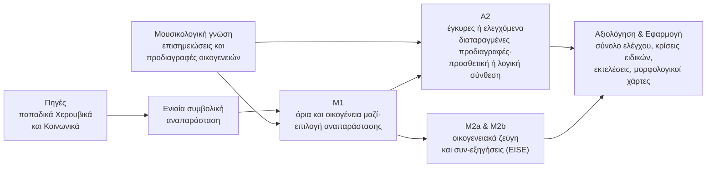

# Σύνοψη του ερευνητικού πυρήνα

<!-- language-switch:start -->
**Γλώσσα / Language:** **Ελληνικά** · [English](../../en/docs/start/research-summary.md)
<!-- language-switch:end -->

[Αρχική σελίδα](../../README.md) · [Συνοπτικό σχέδιο διδακτορικής έρευνας (PDF)](../../documents/core-research-plan.pdf) · [Πρώτη απογραφή](../research/corpus/README.md) · [ByzCorpus (υπό ανάπτυξη)](../research/byzcorpus/README.md) · [Αναλυτικός σχεδιασμός Μ1](../research/m1-selection-decision.md) · [Μ1-X](../research/m1-x-design.md) · [Α2](../research/a2-knowledge-design.md) · [Μ2a/Μ2b](../research/m2-eise-research-design.md)

Η σελίδα αυτή συνοψίζει τον κεντρικό σχεδιασμό της διδακτορικής έρευνας: την από κοινού οριοθέτηση και αναγνώριση μουσικών θέσεων (**Μ1**), τον πειραματικό έλεγχο της μουσικολογικής γνώσης (**Α2**) και τη μάθηση αναπαραστάσεων από οικογενειακές και ιστορικές σχέσεις (**Μ2a** και **Μ2b**, όπου η επιβεβαιωτική αξιολόγηση της Μ2b εξαρτάται από την επάρκεια των πηγών και των ηχογραφημένων εκτελέσεων). Το [αναλυτικό κείμενο της πρότασης (PDF)](../../documents/analytical-proposal.pdf) αναπτύσσει τη μουσικολογική θεμελίωση, ενώ οι επιμέρους τεχνικές σελίδες παρουσιάζουν τα πρωτόκολλα και τους συνθετικούς ελέγχους. Το τελικό μέγεθος του σώματος θα οριστικοποιηθεί μετά την ολοκλήρωση της πιλοτικής φάσης.

## Το μουσικό πρόβλημα

Η βυζαντινή ψαλτική είναι η μονόφωνη φωνητική τέχνη της ορθόδοξης λατρείας, η οποία μεταδόθηκε επί αιώνες μέσα από τη συνύπαρξη χειρόγραφης παράδοσης και προφορικής διδασκαλίας. Το μέλος της αρθρώνεται γύρω από ένα πλούσιο λεξιλόγιο παραδοσιακών μελικών τύπων, των **μουσικών θέσεων**: σχηματισμών μεταβλητής έκτασης που επανέρχονται από έργο σε έργο, προσαρμοσμένοι στον ήχο (το τροπικό πλαίσιο), στη βαθμίδα και στο ποιητικό κείμενο. Οι επιμέρους εμφανίσεις που μοιράζονται την ίδια δομική ταυτότητα συγκροτούν μια **οικογένεια** θέσεων.

Η ταυτότητα μιας θέσης, ωστόσο, δεν ταυτίζεται με την επιφανειακή μελωδική ομοιότητα. Παρόμοιες διαστηματικές πορείες μπορεί να ανήκουν σε διαφορετικές οικογένειες, η ίδια θέση μπορεί να αναπτύσσεται με διαφορετική έκταση και μορφή, ενώ τα όριά της μέσα στη συνεχή ροή του μέλους δεν είναι πάντοτε μονοσήμαντα. Για τον λόγο αυτόν, το μουσικολογικό ερώτημα της θέσης αποτελεί ταυτόχρονα ένα απαιτητικό πρόβλημα συμβολικής ανάκτησης μουσικής πληροφορίας (Symbolic MIR) και μηχανικής μάθησης: ένα υπολογιστικό μοντέλο καλείται να εντοπίζει μονάδες μεταβλητής έκτασης, να αναγνωρίζει την οικογένειά τους και να απέχει όταν τα διαθέσιμα τεκμήρια είναι αμφίσημα.

Η έρευνα προσεγγίζει το πρόβλημα αυτό με **μουσικολογικά καθοδηγούμενη μηχανική μάθηση**. Η μουσικολογική ανάλυση ορίζει τη δομική μονάδα και τα διαγνωστικά κριτήρια κάθε οικογένειας, ενώ η συνεισφορά αυτής της γνώσης —καθώς και ο τρόπος με τον οποίο ενσωματώνεται στο μοντέλο— ελέγχονται ως ρητές πειραματικές μεταβλητές. Το εμπειρικό πεδίο της μελέτης είναι τα παπαδικά Χερουβικά και Κοινωνικά της Νέας Μεθόδου, της αναλυτικής σημειογραφίας που καθιερώθηκε το 1814. Πρόκειται για αργά, εκτενώς μελισματικά μέλη της Θείας Λειτουργίας, όπου οι διαδοχικές θέσεις αναπτύσσονται συχνά μέσα στην ίδια συλλαβή και οι μορφολογικές αμφισημίες είναι ιδιαίτερα πυκνές.

**Συμπληρωματική υποδομή υπό ανάπτυξη.** Το [ByzCorpus](../research/byzcorpus/README.md) οργανώνει το μοντέλο συμβολικών δεδομένων, την τεκμηρίωση πηγών και δικαιωμάτων, καθώς και ένα διακριτό πιλοτικό πρωτόκολλο συμφωνίας ειδικών και στατιστικής κατάτμησης (NHPYLM). Η υποδομή αυτή αναπτύσσεται παράλληλα, διατηρώντας ακέραιο τον βασικό κορμό των μελετών Μ1, Α2 και Μ2.

## 1. Ερευνητικά ερωτήματα

> **Κεντρικό ερώτημα.** Πώς μπορεί ένα υπολογιστικό μοντέλο να προσδιορίσει τα όρια μιας μουσικής θέσης και να αναγνωρίσει την οικογένειά της μέσα στη συνεχή γραφή όταν μεταβάλλεται η πραγμάτωσή της, και τι προσφέρει σε αυτή την αναγνώριση η ρητή μουσικολογική γνώση;

Το κεντρικό ερώτημα εξειδικεύεται σε τρεις συμπληρωματικές μελέτες πάνω στο ίδιο σώμα έργων και στην ίδια συμβολική υποδομή:

**ΕΕ1 — Πώς πρέπει να αναπαρασταθεί η γραφή (Μ1).** Το μέλος μπορεί να κωδικοποιηθεί ως ακολουθία γραφικών σημείων, ατομικών μελωδικών γεγονότων ή ομάδων νευμάτων, εμπλουτισμένη κλιμακωτά με χρονική, τροπική και κειμενική πληροφορία. Ποια αναπαράσταση επιτρέπει την ακριβέστερη από κοινού εκτίμηση των ορίων και της οικογένειας μιας θέσης; Και σε ποιον βαθμό τα όρια αυτά εξηγούνται ήδη από γενικούς δείκτες μελωδικής κατάτμησης, χωρίς καμία γνώση των οικογενειών;

**Συμπληρωματική Μ1-X — Η οικογενειακή δομή και τα όρια.** Μετά τη βασική επιλογή αναπαράστασης, η αυτοτελής επέκταση εξετάζει τη συνεισφορά της οικογενειακά ενημερωμένης παραμετροποίησης σε σύγκριση με την ισχυρή C_fac, υπό κοινή εποπτεία και ισότιμη αναζήτηση. Οι δύο πιθανοτικές μορφές μπορούν υπό κατάλληλες παραμετροποιήσεις να περιγράφουν τις ίδιες κατανομές· αξιολογείται η επαγωγική προδιάθεση στην εκπαίδευση και στη γενίκευση. [Μεθοδολογικό πρωτόκολλο](../research/m1-x-design.md).

**ΕΕ2 — Πώς επιδρά η μουσικολογική γνώση (Α2).** Μια προδιαγραφή οικογένειας μπορεί να απαιτεί συγκεκριμένη κατάληξη, να δέχεται εναλλακτικές εσωτερικές αναπτύξεις και να αποκλείει ορισμένες τροπικές μεταβολές. Βελτιώνει η μουσικολογικά έγκυρη προδιαγραφή την αναγνώριση σε σύγκριση με μια ελεγχόμενα διαταραγμένη προδιαγραφή της ίδιας ακριβώς δομής; Και τι προσθέτει η λογικά δομημένη σύνθεση αυτών των κριτηρίων πέρα από την απλή προσθετική τους άθροιση;

**ΕΕ3 — Οικογενειακή ταυτότητα και διατήρηση της πραγμάτωσης (Μ2a).** Βοηθά η εποπτεία από ζεύγη εμφανίσεων της ίδιας οικογένειας σε διαφορετικά έργα την αναγνώριση σε νέο υλικό; Και πώς επιτυγχάνεται αυτό χωρίς να απαλείφονται από την αναπαράσταση τα ιδιαίτερα μελωδικά και χρονικά γνωρίσματα κάθε πραγμάτωσης;

**Ιστορικό ερώτημα — Παράλληλες εξηγήσεις ως εποπτεία (Μ2b / EISE).** Τι πρόσθετη πληροφορία προσφέρει η μάθηση από ανεξάρτητες ιστορικές εξηγήσεις του **ίδιου χωρίου** (συν-εξηγήσεις), σε σύγκριση με τη μάθηση από εμφανίσεις της ίδιας οικογένειας σε διαφορετικά έργα; Για την απάντηση του ερωτήματος, το προφίλ γραπτής διαφοροποίησης που μαθαίνει κάθε μοντέλο αντιπαραβάλλεται με τη χρονική μεταβλητότητα ηχογραφημένων εκτελέσεων από διαφορετικούς ψάλτες στις αντίστοιχες περιοχές της θέσης.

## 2. Προτεινόμενη προσέγγιση

### Δεδομένα και μουσικολογική τεκμηρίωση

Τα έργα κωδικοποιούνται από δομημένα αρχεία του Neanes, ανοικτού λογισμικού βυζαντινής σημειογραφίας. Ο δημόσιος κατάλογος *Papadic Formulae* της Ιεράς Μονής Αγίου Αντωνίου στην Αριζόνα (με θέσεις από 758 συνθέσεις) αξιοποιείται ως ευρετήριο για τον εντοπισμό υλικού και υποψήφιων οικογενειών· επειδή όμως δεν αποτελεί σώμα πλήρων έργων, η συστηματική απογραφή των πηγών και των αδειών χρήσης αποτελεί το πρώτο βήμα της έρευνας.

Η [προκαταρκτική απογραφή](../research/corpus/README.md) συγκεντρώνει δεδομένα από τη συγκριτική μελέτη του Gheorghiță (2010) για **42 κυριακάτικα Κοινωνικά** και **11 ιστορικά μελωδικά σχήματα**. Έχουν καταγραφεί **338 εγγραφές από 68 συγκριτικούς πίνακες**, οι οποίες κατευθύνουν τον εντοπισμό χωρίων για τη Μ1 και τη σύνταξη προδιαγραφών για την Α2. Μεταξύ αυτών, **35 εγγραφές περιλαμβάνουν παράλληλες εξηγήσεις των Γρηγορίου Πρωτοψάλτη και Χουρμουζίου Χαρτοφύλακα** στα οκτώ Κοινωνικά του Δανιήλ Πρωτοψάλτη. Η καταλληλότητα κάθε ζεύγους για τη Μ2b οριστικοποιείται ύστερα από την ταυτοποίηση των χειρογράφων, των φύλλων και των σχέσεων μετάδοσης.

Ο αρχικός στόχος είναι 40–60 πλήρη έργα και 8–12 οικογένειες θέσεων (με τουλάχιστον 25–30 εμφανίσεις ανά οικογένεια, κατανεμημένες σε τουλάχιστον πέντε ανεξάρτητα έργα). Τα όρια και η οικογενειακή ένταξη επισημειώνονται από ειδικούς, ενώ τουλάχιστον το 30% του υλικού —καθώς και όλες οι αμφίσημες περιπτώσεις— κρίνονται τυφλά από δεύτερο ειδικό. Η πιλοτική φάση των πρώτων έξι μηνών δοκιμάζει ολόκληρη τη ροή εργασίας σε τρεις οικογένειες (*παρακλητική*, *κύλισμα*, *πίασμα*), καταγράφοντας τον χρόνο επισημείωσης και τη συμφωνία των κριτών ώστε η τελική κλίμακα του σώματος να βασιστεί σε εμπειρικά δεδομένα.

### Συμβολική αναπαράσταση

Κάθε έργο μετατρέπεται σε ενιαία συμβολική ακολουθία ατομικών μελωδικών γεγονότων, συνδεδεμένη αμφίδρομα με τα νεύματα και το ακριβές χωρίο της πηγής, ώστε κάθε πρόβλεψη του μοντέλου να επαληθεύεται άμεσα πάνω στην παρτιτούρα. Η υποδομή μετατροπής ελέγχεται μέσω της ακριβούς ανακατασκευής της αρχικής γραφής από τη συμβολική μορφή.

Πάνω στον κοινό αυτόν άξονα, η Μ1 εξετάζει δώδεκα συνδυασμούς ($3\times 4$): τρεις μονάδες εισόδου (γραφικό σημείο, ατομικό μελωδικό γεγονός, ομάδα νευμάτων) σε συνδυασμό με τέσσερα σωρευτικά επίπεδα πληροφορίας — βασική σημειογραφία, χρονικές διάρκειες, τροπικές ενδείξεις (ήχος, μαρτυρίες, φθορές) και κειμενικά γνωρίσματα (συλλαβή, λέξη, τόνος). Η βέλτιστη αναπαράσταση που αναδεικνύεται στη Μ1 αποτελεί την κοινή είσοδο για την Α2 και τη Μ2.

### Μοντελοποίηση

Στη **Μ1**, ένας νευρωνικός κωδικοποιητής πλαισιώνει τα μελωδικά γεγονότα και ένα ημι-Μαρκοβιανό μοντέλο τμημάτων (joint semi-CRF) βαθμολογεί από κοινού την αρχή, το τέλος και την οικογένεια κάθε υποψήφιας θέσης, συνυπολογίζοντας στην εκπαίδευση τις εναλλακτικές αποδεκτές οριοθετήσεις. Η προσέγγιση αντιπαραβάλλεται με διαδοχικά μοντέλα δύο σταδίων (pipelines που οριοθετούν πρώτα και ταξινομούν έπειτα), με αυτοπαλίνδρομο Transformer γεγονότων, με αλγορίθμους τοπικών ορίων και μελωδικής παραλληλίας (LBDM, IDyOM) και με μη εποπτευόμενη στατιστική κατάτμηση Pitman–Yor (NHPYLM). Ο κανόνας επιλογής J προκρίνει την αναπαράσταση με την υψηλότερη επίδοση πλήρους αναγνώρισης, υπό προκαθορισμένο κατώφλι ανάκλησης γνωστών οικογενειών. [Μεθοδολογία και συνθετικοί έλεγχοι Μ1](../research/m1-selection-decision.md)

Η **Α2** διατηρεί σταθερή την εκπαιδευμένη νευρωνική βάση της Μ1 εντός κάθε επανάληψης και εξετάζει τις προδιαγραφές των οικογενειών σε παραγοντικό πείραμα $2\times 2$: έγκυρες έναντι ελεγχόμενα διαταραγμένων προδιαγραφών, και απλή προσθετική έναντι λογικά δομημένης βαθμολόγησης των ίδιων διαγνωστικών εννοιών (όπως η κατάληξη, η εσωτερική ανάπτυξη και οι τροπικές μεταβολές). Οι διαταραχές διατηρούν τον λογικό σκελετό και τις επικαλύψεις των προδιαγραφών, με αντιστοίχιση των συχνοτήτων εμφάνισης και ελλείψεων των εννοιών εντός της προδηλωμένης ανοχής. [Σχεδιασμός Α2](../research/a2-knowledge-design.md) · [Τεχνικό πρωτόκολλο και συνθετικοί έλεγχοι](../appendices/k.md)

Η **Μ2a** αντιπαραβάλλει μια μη νευρωνική συμβολική βάση (Β0) με δύο νευρωνικές συνθήκες: το μοντέλο βάσης (Β1), που εκπαιδεύεται στην αναγνώριση θέσεων και στην ανακατασκευή αποκρυμμένων γνωρισμάτων, και τη συνθήκη οικογενειακής εποπτείας (Β2), που προσθέτει σχέσεις μεταξύ εμφανίσεων της ίδιας οικογένειας από διαφορετικά έργα. Το κέρδος αναγνώρισης συνεξετάζεται με την ικανότητα διατήρησης της πληροφορίας κάθε πραγμάτωσης (μέσω ανακατασκευής και linear probing).

Η **Μ2b** συγκρίνει τον κωδικοποιητή **EISE** (Exegesis-Invariant Segmental Encoder), όπου τα θετικά ζεύγη προέρχονται από επαληθευμένες συν-εξηγήσεις του ίδιου ιστορικού χωρίου, με ένα αντίστοιχο μοντέλο που εκπαιδεύεται σε ζεύγη της ίδιας οικογένειας από διαφορετικά έργα, υπό την ίδια αρχιτεκτονική, αρχικοποίηση και υπολογιστικούς πόρους. [Αναλυτικός σχεδιασμός Μ2a και Μ2b](../research/m2-eise-research-design.md)

### Αξιολόγηση

Για να αποτραπεί κάθε διαρροή πληροφορίας (data leakage), συγγενή έργα, αντίγραφα και συν-εξηγήσεις ομαδοποιούνται πριν από τον διαχωρισμό σε σύνολα εκπαίδευσης, ανάπτυξης και ελέγχου. Ένα αποκλειστικά δεσμευμένο σύνολο τελικού ελέγχου (held-out test set) παραμένει σφραγισμένο έως ότου οριστικοποιηθούν όλες οι μεθοδολογικές επιλογές.

Στη Μ1 η επίδοση αποτιμάται με τον δείκτη $F_1$ πλήρους αναγνώρισης (ταυτόχρονη συμφωνία αποδεκτών ορίων και οικογένειας), ενώ στην Α2 και τη Μ2a με τη μέση ακρίβεια κατάταξης ανά οικογένεια (macro AP) και τους ελέγχους διατήρησης των ιδιαίτερων γνωρισμάτων κάθε πραγμάτωσης. Παράλληλα, ανεξάρτητοι ειδικοί αξιολογούν τυφλά τις προβλέψεις και τις οριακές περιπτώσεις (Μ3a), και το τελικό μοντέλο εφαρμόζεται σε πλήρη έργα εκτός εκπαίδευσης για την παραγωγή μορφολογικών χαρτών (Μ5-min).

Στη **Μ2b**, η ανεξάρτητη αξιολόγηση συγκρίνει το προφίλ των εσωτερικών περιοχών της θέσης όπου αποκλίνουν οι ιστορικές εξηγήσεις με τη χρονική μεταβλητότητα ηχογραφημένων εκτελέσεων διαφορετικών ψαλτών (Μ4-min), ύστερα από κανονικοποίηση του χρονισμού. Η απογραφή των συν-εξηγήσεων παραμένει σε κάθε περίπτωση αυτοτελές μουσικολογικό παραδοτέο.

### Η προσέγγιση συνοπτικά

## 3. Αναμενόμενη συνεισφορά

### Για το συμβολικό MIR και τη μηχανική μάθηση

Η διατριβή τυποποιεί ένα νέο, αναπαραγώγιμο πρόβλημα συμβολικού MIR: την από κοινού οριοθέτηση και αναγνώριση μελωδικών μονάδων μεταβλητής έκτασης μέσα σε συνεχή μελισματική γραφή, με πολλαπλές αποδεκτές οριοθετήσεις, άγνωστες οικογένειες και ρητή δυνατότητα αποχής, συνοδευόμενο από ελεγμένο σώμα αναφοράς και μοντέλα αναφοράς (baselines).

Παράλληλα, η μελέτη Α2 εισάγει έναν αυστηρά ελεγχόμενο πειραματικό σχεδιασμό για την αποτίμηση της γνώσης του πεδίου στη μηχανική μάθηση, απομονώνοντας την επίδραση της επιστημονικής εγκυρότητας των κριτηρίων από την επίδραση της λογικής τους σύνθεσης. Τέλος, οι μελέτες Μ2a και Μ2b εξετάζουν πώς ένα μοντέλο αναπαραστάσεων μπορεί να ευθυγραμμίζει την κοινή ταυτότητα μιας μουσικής μονάδας διατηρώντας παράλληλα την εσωτερική της παραλλαγή.

### Για τη βυζαντινή μουσικολογία

Η έρευνα διαμορφώνει μια λειτουργική και εμπειρικά ελέγξιμη οντολογία της μουσικής θέσης, τεκμηριώνοντας τα κριτήρια ταυτότητας, τις αποδεκτές πραγματώσεις και τις οριακές περιπτώσεις ανά ήχο και είδος. Όπου οι εμφανίσεις των πηγών αποκλίνουν από μια θεωρητική προδιαγραφή, η απόκλιση αυτή καταγράφεται ως ουσιαστικό μουσικολογικό εύρημα και όχι ως απλό σφάλμα ταξινόμησης. Επιπλέον, το συστηματικό μητρώο των παράλληλων ιστορικών εξηγήσεων και οι μορφολογικοί χάρτες πλήρων έργων προσφέρουν νέους πόρους για τη συγκριτική μελέτη της μελοποιίας και της εξηγητικής παράδοσης.

### Παραδοτέα και ερευνητικοί πόροι

- ανοικτή αλυσίδα μετατροπής από αρχεία Neanes σε ενιαία συμβολική αναπαράσταση, με αυτόματο έλεγχο ανακατασκευής·
- επισημειωμένο σώμα αναφοράς και πρωτόκολλο επισημείωσης (δημοσιευμένα σύμφωνα με τις άδειες των πηγών)·
- τεκμηριωμένο μητρώο προδιαγραφών οικογενειών θέσεων και ιστορικών συν-εξηγήσεων·
- ανοικτός κώδικας, εκπαιδευμένα μοντέλα και αναπαραγώγιμοι πειραματικοί έλεγχοι·
- μορφολογικοί χάρτες οργάνωσης θέσεων σε πλήρη παπαδικά έργα·
- δημοσιεύσεις σε διεθνή συνέδρια και περιοδικά MIR / Μηχανικής Μάθησης καθώς και στη μουσικολογική βιβλιογραφία.

---

[Αρχική σελίδα](../../README.md) · [Συνοπτικό σχέδιο διδακτορικής έρευνας (PDF)](../../documents/core-research-plan.pdf) · [Παρατηρήσεις και επιστημονική συζήτηση](../review/feedback.md)
