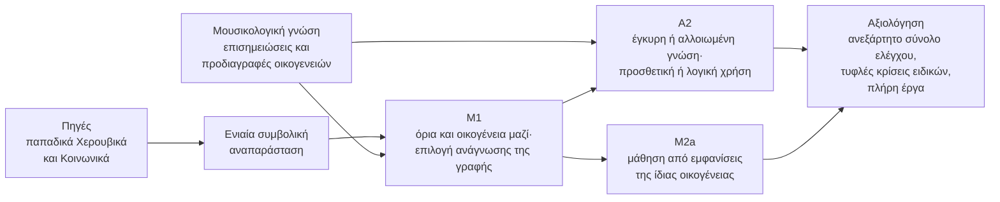

# Σύνοψη του ερευνητικού πυρήνα

<!-- language-switch:start -->
**Γλώσσα / Language:** **Ελληνικά** · [English](../../en/docs/start/research-summary.md)
<!-- language-switch:end -->

[Αρχική σελίδα](../../README.md) · [Συνοπτικό σχέδιο διδακτορικής έρευνας (PDF)](../../documents/core-research-plan.pdf) · [Μ1](../research/m1-selection-decision.md) · [Α2](../research/a2-knowledge-design.md) · [Μ2](../research/m2-eise-research-design.md)

Η σελίδα παρουσιάζει σε τρεις ενότητες τον βασικό πυρήνα της πρότασης, δηλαδή τις μελέτες Μ1, Α2 και Μ2a: τα ερευνητικά ερωτήματα, την προτεινόμενη προσέγγιση και την αναμενόμενη συνεισφορά. Οι τεχνικές προδιαγραφές βρίσκονται στις αναλυτικές σελίδες κάθε μελέτης και στα παραρτήματα. Οι αριθμητικές τιμές τους είναι αρχικές προτάσεις και θα καθοριστούν μαζί με την επιβλέπουσα ομάδα μετά την πιλοτική μελέτη.

## Το μουσικό πρόβλημα

Η βυζαντινή ψαλτική είναι μονόφωνη φωνητική μουσική της ορθόδοξης λατρείας, που μεταδόθηκε επί αιώνες με τη συνύπαρξη γραπτής παράδοσης και προφορικής διδασκαλίας. Στο μέλος της αναγνωρίζεται ένα λεξιλόγιο παραδοσιακών σχηματισμών, των **μουσικών θέσεων**: μελωδικών σχηματισμών μεταβλητής έκτασης που επανέρχονται από έργο σε έργο, προσαρμοσμένοι στον ήχο (το τροπικό πλαίσιο του μέλους), στη βαθμίδα και στο ποιητικό κείμενο. Οι εμφανίσεις που μοιράζονται την ίδια ταυτότητα συγκροτούν μια **οικογένεια** θέσεων.

Η ταυτότητα μιας θέσης δεν συμπίπτει με την επιφανειακή ομοιότητα. Συγγενικές μελωδικές πορείες μπορεί να ανήκουν σε διαφορετικές οικογένειες, η ίδια θέση αναπτύσσεται με διαφορετική έκταση και μορφή, και τα όριά της μέσα στη συνεχή γραφή δεν είναι πάντοτε μονοσήμαντα. Γι’ αυτό το μουσικολογικό ερώτημα είναι συγχρόνως απαιτητικό πρόβλημα συμβολικής ανάκτησης μουσικής πληροφορίας (Music Information Retrieval, MIR) και μηχανικής μάθησης: ένα σύστημα πρέπει να εντοπίζει μονάδες μεταβλητής έκτασης, να αναγνωρίζει την οικογένειά τους και να απέχει όταν τα τεκμήρια δεν επαρκούν.

Η πρόταση προσεγγίζει το πρόβλημα με **μουσικολογικά ενημερωμένη μηχανική μάθηση**. Η μουσικολογία ορίζει τη μονάδα ανάλυσης και τα κριτήρια κάθε οικογένειας. Το πόσο αξίζει αυτή η γνώση, και ο τρόπος με τον οποίο τη χρησιμοποιεί το μοντέλο, εξετάζονται ως ελεγχόμενες πειραματικές μεταβλητές. Το μουσικό πεδίο είναι τα παπαδικά Χερουβικά και Κοινωνικά της Νέας Μεθόδου, του αναλυτικού συστήματος γραφής που καθιερώθηκε το 1814. Είναι αργά, μελισματικά μέλη της Θείας Λειτουργίας, όπου οι θέσεις είναι εκτενείς και οι δύσκολες περιπτώσεις συχνές.

## 1. Ερευνητικά ερωτήματα

> **Κεντρικό ερώτημα.** Πώς αναγνωρίζεται μέσα στη συνεχή γραφή μια μουσική θέση και η οικογένειά της όταν η πραγμάτωση μεταβάλλεται, και τι προσφέρει σε αυτή την αναγνώριση η μουσικολογική γνώση που ορίζει την οικογένεια;

Το ερώτημα αναλύεται σε τρεις μελέτες, που χρησιμοποιούν το ίδιο σώμα έργων και την ίδια συμβολική υποδομή.

**ΕΕ1 — Πώς πρέπει να διαβαστεί η γραφή (Μ1).** Μια θέση μπορεί να διαβαστεί ως σειρά γραφικών σημείων, ως σειρά στοιχειωδών μελωδικών κινήσεων ή ως σειρά νευματικών ομάδων, με ή χωρίς πληροφορία για τον χρόνο, τον ήχο και το κείμενο. Ποια ανάγνωση επιτρέπει να εκτιμώνται από κοινού τα όρια και η οικογένεια μιας θέσης; Και πόσα από τα όρια εξηγούν ήδη οι γενικές ενδείξεις μελωδικής κατάτμησης, που δεν γνωρίζουν τίποτα για τις οικογένειες;

**ΕΕ2 — Τι προσφέρει η μουσικολογική γνώση (Α2).** Μια προδιαγραφή οικογένειας μπορεί να απαιτεί ορισμένη κατάληξη, να επιτρέπει μία από περισσότερες εσωτερικές αναπτύξεις και να αποκλείει μια τροπική μεταβολή. Βελτιώνει η έγκυρη προδιαγραφή την αναγνώριση σε σχέση με μια ελεγχόμενα αλλοιωμένη προδιαγραφή της ίδιας μορφής; Και προσθέτει κάτι η λογική σύνθεση αυτών των σχέσεων πέρα από την απλή, προσθετική χρήση τους;

**ΕΕ3 — Ταυτότητα και πραγμάτωση (Μ2a).** Βοηθά η μάθηση από ζεύγη πραγματικών εμφανίσεων της ίδιας οικογένειας, σε διαφορετικά έργα, να αναγνωρίζεται η οικογένεια; Και το πετυχαίνει χωρίς να χάνεται η μουσικά σημαντική πληροφορία της συγκεκριμένης πραγμάτωσης;

Ο πυρήνας είναι σκόπιμα περιορισμένος, ώστε να είναι εφικτός μέσα στη διατριβή. Ένα ιστορικό σκέλος της Μ2 (Μ2b) αξιοποιεί, όπου οι πηγές το επιτρέπουν, τις **εξηγήσεις**: ιστορικές αποδόσεις του ίδιου παλαιότερου χωρίου στη Νέα Μέθοδο, όπως εκείνες του Γρηγορίου Πρωτοψάλτη και του Χουρμουζίου Χαρτοφύλακος. Το σκέλος αυτό και οι υπόλοιπες επεκτάσεις ενεργοποιούνται μόνο αν πληρούνται προκαθορισμένα κριτήρια επάρκειας δεδομένων και πηγών.

## 2. Προτεινόμενη προσέγγιση

### Δεδομένα

Τα έργα κωδικοποιούνται από αρχεία του Neanes, ανοικτού λογισμικού γραφής της βυζαντινής σημειογραφίας. Ο δημόσιος κατάλογος *Papadic Formulae* της Ιεράς Μονής Αγίου Αντωνίου στην Αριζόνα, με θέσεις από 758 συνθέσεις, χρησιμεύει ως οδηγός για τον εντοπισμό υλικού και για τις υποψήφιες οικογένειες. Δεν είναι όμως έτοιμο σώμα πλήρων έργων, και γι’ αυτό η απογραφή των διαθέσιμων έργων, πηγών και αδειών είναι το πρώτο βήμα της εργασίας.

Ο στόχος είναι 40–60 πλήρη έργα με 8–12 οικογένειες και τουλάχιστον 25–30 εμφανίσεις ανά οικογένεια από τουλάχιστον πέντε ανεξάρτητα έργα. Τα όρια και η οικογένεια κάθε εμφάνισης επισημειώνονται από ειδικούς, και τουλάχιστον το 30% των εμφανίσεων, μαζί με όλες τις δύσκολες περιπτώσεις, επισημειώνεται τυφλά από δεύτερο ειδικό. Η πιλοτική μελέτη των πρώτων έξι μηνών ελέγχει ολόκληρη την αλυσίδα σε τρεις οικογένειες, την παρακλητική, το κύλισμα και το πίασμα, με αφετηρία τις συγκρίσεις του Gheorghiță σε Κοινωνικά. Μετρά επίσης τον χρόνο επισημείωσης και τη συμφωνία των ειδικών, ώστε η κλίμακα του σώματος να αποφασιστεί με βάση μετρήσεις.

### Αναπαράσταση της μουσικής

Κάθε έργο μετατρέπεται σε μια ενιαία συμβολική μορφή: μια ακολουθία ατομικών μελωδικών γεγονότων, συνδεδεμένη αμφίδρομα με τα γραφικά σημεία, ώστε κάθε αυτόματη απόφαση να μπορεί να ελεγχθεί στο χωρίο που την παρήγαγε. Υπάρχει ήδη αρχική υποδομή μετατροπής. Θα ελεγχθεί σε πραγματικά έργα με επαναφορά της αρχικής γραφής από τη συμβολική μορφή.

Πάνω σε αυτή τη μορφή η Μ1 συγκρίνει δώδεκα αναγνώσεις της γραφής. Συνδυάζει τρεις μονάδες εισόδου (γραφικό σημείο, ατομικό μελωδικό γεγονός, νευματική ομάδα) με τέσσερα σωρευτικά στρώματα πληροφορίας: σημειογραφικό, χρονικό, τροπικό (ήχος, μαρτυρίες, φθορές) και κειμενικό (συλλαβή, λέξη, τόνος). Η ανάγνωση που επιλέγεται στη Μ1 γίνεται η κοινή είσοδος της Α2 και της Μ2a.

### Μοντέλα

Η **Μ1** χρησιμοποιεί ως κύριο μοντέλο ένα semi-CRF, πιθανοτικό μοντέλο που βαθμολογεί ολόκληρα υποψήφια τμήματα και όχι μεμονωμένα σημεία. Έτσι αποφασίζει μαζί πού αρχίζει και πού τελειώνει μια θέση και σε ποια οικογένεια ανήκει. Το μοντέλο συγκρίνεται με λύσεις δύο σταδίων, που βρίσκουν πρώτα τα όρια και ύστερα την οικογένεια. Συγκρίνεται επίσης με έναν Transformer σε επίπεδο γεγονότων, με γενικές ενδείξεις κατάτμησης (τοπικές ασυνέχειες κατά το LBDM, απροσδοκησία κατά το IDyOM, επανάληψη μελωδικών δομών) και με μη εποπτευόμενη στατιστική κατάτμηση.

Η **Α2** κρατά σταθερό το μοντέλο της Μ1 και προσθέτει μόνο τη μουσικολογική γνώση. Οι προδιαγραφές των οικογενειών γράφονται ως λογικοί κανόνες πάνω σε μουσικές έννοιες, π.χ. κατάληξη, εσωτερική ανάπτυξη ή τροπική μεταβολή, που εξάγονται αυτόματα από τη γραφή. Τέσσερις συνθήκες διασταυρώνουν την έγκυρη ή ελεγχόμενα αλλοιωμένη προδιαγραφή με την προσθετική ή τη λογική χρήση της. Οι αλλοιωμένες προδιαγραφές διατηρούν τη μορφή, τις συχνότητες και τις επικαλύψεις των έγκυρων, ώστε η σύγκριση να αφορά μόνο το περιεχόμενο. Δύο ισχυρά μοντέλα αναφοράς μαθαίνουν από τις ίδιες έννοιες χωρίς προδιαγραφή.

Η **Μ2a** συγκρίνει τρεις κλιμακωτές συνθήκες. Η πρώτη είναι το συμβολικό μοντέλο της Μ1, χωρίς μάθηση αναπαράστασης. Η δεύτερη προσθέτει νευρωνικό κωδικοποιητή, που μαθαίνει από τις ετικέτες οικογένειας και από την ανακατασκευή της πραγμάτωσης. Η τρίτη προσθέτει έναν όρο που φέρνει κοντά τις αναπαραστάσεις εμφανίσεων της ίδιας οικογένειας από διαφορετικά έργα. Ο κωδικοποιητής κρατά χωριστά την ταυτότητα της οικογένειας και την πληροφορία της συγκεκριμένης πραγμάτωσης, ώστε να ελέγχεται αν η καλύτερη αναγνώριση επιτυγχάνεται εις βάρος της παραλλαγής.

### Αξιολόγηση

Τα έργα που μοιράζονται ιστορικό υλικό, π.χ. αντίγραφα ή αποδόσεις του ίδιου χωρίου, ανήκουν πάντα στο ίδιο τμήμα των δεδομένων. Έτσι η επίδοση δεν αυξάνεται τεχνητά από σχεδόν ίδιο υλικό στην εκπαίδευση και στον έλεγχο. Ένα ανεξάρτητο σύνολο ελέγχου ορίζεται από νωρίς και ανοίγει μία φορά, αφού έχουν αποφασιστεί όλες οι επιλογές.

Η Μ1 μετρά πόσες εμφανίσεις βρίσκονται με αποδεκτά όρια και σωστή οικογένεια. Η Α2 και η Μ2a μετρούν πόσο καλά κατατάσσει το μοντέλο τις πραγματικές εμφανίσεις κάθε οικογένειας, με τη μέση ακρίβεια (average precision). Η Μ2a μετρά επιπλέον πόση πληροφορία της πραγμάτωσης διατηρείται στις αναπαραστάσεις.

Ανεξάρτητοι ειδικοί κρίνουν τυφλά, χωρίς να γνωρίζουν την πηγή των προτάσεων, τις αναγνωρίσεις και τις δύσκολες περιπτώσεις (Μ3a). Τέλος, το τελικό μοντέλο εφαρμόζεται σε πλήρη έργα εκτός εκπαίδευσης για χάρτες της οργάνωσης των θέσεων (Μ5-min). Για τις κύριες συγκρίσεις της Α2 ορίζεται εκ των προτέρων στατιστικός έλεγχος. Αν τα δεδομένα δεν επαρκούν, τα αποτελέσματα αναφέρονται ως εκτιμήσεις με την αβεβαιότητά τους.

### Η προσέγγιση με μια ματιά

## 3. Αναμενόμενη συνεισφορά

### Για το MIR και τη μηχανική μάθηση

Η διατριβή ορίζει ένα νέο, τυποποιημένο πρόβλημα συμβολικού MIR: την κοινή οριοθέτηση και αναγνώριση μελωδικών τύπων μέσα στη συνεχή γραφή, με περισσότερες αποδεκτές οριοθετήσεις, άγνωστες οικογένειες και δυνατότητα αποχής. Το πρόβλημα συνοδεύεται από σώμα αξιολόγησης και μοντέλα αναφοράς.

Η Α2 προσφέρει έναν ελεγχόμενο τρόπο να μετρηθεί τι προσθέτει η γνώση των ειδικών σε ένα μοντέλο μηχανικής μάθησης. Διακρίνει την αξία του περιεχομένου της γνώσης από την αξία του τρόπου με τον οποίο χρησιμοποιείται, μέσω σύγκρισης με αλλοιωμένη γνώση ίδιας μορφής. Ο σχεδιασμός μεταφέρεται σε κάθε πεδίο όπου οι ειδικοί διατυπώνουν ελέγξιμα κριτήρια κατηγοριών.

Η Μ2a εξετάζει πώς μαθαίνεται η ταυτότητα μιας κατηγορίας χωρίς να σβήνεται η εσωτερική της παραλλαγή, ζήτημα κεντρικό για κάθε μουσική παράδοση που οργανώνεται σε μελωδικούς τύπους.

### Για τη βυζαντινή μουσικολογία

Η εργασία διατυπώνει ρητές, ελέγξιμες προδιαγραφές οικογενειών θέσεων και τεκμηριώνει ποιες εμφανίσεις ανήκουν στην ίδια θέση, ανά ήχο, είδος και μορφή. Καταγράφει πού συγκεντρώνεται η γραπτή παραλλαγή κάθε οικογένειας και συγκεντρώνει τις δύσκολες περιπτώσεις με πλήρεις σημειογραφικές παραπομπές. Οι προδιαγραφές ελέγχονται εμπειρικά. Όπου τα δεδομένα διαφωνούν με μια προδιαγραφή, η διαφωνία είναι μουσικολογικό εύρημα και όχι απλό σφάλμα του μοντέλου. Η απογραφή των ιστορικών εξηγήσεων του ίδιου χωρίου είναι αυτοτελές παραδοτέο, χρήσιμο και πέρα από τη διατριβή.

### Συγκεκριμένα αποτελέσματα και εργαλεία

- ανοικτή αλυσίδα μετατροπής από αρχεία Neanes σε ενιαία συμβολική μορφή, με έλεγχο ανακατασκευής·
- επισημειωμένο σώμα αξιολόγησης με πρωτόκολλο επισημείωσης, που δημοσιεύεται όπου το επιτρέπουν οι άδειες·
- μητρώο ελεγμένων προδιαγραφών οικογενειών θέσεων·
- εκπαιδευμένα μοντέλα, κώδικας και μοντέλα αναφοράς για το νέο πρόβλημα·
- χάρτες της οργάνωσης των θέσεων σε πλήρη έργα·
- δημοσιεύσεις σε συνέδρια και περιοδικά MIR και σε μουσικολογικά περιοδικά.

---

[Αρχική σελίδα](../../README.md) · [Συνοπτικό σχέδιο διδακτορικής έρευνας (PDF)](../../documents/core-research-plan.pdf) · [Παρατηρήσεις και επιστημονική συζήτηση](../review/feedback.md)
