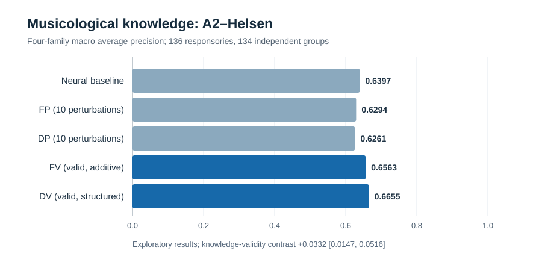
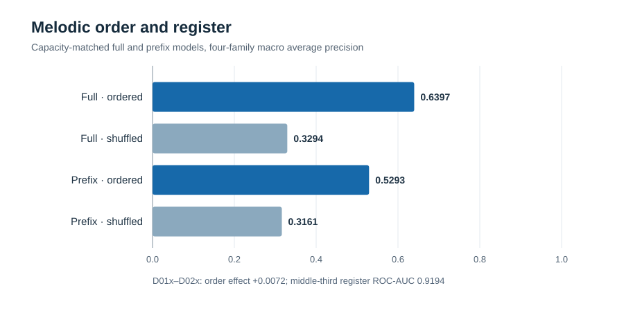

# Musicological Knowledge and Melodic-Family Recognition: The A2–Helsen Experimental Study

<!-- language-switch:start -->
**Language / Γλώσσα:** [Ελληνικά](../../../../../docs/research/byzcorpus/a2-helsen/README.md) · **English**
<!-- language-switch:end -->

[ByzCorpus](../README.md) · [Extended NHPYLM–Helsen experiments](../nhpylm-helsen-extended-experiments.md) · [A2 research design](../../a2-knowledge-design.md) · [A2 technical protocol (Greek)](../../../../../docs/appendices/k.md)

**Scope:** computational recognition of melodic-formula families and controlled evaluation of musicologically documented knowledge. **Status:** completed exploratory computational experiments with grouped internal evaluation; independent musicological adjudication and external confirmation are separate subsequent stages.

## 1. Research question

This study examines (a) the predictive contribution of valid musicological relationships to melodic-family recognition and (b) the incremental value of organising those relationships as explicit logical constraints. It combines Helsen's (2008) primary musicological analysis, data-derived melodic descriptors, and neural modelling of complete melodic elements.

The study is a **Gregorian comparative implementation of the A2 design**. The principal doctoral application addresses families of Byzantine melodic positions in ByzCorpus. It complements the [NHPYLM–Helsen experiments](../nhpylm-helsen-extended-experiments.md), which address statistical segmentation and its relationship to complete musicological elements.

## 2. Corpus and evaluation

The dataset contains **136 mode-1 responsories**, **134 independent melodic groups**, **19,838 pitch events**, and **1,037 annotated complete melodic elements** from Paris, BnF, lat. 12044. Analytical labels derive from Helsen's dissertation appendix; pitch sequences were aligned with CantusCorpus v0.2. The evaluation uses three folds with disjoint melodic groups across training, development and test partitions.

The source annotations contain 367 distinct codes: 69 named element types account for 660 occurrences, while 298 additional descriptive codes account for 377 occurrences. The 134 groups are **melodic split groups**, not family-label categories. The initial controlled comparison focuses on `D01x`, `D02x`, `H01i`, and `c01`, which have sufficient coverage across the three folds.

`D01x` and `D02x` both function as final elements and resolve to D. Helsen's Table 59 (2008, p. 289) identifies the shared cadential figure `F–E–F–E–D`, making this pair a focused test of internal melodic identity. The [earlier 123-responsory benchmark](../segmentation-and-family-recognition/05-gregorian-benchmark.md) uses a different sample and remains a distinct experiment.

## 3. Method

### 3.1 Source-based and learned specifications

The `V_source` family specifications use Helsen's written analysis and notated examples. Each specification comprises required relations (`R`), alternative combinations (`A`), and exclusions (`E`). A separate exploratory `V_train` track uses additional discriminative features selected from the training groups of each fold.

Concept values are represented as observed present, observed absent, or unknown (`1/0/?`). The structured operator evaluates the complete family rule and penalises documented violations. Ten controlled perturbed specifications per fold are generated using constrained permutations, with linear-programming certificates establishing non-equivalence over the specified model class.

### 3.2 Factorial comparison

| | Flat additive composition F | Structured composition D |
|---|---|---|
| Valid knowledge V | FV | DV |
| Controlled perturbation P | FP | DP |

The additive and structured conditions operate on matched frozen neural backbones; D additionally applies a logical-violation penalty. The primary validity contrast is

```math
\Delta_{\mathrm{know}}=\frac{(DV-DP)+(FV-FP)}{2},
```

with `DV − FV` assessing the additional logical effect. The A2 protocol uses **macro Average Precision on accepted element spans** as its principal metric. Exact span-and-family semi-CRF performance is reported as a distinct supplementary outcome. In the Gregorian experiment, knowledge heads were fitted on accepted element spans, while full semi-CRF decoding was evaluated separately on a common set of stored candidate-span scores. The principal A2 protocol additionally specifies full-sequence likelihood training and a strong `B★` comparator.

Neural backbones use matched data and five repetitions per fold; further analyses compare capacity-matched ordered and shuffled architectures and masking schemes that preserve information about removed regions.

## 4. Results

### 4.1 Knowledge validity



| `V_source` condition | Macro AP, four target families |
|---|---:|
| Neural baseline | 0.6397 |
| FP, mean over ten perturbations | 0.6294 |
| DP, mean over ten perturbations | 0.6261 |
| FV | 0.6563 |
| DV | **0.6655** |

The primary knowledge-validity contrast is **+0.0332 macro AP**, with a grouped jackknife 95% interval of **[+0.0147, +0.0516]**. The additional logical effect on the same classification task is **+0.0093**, with an interval of **[−0.0030, +0.0216]**.

### 4.2 Full-span semi-CRF decoding

Target-family exact span-and-family F1 increases from **0.4517 (FV)** to **0.4781 (DV)**: **+0.0264**, with a 95% interval of **[+0.0083, +0.0444]**. Overall joint F1 across all categories changes from **0.2282** to **0.2290**. The structured knowledge term therefore has its most visible effect on selective retrieval of the four target families.

### 4.3 Melodic order and register



A parameter-matched comparison between an ordered BiGRU and a BiGRU trained on shuffled pitch orders yields **+0.3103 macro AP** for four-family recognition, with a 95% interval of **[+0.2406, +0.3800]**. For the `D01x–D02x` pair, the corresponding effect is **+0.0072**, with interval **[−0.0361, +0.0505]**. A one-dimensional index based on the mean register of the middle third attains **ROC-AUC 0.9194** for this pair.

Gap-preserving masking experiments additionally demonstrate that joining pitches across a removed melodic region had inflated earlier estimates of that region's importance. The results distinguish the contribution of ordered melodic events to the broader four-family task from the strong discriminative role of register in the specific `D01x–D02x` comparison.

### 4.4 Variation and expert review

The initial `V_source` specification produces **19 logical violations among 139 genuine occurrences** of the four families: **9/31 `D02x`**, **7/43 `D01x`**, **3/40 `H01i`**, and **0/25 `c01`**. A blinded expert-review protocol covers these 19 cases and six reference cases. Expert judgments remain pending, and specification revisions will follow the primary-source evidence and the independent review.

## 5. Evidential status and reproducibility

The results form an **exploratory study on the same 136 responsories**, evaluated using three grouped folds. Family selection and several diagnostic decisions developed during the research sequence. External confirmation is designed around new independent melodic sources, frozen specifications, and prospective calibration of the statistical procedure.

The [aggregate results table](../../../../../docs/research/byzcorpus/a2-helsen/results-summary.csv) reports the public numerical summaries. Raw melodic sequences, Helsen's annotations, work-level identities, private expert forms, and neural checkpoints are maintained separately in accordance with the respective source rights and evaluation protocol. Re-training requires authorised access to the original materials and annotations.

## 6. Transfer to ByzCorpus

The study provides an executable framework for testing **diagnostic musicological relations**, **permissible within-family variation**, and **structured selection of complete musical elements**. Transfer to Byzantine melodic positions requires source-specific neumatic representations, independently annotated positions, and documented musicological family specifications. The principal A2 study continues to follow the [established technical protocol](../../../../../docs/appendices/k.md).

## References

[Helsen (2008) bibliography entry](../../../../../docs/bibliography/entries/b143.md) · [Cambouropoulos (2001b) on category formation](../../../../../docs/bibliography/entries/b139.md) · [van Kranenburg et al. (2013) on local and global features](../../../../../docs/bibliography/entries/b144.md).

- Helsen, K. E. (2008). *The Great Responsories of the Divine Office: Aspects of Structure and Transmission*. [DOI](https://doi.org/10.5283/epub.10769).
- Cambouropoulos, E. (2001). *Melodic Cue Abstraction, Similarity, and Category Formation: A Formal Model*. *Music Perception*, 18(3), 347–370.
- Lanz, V., & Hajič, J., Jr. (2025). *Gregorian Melody, Modality, and Memory: Segmenting Chant with Bayesian Nonparametrics*. [Zenodo](https://doi.org/10.5281/zenodo.17811449).
- [Annotated bibliography of the Gregorian experimental series](../nhpylm-helsen-bibliography.md).