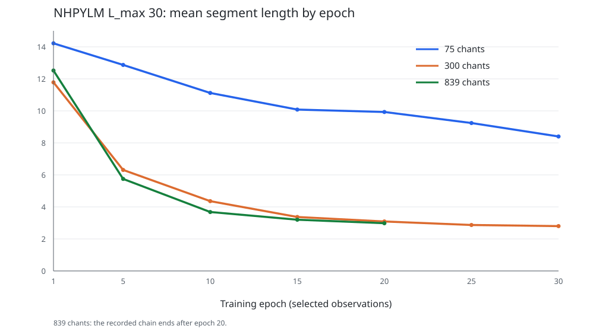

# Melodic Segmentation and the Scale of Musicological Units: Experimental Evaluation of NHPYLM, Supervised Neural Models, and Semi-Markov Architectures

**Extended ByzCorpus research study · Comparative evaluation on Gregorian chant and transfer design for M1-X**

---

**Publication status:** Technical research report, 18 November 2026. The report brings together completed experiments on Gregorian chant and the specifications for subsequent evaluation on Byzantine chant. Each experimental series retains its own dataset partitions and evaluation metrics.

**Related research:** [Gregorian pilot study](gregorian-nhpylm-helsen-pilot.md) · [ByzCorpus](README.md) · [M1-X](../m1-x-design.md) · [Annotated bibliography](nhpylm-helsen-bibliography.md) · [Greek edition](../../../../docs/research/byzcorpus/nhpylm-helsen-extended-experiments.md).

## Contents

[Research questions](#r1) · [Data](#r2) · [Evaluation metrics](#r3) · [Repetenda](#r4) · [Implementation](#r5) · [Maximum-length experiment](#r6) · [Relationship to Helsen elements](#r7) · [BiLSTM](#r8) · [Training-data scale](#r9) · [L30 versus L7](#r10) · [Melodic variation and MDL](#r11) · [Semi-CRF/LASM](#r12) · [Adaptive length](#r13) · [Case studies](#r14) · [ByzCorpus/M1-X](#r15) · [Detailed results and decision criteria](#r16) · [Synthesis and architectural programme](#r17) · [Bibliography](nhpylm-helsen-bibliography.md).

**Documentation and reproducibility.** All reported values are drawn from the recorded experimental result tables. The public report documents the methods, reproduction commands, and aggregate findings. Source files owned by third parties, copyrighted annotations, and raw experimental packages are released only after review of rights and provenance. The Gregorian evaluation constitutes a completed pilot study; the Byzantine experiments are presented as a specified next research phase.

## 1. Research Questions and Summary of Findings

This study investigates the relationship between unsupervised statistical segmentation of melodic sequences and the delineation of complete musicological units (melodic types or formulae). It arose from an observation concerning the application of the **Nested Hierarchical Pitman–Yor Language Model (NHPYLM)** to Gregorian chant by [Lanz and Hajič (2025)](https://doi.org/10.5281/zenodo.17811449): their implementation uses a default **maximum segment length of $L_{\max}=7$ pitches**, whereas the analytical melodic elements (*centones* or formulaic phrases) identified by [Katherine E. Helsen (2008)](https://doi.org/10.5283/epub.10769) in the Great Responsories have an **average length of 19.1 pitches**, with 99% longer than seven pitches.

Three questions guided the experiments:

1. To what extent does the discrepancy in scale between NHPYLM segments and musicological elements depend on the maximum-length constraint $L_{\max}=7$, the size of the unlabelled training pool, and the number of Gibbs-sampling epochs?
2. How closely do statistically induced boundaries align with Helsen's annotations relative to density-matched random boundaries, local melodic cues based on large intervals, and supervised neural boundary predictors such as BiLSTM?
3. Does unsupervised subsegmentation information improve supervised boundary prediction and complete-element recognition when supplied either as input features or through LASM boundary-compatibility potentials in semi-Markov CRF models?

### Main experimental findings

* **NHPYLM continues to favour short segments when the maximum allowed length is increased from 7 to 30 pitches.**
  * In the initial 75-chant training sample, at 30 epochs, maximum lengths of **7 / 12 / 20 / 30** yielded mean segment lengths of **2.04 / 3.27 / 6.08 / 6.72 pitches**, respectively, after correction of a 32-bit factorial overflow at $13!$ in the Poisson length distribution. Even with $L_{\max}=30$, no training segment exceeded 20 pitches.
  * Increasing the training corpus for $L_{\max}=30$ from 75 to 300 and 839 chants produced substantially **shorter** segments: **7.80 pitches** with 75 chants at epoch 30, **2.54** with 300 chants at epoch 30, and **2.77 / 2.66** with 839 chants at epoch 20 (seeds 0/1).
  * At epoch 20 in the 839-chant pool, the ratio of mean lengths **$L_{30}/L_7$** had declined to **1.08–1.09**, from 1.52–1.53 at epoch 10. The longer segments obtained with only 75 training chants coincided with pronounced **memorisation/overfitting**, as indicated by 0.46 bits per pitch in training versus 2.29 bits per pitch on unseen works.
  * Increasing training from 30 to 200 epochs at $L_{\max}=7$ generally yielded **finer segmentation** across corpus sizes: from 2.48 to 2.22 pitches in the 839-chant condition, for example, and from 1.99 to 1.49 pitches in the 75-chant condition. The per-pitch model scores changed according to the training condition.
* **Short statistical segments can be treated as candidate subdivisions of Helsen's larger musicological elements.**
  * Direct exact recognition of a complete Helsen element by NHPYLM was extremely limited, with maximum complete-element F1 **0.040**, well below the criterion of 0.10.
  * With $L_{\max}=7$, **66%–74%** of Helsen elements could be reconstructed as **exact unions** of consecutive statistical segments, compared with 26%–39% under density-matched chance controls and 29%–33% under the local large-interval control. The relevant 5,000-permutation comparisons yielded $p=0.0002$ per condition; repeated conditions are not independent experiments.
* **A supervised BiLSTM and its combination with NHPYLM features.**
  * A small supervised **BiLSTM**, using only melodic pitch and pitch interval without text, achieved **boundary F1 = 0.562** (95% confidence interval **[0.531, 0.595]**) across three grouped folds and three random seeds. It predicted 5.8 boundaries per chant on average, compared with 6.6 in the Helsen annotations.
  * Appending discrete NHPYLM boundary indicators or segment lengths as input features produced no stable improvement over shuffled controls matched for boundary density or segment-length distribution; observed differences varied across NHPYLM seeds (up to approximately ±0.021).
* **Full-element semi-Markov models and melodic variation.**
  * Only approximately **13%** of the 1,037 Helsen elements recurred as identical pitch sequences. Mean normalised edit distance was **0.39** between elements sharing an analytical label, compared with **0.70** between elements with different labels and matched lengths. This pattern is consistent with the value of exact repetition for a segment lexicon and with a descriptive dictionary code that achieves lower costs for 2–3-pitch segments (2.6–3.4 bits per pitch) than for complete 19-pitch elements (4.7 bits per pitch).
  * The full-element neural semi-Markov model (**F / segmental semi-CRF**) achieved **element F1 = 0.391** from melody alone (boundary F1 = 0.587) and **0.696** with melody and text (boundary F1 = 0.828). Adding the **LASM** subsegment-compatibility term at $L_{\max}=7$ was associated with melody-only element F1 of **0.410**, a difference of +0.019 (95% interval [−0.006, +0.045]; boundary F1 = 0.606), compared with 0.394 for the adaptive variant. Joint element-and-family prediction is evaluated separately.

---

## 2. Data, Helsen–CantusCorpus Alignment, and Evaluation Protocol

### 2.1 Main evaluation corpus: 136 responsories

* **Sources:** The analytical appendix to Katherine Eve Helsen's doctoral dissertation, *The Great Responsories of the Divine Office* (2008), aligned with **CantusCorpus v0.2** symbolic transcriptions encoded in Volpiano.
* **Manuscript and mode:** Paris, Bibliothèque nationale de France, MS lat. 12044; mode-1 responsories.
* **Eligibility and alignment:** Candidate records were matched by CAO identifier or normalised incipit, requiring normalised melodic edit distance $\le 0.05$ and unambiguous projection of every internal boundary across all optimal alignments. Exclusions comprised 13 records without a mode-1 match, 48 above the distance threshold, and 17 with ambiguous boundary projection.
* **Final corpus:** **136 chants**, **134 melodic groups**, **1,037 complete Helsen elements**, and **901 internal boundaries** (6.6 per chant on average). The recorded corpus file is *helsen.json*, with SHA-256 beginning **0867ee2a**.
* **Element lengths:** Mean **19.1 pitches**, median **19**, maximum **45**. The proportions exceeding 7, 12, 20, and 30 pitches are **99%**, **89%**, **40%**, and **3%**, respectively.

### 2.2 Grouped cross-validation

To prevent leakage between closely related melodies, training, development, and test sets were partitioned at the **melodic-group level**.

| Fold | Annotated chants (train / dev / test) | Internal test boundaries | Full NHPYLM pool (unlabelled + fold training set) |
| :---: | :---: | :---: | :---: |
| **Fold 0** | 67 / 23 / 46 | 279 | 839 chants (113,404 pitches) |
| **Fold 1** | 68 / 23 / 45 | 312 | 842 chants (112,495 pitches) |
| **Fold 2** | 67 / 24 / 45 | 310 | 839 chants (112,733 pitches) |

* **Nested scaling pools ($75\subset 300\subset 769$):** A fixed nested sequence of 75 (10,582 pitches), 300 (39,676 pitches), and 769 (102,718 pitches) strictly unlabelled chants was constructed to test corpus-size effects in Experiment 3. All 136 annotated chants were excluded from these pools. The full fold-0 pool of 839 chants additionally includes 70 melodies from the fold's training groups and excludes all development and test groups.
* **Initial 75-chant pool (Experiment 1):** The first $L_{\max}\in\{7,12,20,30\}$ comparisons used a different fixed selection of 75 unlabelled chants (10,286 pitches), disjoint from the annotated groups.
* **Earlier 123-chant corpus (Experiment 5):** Initial F/C/LASM evaluations were performed on an earlier alignment of 123 responsories, comprising 121 groups and 793 internal boundaries, before expansion to 136 chants.

---

## 3. Evaluation Metrics and Methodological Distinctions

Let $x_1,\ldots,x_T$ denote the pitch sequence, $G\subseteq\{1,\ldots,T-1\}$ the set of annotated internal boundaries, and $B\subseteq\{1,\ldots,T-1\}$ the set of predicted internal boundaries.

* **Boundary precision, recall and F1:** Exact agreement at an internal gap: $\mathrm{P}=|B\cap G|/|B|$, $\mathrm{R}=|B\cap G|/|G|$, and $\mathrm{F1}=2\mathrm{PR}/(\mathrm{P}+\mathrm{R})$.
* **Density-matched chance control:** For each chant, place $|B|$ boundaries at random positions; evaluate analytical expectation and a 5,000-permutation test. *Lift* is the ratio of observed recall to expected chance recall.
* **Density-matched local interval cue:** Select $|B|$ gaps by the largest absolute pitch intervals, without any textual information.
* **Matched-density diagnostic recall:** Rank candidate boundaries and retain as many as there are annotated Helsen boundaries in the same chant ($|G|$); evaluate the fraction correctly recovered. This is a **diagnostic measure of ranking quality**, because the test annotations determine how many candidates are retained.
* **Development-selected thinning (dev-thinned F1):** Filter NHPYLM boundaries using a criterion such as retaining a boundary only when the preceding statistical segment has length $\ge m$. The threshold $m$ is selected exclusively on the development set and evaluated on the test set.
* **Complete element as an exact union:** The proportion of reference intervals $[a,b)$ whose two endpoints belong to $B\cup\{0,T\}$. Such an element is exactly reconstructible by concatenating consecutive NHPYLM subsegments.
* **Element/span F1:** Strict exact-match evaluation: a predicted $[a,b)$ is correct only when **both** endpoints match those of an annotated Helsen element.
* **Joint span-and-family F1:** Both endpoints and the family label $f$ must match.
* **Bits per pitch:** $ -\log_2 P_{\mathrm{Viterbi}}(\mathbf{x})/N_{\mathrm{notes}}$. This normalises the score of the selected segmentation by pitch count, enabling comparison across training and unseen works and across different segmentation densities. The score is distinct from the likelihood obtained by marginalising over all possible segmentations.

---

## 4. Preliminary Pilot Study: Repetenda Boundaries and Textual Articulation

An initial experiment used 995 complete responsories from CantusCorpus, of which 887 contained exactly one internal *repetenda* barline. We examined whether NHPYLM ($L_{\max}=7$, 200 epochs, two grouped folds) predicted a statistical boundary at this structural division.

| Metric (preliminary repetenda pilot) | Value |
| :--- | :---: |
| Evaluated responsories / melodic groups | 887 / 879 |
| Exact boundary match at the *repetenda* ($h_S$) | **0.8929** (95% CI: `[0.8725, 0.9126]`) |
| Random reassignment with matched segment lengths ($h_R$) | 0.4997 (95% CI: `[0.4921, 0.5075]`) |
| Recall advantage over chance ($d_R = h_S - h_R$) | **+0.3932** (95% CI: `[0.3711, 0.4146]`) |
| Boundary match within $\pm 1$ gap | **0.9876** |
| Match at other word endings ($w_S$) | 0.7367 (difference $+0.1562$) |
| Mean segment length / single-pitch segments | 1.967 pitches / 60.79% |

A related analysis of Helsen elements found that **99.4% of their boundaries coincide with word endings**. This close relationship between melodic-element boundaries and verbal articulation in the Gregorian sample motivates **melody-only** tests, excluding word-ending information from model inputs, in order to assess how well melodic structure alone predicts the musicological segmentation.

---

## 5. NHPYLM Implementation, Reproducibility, and the Poisson Numerical Correction

### 5.1 Correcting a 32-bit integer overflow in the Poisson distribution

In the [original Cython implementation](https://github.com/lanzv/nhpylm), at commit **f928c78** (file *nhpylm/random_utils.pyx*), the Poisson probability calculation used a signed 32-bit integer to evaluate the factorial $k!$. Since $13!=6,227,020,800$ exceeds the 32-bit signed integer limit of $2,147,483,647$, factorial evaluation overflowed for $k\ge13$; for instance, $13!$ was incorrectly represented as $1,932,053,504$. This affected the Poisson length correction for all experiments permitting lengths greater than 12.

The calculation was replaced by a log-space expression based on the gamma function:

$$
\log p(k;\lambda)=-\lambda+k\log(\lambda)-\ln\Gamma(k+1),
\qquad
p(k;\lambda)=\exp(\log p(k;\lambda)).
$$

**Numerical verification.** Across **310 tests** ($k=0,\ldots,30$, combined with ten values of $\lambda$), behaviour was bit-identical for $k\le12$; the maximum relative error against a high-precision reference for $k=13,\ldots,30$ was $6.15\times10^{-7}$.

### 5.2 Deterministic reproducibility and computational cost

Two implementation details affecting reproducibility were identified and resolved:

1. **Dependence on the Python hash seed.** Constructing the vocabulary by converting a set to a list depended on the Python hash seed. With the same model random seed, the measured mean segment length could vary between 2.15 and 2.44 pitches. The subsequent scaling experiments consistently fixed **PYTHONHASHSEED=0**.
2. **Continuity of the MCMC chain.** Each call to *NHPYLMModel.train()* reinitialises the NPYLM object. A dedicated runner was therefore used to maintain a single continuous Gibbs-sampling chain and record intermediate snapshots without altering the random-generator state. Bit-for-bit agreement was verified in independent **RERUN_L7_s0** and **RERUN_L7_s1** executions and across **Python 3.11, 3.12 and 3.13**.

| Computational-cost metric | $L_{\max}=7$ | $L_{\max}=30$ |
| :--- | :---: | :---: |
| Time per epoch / 1,000 pitches | ~0.40 s | ~18.3 s |
| Time per epoch (839 chants / 113,404 pitches) | ~46–53 s | ~2,170 s (~36 minutes) |
| 30-epoch training (839 chants) | ~25 minutes | ~19 hours |
| 200-epoch training (839 chants) | ~2.7 hours | ~119 hours (estimate) |
| Relative computational cost / RAM | $1\times$ (~60 MB) | $\sim 45\times$ (~60 MB) |

---

## 6. Experiment 1: Effect of Maximum Segment Length ($L_{\max}\in\{7,12,20,30\}$)

For the first controlled series, NHPYLM was trained from scratch on a shared set of **75 unlabelled melodies (10,286 pitches)**, using the standard hyperparameters $d=0.5$, $\theta=2.0$, $\alpha_\lambda=6.0$, and $\beta_\lambda=1.2$. Maximum segment lengths were $L_{\max}\in\{7,12,20,30\}$. The resulting segmentations were evaluated across the three folds of the 136 annotated chants.

| $L_{\max}$ | Epochs | Runs (fold × seed) | Mean segment length (± SD) | Predicted boundaries per chant (Helsen: 6.6) | Precision | Recall | Boundary F1 | Chance F1 |
| :---: | :---: | :---: | :---: | :---: | :---: | :---: | :---: | :---: |
| **7** | 30 | 9 (3×3) | 2.041 ± 0.232 | 71.4 | 0.076 | 0.812 | 0.139 | 0.084 |
| **7** | 200 | 3 (3×1) | 1.360 ± 0.019 | 106.3 | 0.058 | 0.935 | 0.110 | 0.086 |
| **12** | 30 | 9 (3×3) | 3.273 ± 0.907 | 46.3 | 0.099 | 0.675 | 0.171 | 0.079 |
| **20** | 30 | 6 (3×2) | 6.079 ± 0.089 | 23.0 | 0.116 | 0.404 | 0.181 | 0.071 |
| **30** | 30 | 3 (3×1) | 6.715 ± 0.132 | 20.7 | 0.151 | 0.473 | 0.229 | 0.069 |

### Principal observations

1. **Observed length remains below the imposed maximum.** Although $L_{\max}=30$ permits segments as long as 30 pitches, the mean inferred length in this initial sample was **6.72 pitches**, approximately one-third of Helsen's 19.1-pitch mean; no training segment exceeded 20 pitches.
2. **Boundary density contributes to the F1 change.** Increasing $L_{\max}$ from 7 to 30 raised boundary F1 from **0.139 to 0.229**, alongside a reduction in predicted boundaries from **71.4 to 20.7 per chant**. Much of the improvement reflects reduced oversegmentation.
3. **Training to 200 epochs at $L_{\max}=7$.** In the original 75-chant experiment, training perplexity decreased from **11.9 to 7.1**, while the mean segment length declined from approximately **2.14 to 1.36 pitches**, and **83%** of segments became single-pitch units.
4. **Historical per-segment perplexity results.** On the 136 unseen annotated chants, per-segment perplexity increased sharply with maximum length: **27** at $L_{\max}=7$, **1,184** at 12, **17,221** at 20, and **38,139** at 30. These values are retained as part of the original experimental record. Because the number and length of segments change across configurations, comparisons between models use the same held-out works and a common **bits-per-pitch** normalisation.

---

## 7. Relationship Between Statistical Subsegments and Helsen Elements

The NHPYLM segments occupy a much finer scale than the annotated Helsen elements. We therefore examined whether they constitute **structural refinements**, such that a larger Helsen element can be expressed as a concatenation of consecutive statistical subsegments. All **136 annotated chants** were considered.

| $L_{\max}$ | Epochs | Seed | NHPYLM cuts per Helsen boundary | Recall (chance) | Lift over chance [95% CI] | Lift over local cue [95% CI] | Recall difference: NHPYLM − local [95% CI] | Exact-union Helsen elements: NHPYLM / local / chance |
| :---: | :---: | :---: | :---: | :---: | :---: | :---: | :---: | :---: |
| **7** | 30 | 0 | 10.14 | 0.785 (0.463) | 1.69 `[1.63, 1.76]` | 1.03 `[0.96, 1.10]` | **+0.309** `[+0.268, +0.347]` | **0.662** / 0.299 / 0.281 |
| **7** | 30 | 1 | 9.67 | 0.815 (0.442) | 1.84 `[1.78, 1.91]` | 1.06 `[0.99, 1.14]` | **+0.346** `[+0.307, +0.384]` | **0.706** / 0.292 / 0.260 |
| **7** | 30 | 2 | 12.52 | 0.837 (0.573) | 1.46 `[1.40, 1.52]` | 0.88 `[0.82, 0.94]` | **+0.334** `[+0.293, +0.376]` | **0.736** / 0.327 / 0.394 |
| **7** | 200 | 0 | 16.04 | 0.935 (0.734) | 1.27 `[1.25, 1.30]` | 0.78 `[0.73, 0.83]` | **+0.361** `[+0.325, +0.397]` | **0.887** / 0.399 / 0.594 |
| **12** | 30 | 0 | 4.78 | 0.537 (0.218) | 2.46 `[2.31, 2.64]` | 1.82 `[1.67, 1.98]` | **+0.141** `[+0.104, +0.179]` | **0.339** / 0.220 / 0.092 |
| **12** | 30 | 1 | 7.72 | 0.738 (0.353) | 2.09 `[2.00, 2.18]` | 1.24 `[1.14, 1.34]` | **+0.301** `[+0.263, +0.337]` | **0.595** / 0.258 / 0.186 |
| **12** | 30 | 2 | 8.46 | 0.748 (0.387) | 1.93 `[1.85, 2.02]` | 1.17 `[1.09, 1.26]` | **+0.296** `[+0.256, +0.337]` | **0.612** / 0.274 / 0.212 |
| **20** | 30 | 0 | 3.47 | 0.398 (0.159) | 2.51 `[2.31, 2.72]` | 2.24 `[2.05, 2.44]` | **+0.043** `[+0.003, +0.083]` | **0.202** / 0.184 / 0.060 |
| **20** | 30 | 1 | 3.47 | 0.412 (0.159) | 2.60 `[2.41, 2.79]` | 2.23 `[2.02, 2.44]` | **+0.059** `[+0.024, +0.096]` | **0.218** / 0.184 / 0.060 |
| **30** | 30 | 0 | 3.13 | 0.473 (0.143) | 3.31 `[3.09, 3.54]` | 2.40 `[2.18, 2.62]` | **+0.130** `[+0.097, +0.165]` | **0.274** / 0.175 / 0.052 |

The 5,000-permutation test returned **$p=0.0002$** for each recorded comparison. Multiple epochs and repeated observations belong to correlated training chains; generalisation is assessed primarily through grouped train/development/test splits and paired differences across independent chants.

When a thinning rule was selected exclusively on the development set—typically retaining a boundary only when the preceding statistical segment had length $m\in[4,7]$ or greater—the NHPYLM $L_{\max}=7$ boundary density approached that of the reference analysis (**5.5 predicted boundaries per chant**), and boundary F1 reached **0.311 ± 0.025**, compared with a chance baseline of **0.040**.

---

## 8. Experiment 2: A Supervised BiLSTM Baseline and NHPYLM Feature Integration

### 8.1 Performance of the melody-only supervised BiLSTM

A bidirectional LSTM with **32 hidden units per direction** was trained with Adam (learning rate **0.002**) for up to **35 epochs**, using positive-class weighting derived from the proportion of boundary gaps in the training set. Both the checkpoint and decision threshold were selected on the development set. Its inputs consisted exclusively of pitch and the melodic interval from the preceding pitch.

| Fold | Seed | Chants (train/dev/test) | Selected epoch | Threshold | TP | FP | FN | Precision | Recall | Test boundary F1 |
| :---: | :---: | :---: | :---: | :---: | :---: | :---: | :---: | :---: | :---: | :---: |
| **0** | 0 | 67 / 23 / 46 | 23 | 0.85 | 168 | 105 | 111 | 0.615 | 0.602 | **0.609** |
| **0** | 1 | 67 / 23 / 46 | 35 | 0.75 | 165 | 118 | 114 | 0.583 | 0.591 | **0.587** |
| **0** | 2 | 67 / 23 / 46 | 16 | 0.90 | 150 | 92 | 129 | 0.620 | 0.538 | **0.576** |
| **1** | 0 | 68 / 23 / 45 | 28 | 0.90 | 150 | 83 | 162 | 0.644 | 0.481 | **0.550** |
| **1** | 1 | 68 / 23 / 45 | 32 | 0.90 | 156 | 86 | 156 | 0.645 | 0.500 | **0.563** |
| **1** | 2 | 68 / 23 / 45 | 17 | 0.90 | 165 | 114 | 147 | 0.591 | 0.529 | **0.558** |
| **2** | 0 | 67 / 24 / 45 | 32 | 0.85 | 162 | 120 | 148 | 0.574 | 0.523 | **0.547** |
| **2** | 1 | 67 / 24 / 45 | 16 | 0.85 | 155 | 117 | 155 | 0.570 | 0.500 | **0.533** |
| **2** | 2 | 67 / 24 / 45 | 28 | 0.90 | 153 | 107 | 157 | 0.588 | 0.494 | **0.537** |
| **Total** | **9 runs** | **136 test works** | — | — | **1,424** | **942** | **1,279** | **0.602** | **0.527** | **0.562** `[0.531, 0.595]` |

### 8.2 Additional NHPYLM input channels versus shuffled controls

We tested whether supplying NHPYLM predictions to BiLSTM, either as a binary boundary indicator or as a normalised segment length $k/L_{\max}$, improved performance relative to a shuffled channel with matched boundary density or segment-length distribution.

| NHPYLM setting and input channel | F1 with actual channel | F1 with shuffled control | Difference (actual − control) [95% CI] |
| :--- | :---: | :---: | :---: |
| **$L_{\max}=7$**, boundary positions | 0.558 | 0.558 | +0.001 `[−0.015, +0.017]` |
| **$L_{\max}=7$**, segment lengths | 0.562 | 0.561 | +0.002 `[−0.014, +0.018]` |
| **$L_{\max}=12$**, boundary positions | 0.557 | 0.558 | −0.002 `[−0.017, +0.011]` |
| **$L_{\max}=12$**, segment lengths | 0.570 | 0.564 | +0.007 `[−0.008, +0.021]` |
| **$L_{\max}=20$**, boundary positions | 0.567 | 0.569 | −0.001 `[−0.017, +0.014]` |
| **$L_{\max}=20$**, segment lengths (NHPYLM seed 0) | 0.574 | 0.558 | **+0.015** `[+0.005, +0.026]` (9/9 runs) |
| **$L_{\max}=20$**, segment lengths (NHPYLM seed 1) | 0.554 | 0.574 | **−0.021** `[−0.033, −0.008]` (0/9 runs) |
| **$L_{\max}=30$**, boundary positions | 0.551 | 0.556 | −0.005 `[−0.020, +0.009]` |
| **$L_{\max}=30$**, segment lengths | 0.562 | 0.569 | −0.006 `[−0.019, +0.006]` |

**Interpretation.** The apparent advantage of segment lengths at $L_{\max}=20$ in the first NHPYLM run (**+0.015**, seed 0) reversed with a second independent NHPYLM run (**−0.021**, seed 1). Relative to the original BiLSTM without additional inputs (**F1 = 0.562**), all variants fell within **[−0.011, +0.011]**, and their 95% confidence intervals included zero. These tests provide a basis for explicit ablations of NHPYLM-derived information in subsequent full-element architectures.

---

## 9. Experiment 3: Scaling the Training Corpus ($N\in\{75,300,769,839\}$) and Training Duration

To investigate whether the short NHPYLM segments resulted from the limited initial 75-chant corpus, systematic training runs were conducted with **PYTHONHASHSEED=0**, using the nested unlabelled pools $75\subset300\subset769$ and the full fold-specific pools of **839–842 chants**. Checkpoints covered epochs 10–200.

### 9.1 Scaling with $L_{\max}=7$: evaluation on 46 fold-0 test chants

| Training pool / seed | Epochs | Mean test length | Median | Single-pitch fraction | Boundary F1 | Matched-density recall | Exact-union elements | Test bits per pitch |
| :--- | :---: | :---: | :---: | :---: | :---: | :---: | :---: | :---: |
| **75 nested** (seed 0) | 30 | 1.99 | 2 | 0.47 | 0.132 | 0.237 | 0.66 | 2.221 |
| **75 nested** (seed 0) | 200 | 1.49 | 1 | 0.75 | 0.120 | 0.237 | 0.91 | 2.076 |
| **300 nested** (seed 0) | 30 | 1.93 | 1 | 0.61 | 0.136 | 0.290 | 0.74 | 2.004 |
| **300 nested** (seed 0) | 200 | 1.77 | 1 | 0.65 | 0.126 | 0.283 | 0.74 | 1.970 |
| **769 nested** (seed 0) | 30 | 2.22 | 2 | 0.48 | 0.148 | 0.183 | 0.70 | 1.874 |
| **769 nested** (seed 0) | 200 | 2.02 | 1 | 0.55 | 0.141 | 0.190 | 0.73 | 1.877 |
| **839 Fold 0** (seed 0) | 30 | 2.48 | 2 | 0.42 | 0.165 | 0.247 | 0.69 | 1.785 |
| **839 Fold 0** (seed 0) | 200 | 2.22 | 1 | 0.53 | 0.153 | 0.244 | 0.71 | 1.764 |
| **839 Fold 0** (seed 1) | 30 | 2.33 | 1 | 0.51 | 0.158 | 0.294 | 0.70 | 1.789 |
| **842 Fold 1** (seed 0, Test Fold 1) | 30 / 200 | 2.22 / 2.01 | 1 / 1 | 0.55 / 0.61 | 0.155 / 0.147 | 0.304 / 0.324 | 0.70 / 0.76 | 1.826 / 1.818 |
| **839 Fold 2** (seed 0, Test Fold 2) | 30 / 200 | 2.41 / 2.11 | 2 / 1 | 0.38 / 0.52 | 0.150 / 0.152 | 0.239 / 0.265 | 0.62 / 0.78 | 1.896 / 1.889 |

**Criteria K1 and K2.** With a predefined relevance threshold of **0.50 pitches**, increasing the training pool from 75 to 839 chants produced an increase of **+0.49 pitches** at epoch 30, near the threshold. Increasing training from 30 to 200 epochs consistently shortened the inferred segments in all three folds: **−0.26 pitches** in fold 0, **−0.21** in fold 1, and **−0.30** in fold 2.

### 9.2 Scaling with $L_{\max}=30$: shorter segments with larger training pools

*Figure 1. Mean sampled segment length in the training chain with 75, 300 and 839 melodies (seed 0). The chart displays training-chain observations; the segmentations obtained on the same 46 held-out works appear in the table below. The 839-chant training run was interrupted after epoch 20.*

| Training pool ($L_{\max}=30$) | Epoch 10: mean test length | Epoch 20: mean test length | Epoch 30: mean test length | Bits per pitch (train / test), last epoch |
| :--- | :---: | :---: | :---: | :---: |
| **75 nested** (seed 0) | 10.98 | 9.69 | **7.80** | 0.458 / 2.290 |
| **300 nested** (seed 0) | 6.83 | 3.30 | **2.54** | 1.150 / 2.058 |
| **839 Fold 0** (seed 0) | 4.22 | **2.77** | *(pending)* | 1.193 / 1.832 (ep. 20) |
| **839 Fold 0** (seed 1) | 4.17 | **2.66** | *(pending)* | 1.203 / 1.811 (ep. 20) |

**Principal finding.** For $L_{\max}=30$, a larger training corpus was associated with a substantial **reduction in inferred segment length**: **7.80 pitches** for 75 chants at epoch 30, **2.54** for 300 chants at epoch 30, and **2.66–2.77** for the 839-chant runs at epoch 20. In the 300-chant condition, as mean length declined from 6.83 (epoch 10) to 2.54 (epoch 30), matched-density diagnostic recall rose from **0.172 to 0.323**, while the held-out score improved from **2.115 to 2.058 bits per pitch**.

---

## 10. Experiment 4: Paired $L_{\max}=30$ versus $L_{\max}=7$ Comparison and Generalisation in Bits per Pitch

On the same **46 test chants of fold 0**, with the full training pool of **839 chants**, paired comparisons of the two maximum-length settings were made at matching epochs and separately for random seeds 0 and 1. The training trajectories reveal how their segment-length distributions approached one another as Gibbs sampling progressed.

| Metric (fold 0, $N=839$) | Epoch 10 (L30 / L7, seed 0) | Epoch 20 (L30 / L7, seed 0) | Epoch 10 (L30 / L7, seed 1) | Epoch 20 (L30 / L7, seed 1) |
| :--- | :---: | :---: | :---: | :---: |
| **Mean segment length (test)** | 4.22 / 2.76 (ratio **1.53**) | 2.77 / 2.56 (ratio **1.08**) | 4.17 / 2.74 (ratio **1.52**) | 2.66 / 2.43 (ratio **1.09**) |
| **Paired length difference per chant** | +1.745 `[+1.42, +2.08]` | +0.290 `[+0.12, +0.47]` | +1.816 `[+1.43, +2.23]` | +0.311 `[+0.15, +0.47]` |
| **Median length / single-pitch fraction** | 2.0 vs 2.0 / 0.39 vs 0.34 | 1.0 vs 2.0 / 0.50 vs 0.39 | 2.0 vs 2.0 / 0.42 vs 0.37 | 1.0 vs 2.0 / 0.57 vs 0.46 |
| **Boundary F1** | 0.197 / 0.175 | 0.173 / 0.169 | 0.199 / 0.165 | 0.173 / 0.159 |
| **Matched-density recall** | 0.262 / 0.244 | 0.287 / 0.244 | 0.287 / 0.265 | 0.333 / 0.294 |
| **Paired difference in matched-density recall** | +0.027 `[−0.038, +0.091]` | +0.046 `[−0.012, +0.104]` | +0.028 `[−0.036, +0.089]` | +0.048 `[−0.012, +0.106]` |
| **Complete Helsen elements (exact unions)** | 0.403 / 0.652 | 0.634 / 0.695 | 0.422 / 0.591 | 0.655 / 0.668 |
| **Dev-thinned F1** | 0.274 / 0.269 | 0.292 / 0.295 | 0.315 / 0.282 | 0.343 / 0.304 |
| **Training bits per pitch** | 0.950 / 1.292 | 1.193 / 1.352 | 0.952 / 1.269 | 1.203 / 1.343 |
| **Test bits per pitch** | 1.861 / 1.797 | 1.832 / 1.800 | 1.874 / 1.798 | 1.811 / 1.793 |
| **Paired difference in test bits per pitch** | +0.056 `[+0.026, +0.087]` | +0.028 `[−0.000, +0.055]` | +0.077 `[+0.046, +0.111]` | +0.020 `[−0.012, +0.051]` |

### Share of pitches by segment-length band (epoch 20, fold 0)

| Segment length (pitches) | 1 | 2 | 3 | 4–7 | 8–12 | 13–20 | 21–30 | $\ge31$ |
| :--- | :---: | :---: | :---: | :---: | :---: | :---: | :---: | :---: |
| **$L_{\max}=30$ (Seed 0)** | 0.18 | 0.16 | 0.06 | 0.29 | 0.27 | 0.04 | 0.00 | 0.00 |
| **$L_{\max}=30$ (Seed 1)** | 0.21 | 0.11 | 0.06 | 0.28 | 0.27 | 0.06 | 0.00 | 0.00 |
| **$L_{\max}=7$ (Seed 0)** | 0.15 | 0.22 | 0.11 | 0.52 | 0.00 | 0.00 | 0.00 | 0.00 |
| **Helsen elements (reference)** | 0.00 | 0.00 | 0.00 | 0.00 | 0.06 | 0.42 | 0.49 | 0.03 |

**Generalisation pattern.** In both seeds, $L_{\max}=30$ attained **lower bits-per-pitch scores on the training pool**, accompanied by **higher (worse) scores on unseen test works** than the $L_{\max}=7$ model. Between epochs 10 and 20, the sampler progressively favoured shorter segments: training bits increased from approximately **0.95 to 1.20**, while test bits decreased from approximately **1.87 to 1.81**. The resulting length distribution moved closer to that of $L_{\max}=7$.

### Interpretation of the per-pitch score

For comparing different values of $L_{\max}$, the held-out score is normalised by the number of pitches:

$$
b(X)=-\frac{\log_2 P_{\mathrm{Viterbi}}(X)}{T}.
$$

This measures the **score assigned to a selected segmentation** by the specified decoding procedure. It differs from fully marginalised likelihood, which sums probability mass across all admissible segmentations. Per-segment perplexity changes mechanically with the length and number of segments; it is therefore retained only as a diagnostic measure from the initial experiments.

The paired comparisons use the same 46 test chants, random seed and training epoch. Uncertainty is calculated by resampling the relevant independent unit (chant or independent melodic group). Paired 95% confidence intervals are reported alongside effect sizes, consistent with recommended practice in statistical testing for structured prediction ([Dror et al., 2018](https://aclanthology.org/P18-1128/)).

---

## 11. Melodic Variation, Edit Distance, and Minimum Description Length (MDL)

Why does a sequence-based unsupervised model such as NHPYLM favour 2–3-pitch units over Helsen's much longer elements, whose mean length is approximately 19 pitches? An analysis of **within-label melodic variation** and a **two-part description-length code** offers a concrete, testable explanation.

### 11.1 Exact repetition and variation within Helsen labels (136 chants)

* **Element count:** **1,037 occurrences (tokens)** corresponding to **962 distinct pitch strings (types)**.
* **Exact repetition:** Only **12.6%** of elements recur as identical pitch sequences; **11.9%** have an exact repetition in another chant.
* **Analytical labels:** **367 distinct Helsen labels**, of which **127** occur at least twice, collectively covering **797 elements**. Within the same label, only **93 occurrences** exactly reproduce another occurrence's pitch sequence; just **1.2%** of the **5,216 same-label pairs** drawn from different works are identical.
* **Normalised edit distance:** For two elements with the **same Helsen label**, drawn from different works, mean distance **0.394**, median **0.40**. For elements with **different labels** and matched lengths, mean **0.698**, median **0.70**.

### 11.2 Two-part description-length analysis on 46 held-out chants

The analysis below uses an explicitly constructed **two-part code**, comprising vocabulary costs, parameter costs, and data-encoding costs. It is a **descriptive test of representational scale**, with a different objective from both NHPYLM training and Mavromatis's HMM/MDL models. The values illustrate the statistical economics of exact repetition; model-to-model performance comparisons are conducted on matched held-out works with identical normalisation.

| Segmentation | Mean length | Distinct types | Vocabulary cost (bits/pitch) | Parameter cost (bits/pitch) | Data cost (bits/pitch) | **Total bits per pitch** | Segments exactly repeated in another work |
| :--- | :---: | :---: | :---: | :---: | :---: | :---: | :---: |
| **Fixed 2-pitch (`fixed_2`)** | 1.99 | 72 | 0.14 | 0.07 | 2.41 | **2.62** | 99.6% |
| **Individual pitches (`tones`)** | 1.00 | 15 | 0.02 | 0.02 | 2.81 | **2.84** | 100.0% |
| **Fixed 3-pitch (`fixed_3`)** | 2.98 | 223 | 0.57 | 0.20 | 2.23 | **3.01** | 95.9% |
| **NHPYLM $L_{\max}=7$ ($N=839$, seed 1)** | 2.33 | 219 | 0.79 | 0.20 | 2.34 | **3.33** | 96.6% |
| **NHPYLM $L_{\max}=7$ ($N=839$, seed 0)** | 2.48 | 234 | 0.84 | 0.21 | 2.34 | **3.39** | 96.6% |
| **NHPYLM $L_{\max}=30$ ($N=300$, seed 0)** | 2.54 | 249 | 1.18 | 0.23 | 2.07 | **3.48** | 94.5% |
| **NHPYLM $L_{\max}=12$ ($N=75$, seed 0)** | 4.30 | 442 | 1.96 | 0.37 | 1.74 | **4.08** | 79.0% |
| **NHPYLM $L_{\max}=30$ ($N=75$, earlier run)** | 6.57 | 508 | 2.94 | 0.41 | 1.24 | **4.58** | 56.1% |
| **Helsen elements (`helsen_elements`)** | 19.03 | 315 | 4.07 | 0.21 | 0.43 | **4.72** | **4.3%** |
| **Fixed 19-pitch (`fixed_19`)** | 17.77 | 338 | 4.18 | 0.23 | 0.47 | **4.88** | 4.9% |

**Interpretation of the description-length control.** Variation among Helsen elements (average within-label edit distance approximately 0.39) increases the dictionary cost of storing complete exact melodic sequences: **4.07 bits per pitch** for the Helsen-element vocabulary in the constructed code. For 2–3-pitch segments, exact reuse exceeds **95%**, and total description length falls to approximately **2.6–3.4 bits per pitch**. These results motivate architectures that explicitly represent shared family structure across varied melodic realisations.

---

## 12. Experiment 5: Full-Element Semi-Markov Architectures (F, C, RM) and Subsegment Compatibility (LASM)

Four architectures were evaluated for direct prediction of a complete element $[a,b)$ and its family label $f$:

* **F — Full-Span Segmental Semi-CRF:** A neural encoder directly scores each candidate complete span $[a,b)$ together with its family label $f$.
* **C — Compositional Latent Subsegment Model:** Complete elements are constructed from latent subsegments.
* **LASM — Lattice-Aligned Subsegment Marginal:** The F model is supplemented by a boundary-compatibility potential from a fixed, unsupervised subsegment model $q_0$:

$$
\log Q_0(B(y)\mid X)=
\sum_{[a,b)\in y}\log Z_0(a,b)-\log Z_0(0,T),
\qquad
\mathrm{score}(a,b,f)=\mathrm{score}_F(a,b,f)+\lambda\log Z_0(a,b).
$$

* **RM — Normalised Family Subsegment Model:** A normalised family-specific component is introduced, $\tau_f(a,b)=\log Z_f(a,b)-\log Z_0(a,b)$.

### 12.1 Initial evaluation on 123 responsories (two random seeds)

| Model / condition | Boundary F1 | Predicted boundaries | Complete-element F1 (span F1) | Joint F1 | Family accuracy (given gold boundaries) |
| :--- | :---: | :---: | :---: | :---: | :---: |
| **NHPYLM at word endings** | 0.550 | 1,783 | 0.139 | — | — |
| **Local cadence rule** | 0.582 | 1,616 | 0.173 | — | — |
| **F (Melody only)** | 0.524 | 691 | 0.329 | 0.149 | 0.427 |
| **F + LASM (Melody only)** | **0.572** | — | **0.373** | **0.170** | **0.433** |
| **F + Shuffled base model (Null Control, Melody)** | 0.517 | — | 0.327 | 0.140 | 0.415 |
| **F (Melody + text)** | **0.828** | 723 | **0.684** | **0.319** | **0.448** |
| **F + LASM (Melody + text)** | 0.808 | — | 0.663 | 0.311 | 0.447 |

**Paired differences in element/span F1**, based on 10,000 bootstrap resamples of melodic groups:

* **Melody only:** $\mathrm{LASM}_{\mathrm{mel}}-\mathrm{F}_{\mathrm{mel}}=\mathbf{+0.0439}$, with interval **[+0.0246, +0.0635]**; the difference between LASM and the shuffled/null control was **+0.0455** [ +0.0259, +0.0651 ].
* **Melody and text:** $\mathrm{LASM}_{\mathrm{text}}-\mathrm{F}_{\mathrm{text}}=-0.0206$, with interval **[−0.0404, −0.0008]**.

### 12.2 Capacity-controlled synthetic evaluation (Synthetic-G0, melody only, three seeds)

A controlled synthetic experiment comprising **18 training runs** compared F and its extensions against parameter-capacity-matched models (**F-wide** and **C-matched**). The dataset comprised **24 training works**, **288 test works**, and **300 unlabelled works** used to construct the multigram reference model.

| Model | Active parameters | Boundary F1 | Complete-element F1 (span F1) | Joint F1 (± SD) | Training time (s) |
| :--- | :---: | :---: | :---: | :---: | :---: |
| **F** | 10,150 | 0.749 | 0.646 | 0.627 ± 0.013 | 4.19 |
| **F + LASM ($\lambda \ge 0$)** | 10,151 | **0.779** | **0.684** | **0.663 ± 0.014** | 4.18 |
| **F + RM** | 11,988 | 0.759 | 0.658 | 0.642 ± 0.021 | 8.70 |
| **F-wide (capacity-matched to RM)** | 12,037 | 0.764 | 0.670 | 0.653 ± 0.027 | 4.38 |
| **PART (Composition from a fixed reference)** | 8,286 | 0.538 | 0.348 | 0.331 ± 0.027 | 6.59 |
| **C-matched (capacity-matched to F)** | 10,129 | 0.360 | 0.255 | 0.237 ± 0.209 | 19.44 |

On this synthetic benchmark, the full-span F architecture attained substantially higher joint F1 than the latent compositional **C-matched** model (difference **+0.381**), which showed considerable variation across seeds (**0.260 / 0.018 / 0.434**). The LASM extension added only one parameter, $\lambda$, and improved F by **+0.036 joint F1**, with a 95% confidence interval of **[+0.0225, +0.0499]**.

---

## 13. Experiment 6: Fixed versus Adaptive Maximum Subsegment Length in LASM

On the complete set of **136 responsories** (three grouped folds × three seeds, with an explicit full-element duration potential), the study compared LASM with a fixed maximum subsegment length of $L_{\max}=7$ against fixed candidate caps **5, 6, 7, 8, 9, 12, 14, 16 and 20**, and an **adaptive maximum** conditioned on the local melodic context.

### 13.1 Stage A: rescoring a fixed F model; Stage B: complete retraining

| Model variant (136 chants, 3 folds × 3 seeds) | Stage A span F1 (melody only) | Stage A span F1 (+text) | Stage B span F1 (melody only) | Stage B boundary F1 (melody only) | Stage B span F1 (+text) | Stage B joint F1 (melody / +text) |
| :--- | :---: | :---: | :---: | :---: | :---: | :---: |
| **F (baseline without LASM)** | 0.391 | 0.696 | 0.391 | 0.587 | 0.696 | 0.218 / 0.339 |
| **F + LASM (Fixed $L_{\max}=7$)** | 0.401 | 0.695 | **0.410** | **0.606** | 0.695 | **0.218** / 0.328 |
| **F + LASM (Fixed cap selected on dev)** | 0.402 | **0.704** | 0.401 | 0.594 | 0.682 | 0.211 / 0.307 |
| **F + Adaptive LASM** | 0.397 | 0.701 | 0.394 | 0.584 | 0.695 | 0.209 / 0.324 |
| **F + Shuffled length caps (Shuffled Caps)** | 0.399 | 0.702 | 0.401 | 0.592 | 0.702 | 0.213 / 0.330 |
| **F + Duration information only (Duration Control)** | 0.392 | 0.693 | 0.393 | 0.588 | **0.707** | 0.212 / **0.339** |

**Paired Stage-B differences (element/span F1, melody only):**

* **LASM 7 − F:** **+0.019**, 95% interval **[−0.006, +0.045]**.
* **Adaptive LASM − LASM 7:** **−0.016**, 95% interval **[−0.041, +0.006]**.
* In the melody-only condition, the development sets selected the following maximum lengths for folds 0, 1 and 2: **7, 7 and 6**, respectively. This supports retaining the fixed $L_{\max}=7$ setting as the primary LASM subsegment-length reference in this experiment.

---

## 14. Case Study: Two Actual Responsories

Two representative held-out responsories were examined to inspect model behaviour: a challenging chant of **186 pitches with nine internal Helsen boundaries**, and a more typical chant of **94 pitches with four internal boundaries**.

| Model | Responsory 1 (186 pitches; 9 Helsen boundaries) | Responsory 2 (94 pitches; 4 Helsen boundaries) |
| :--- | :---: | :---: |
| **NHPYLM ($L_{\max}=7$)** | 97 predicted boundaries, 7 correct (F1 = **0.13**) | 50 predicted boundaries, 2 correct (F1 = **0.07**) |
| **NHPYLM ($L_{\max}=30$)** | 27 predicted boundaries, 2 correct (F1 = **0.11**) | 16 predicted boundaries, 2 correct (F1 = **0.20**) |
| **Supervised BiLSTM** | 4 predicted boundaries, 1 correct (F1 = **0.15**) | 4 predicted boundaries, 4 correct (F1 = **1.00**) |

On the second chant, the supervised BiLSTM recovered all four Helsen phrase boundaries exactly (**F1 = 1.00**). NHPYLM at $L_{\max}=30$ recovered two of the four reference boundaries among 16 predicted cuts, dividing the phrases into shorter motivic cells.

### From statistical segments to family identity: a theoretical transition

Computational linguistics offers two concrete methodological routes for the next architectural comparison. [Uchiumi, Tsukahara and Mochihashi (2015)](https://aclanthology.org/P15-1171/) introduced PYHSMM for jointly inducing word boundaries and latent part-of-speech labels. [Fujii, Domoto and Mochihashi (2017)](https://aclanthology.org/Q17-1013/) combined nonparametric word segmentation with a supervised CRF in a semi-supervised setting. Together, these studies motivate joint learning of boundaries and categories.

For melodic-formula recognition, the corresponding formulation uses three variables: a sequence of boundaries $B$, family labels $F$, and the sequence of musical events $X$. The proposed generative model combines the transition probability between families, family-conditioned length distributions, and a likelihood for each melodic realisation. The family labels are linked to independently established musicological categories, including an explicit procedure for handling previously unseen families. **PYHSMM is a proposed architecture for subsequent evaluation**; its final specification and performance are not reported as outcomes of the completed experiments.

The same methodological objective relates to the [semi-CRF of Sarawagi and Cohen (2004)](https://proceedings.neurips.cc/paper_files/paper/2004/hash/eb06b9db06012a7a4179b8f3cb5384d3-Abstract.html), which predicts labels for complete spans. M1-X explicitly compares joint scoring of formula spans and family identities with a strong factorised architecture, distinguishing parameterisation effects from search effects. Potential NHPYLM features remain an ablation question, given the lack of stable gains when they were added directly to the supervised BiLSTM.

**Computational precedent.** [Mavromatis's HMM/MDL approach](https://www.tandfonline.com/doi/abs/10.1080/17459730903313122) offers a complementary mechanism for learning related melodic realisations through shared states and model-structure selection. Musicological and historical studies by [Gheorghiță (2009, 2010)](https://www.scia.istoria-artei.ro/2010.php) and Karagkounis (2003) provide source material for independently defining formula boundaries and families in Byzantine Koinonika and Cherubic hymns. These precedents motivate a controlled ByzCorpus comparison of alternative architectures.

---

## 15. Research Decisions and Transfer Protocol for ByzCorpus and M1-X

### 15.1 Methodological decisions from the Gregorian benchmark

1. **Retain NHPYLM at $L_{\max}=7$ as the unsupervised reference model.** It is computationally efficient (approximately **45 times faster** than $L_{\max}=30$), attains better out-of-sample scores in the relevant paired comparisons, and produces candidate boundaries from which approximately **70%** of Helsen elements can be reconstructed as exact unions. Its boundary ranking also surpasses the corresponding local cues in most evaluated conditions.
2. **Model complete musicological elements at a larger structural scale.** In the large training pools, NHPYLM preferentially induced smaller recurring sequences. The complete-element results and the observed within-label melodic variation motivate explicit modelling of shared patterns across related realisations.
3. **Close the remaining K4 decision on a stable server.** Run fresh, uninterrupted training chains from epoch 0 for **B2_fold0_L30_s0_E30**, **B2_fold0_L30_s1_E30**, and **B1_n769_L30_s0_E30**, using the self-contained reproduction package. The recorded command sequence is:

~~~bash
REPRODUCE.sh stage3 9 && REPRODUCE.sh evaluate && REPRODUCE.sh gate
~~~

   This will record the complete epoch-30 results required for formal adjudication.

### 15.2 Transfer to ByzCorpus: the New Method and the papadic style of composition

In Helsen's Gregorian corpus, **99.4%** of musicological-element boundaries coincide with word endings. In **Byzantine chant notated according to the New Method**, particularly the **papadic style** of Koinonika (Communion chants) and Cherubic hymns, extended melismatic settings allow successive melodic formations to unfold within a single syllable. The relationship between syllabic units and formula boundaries is therefore a central empirical question for ByzCorpus.

* **Intra-syllabic structure.** Formulaic formations are delineated within extended melismas, and their relationship to musicologically documented *theseis* is recorded.
* **Textual structure and cadences.** Intra-syllabic and inter-syllabic cuts are analysed separately, with their locations relative to words, textual cola, cadential formations and modal signatures (*martyriai*).

**Experimental sequence for ByzCorpus (B-P1 and M1-X):**

1. **Two independent annotators.** Encode continuous melodic sequences from Koinonika and Cherubic hymns with full correspondence between symbolic events, notated signs, and syllabic status (**lexical_status**, **syllable_id**). Two qualified specialists will independently mark formula boundaries and families on at least **20%** of the corpus.
2. **Separate evaluation of intra-syllabic and inter-syllabic boundaries.** Compare $L_{\max}=7$ NHPYLM at 30 and 200 epochs, local interval and mode-specific cadence-note cues, and a supervised BiLSTM, with metrics reported separately for melismatic boundaries within syllables and boundaries between syllables.
3. **Full-formula and family architecture comparisons (M1/M1-X).** Evaluate **full-span semi-CRF (model F/A)**, **semi-CRF with LASM or RM** subsegment marginalisation, **family-conditioned PYHSMM**, and **HMM with MDL-based model-structure selection**, using the same grouped folds and supervision fractions of **10%, 25%, 50% and 100%** of annotated works.

---

## 16. Appendix: Detailed Results and Predefined Evaluation Criteria

### 16.1 Consolidated Stage 2 and Stage 3 results at the available epoch-20 and epoch-30 checkpoints (46 held-out chants, fold 0)

| Training condition | Mean / median / 90th-percentile length | Single-pitch segments | Pitches in segments $>7$ | Precision | Recall | Boundary F1 (chance) | Matched-density recall | Exact-union elements (chance) | Recall − local [95% CI] | Span F1 | Dev-thinned F1 (rule) | Bits/pitch (test / train) | Time (h) |
| :--- | :---: | :---: | :---: | :---: | :---: | :---: | :---: | :---: | :---: | :---: | :---: | :---: | :---: |
| **L7 · 839 · seed 0** | 2.48 / 2 / 6 | 0.42 | 0.00 | 0.092 | 0.806 | 0.165 (0.082) | 0.247 | 0.69 (0.23) | +0.369 `[0.30, 0.44]` | 0.001 | 0.289 (`prev>=5`) | 1.79 / 1.38 | 0.5 |
| **L7 · 839 · seed 1** | 2.33 / 1 / 6 | 0.51 | 0.00 | 0.088 | 0.817 | 0.158 (0.083) | 0.294 | 0.70 (0.25) | +0.369 `[0.29, 0.44]` | 0.000 | 0.315 (`prev>=5`) | 1.79 / 1.38 | 0.5 |
| **L30 · 839 · seed 0 (ep. 20)** | 2.77 / 1 / 7 | 0.50 | 0.31 | 0.098 | 0.767 | 0.173 (0.081) | 0.287 | 0.63 (0.20) | +0.333 `[0.25, 0.41]` | 0.002 | 0.292 (`prev>=7`) | 1.83 / 1.19 | 13.1 |
| **L30 · 839 · seed 1 (ep. 20)** | 2.66 / 1 / 7 | 0.57 | 0.33 | 0.097 | 0.792 | 0.173 (0.082) | 0.333 | 0.66 (0.21) | +0.362 `[0.29, 0.43]` | 0.003 | 0.343 (`prev>=7`) | 1.81 / 1.20 | 13.0 |
| **L30 · 75 nested · seed 0** | 7.80 / 8 / 11 | 0.02 | 0.70 | 0.147 | 0.394 | 0.214 (0.066) | 0.140 | 0.19 (0.04) | +0.111 `[0.06, 0.17]` | 0.009 | 0.222 (`prev>=3`) | 2.29 / 0.46 | 2.0 |
| **L30 · 300 nested · seed 0** | 2.54 / 1 / 6 | 0.58 | 0.25 | 0.082 | 0.703 | 0.147 (0.081) | 0.323 | 0.54 (0.22) | +0.272 `[0.22, 0.32]` | 0.001 | 0.328 (`prev>=7`) | 2.06 / 1.15 | 7.1 |
| **L7 · 75 nested · seed 0** | 1.99 / 2 / 4 | 0.47 | 0.00 | 0.072 | 0.789 | 0.132 (0.083) | 0.237 | 0.66 (0.32) | +0.315 `[0.25, 0.38]` | 0.000 | 0.240 (`prev>=5`) | 2.22 / — | 0.1 |
| **L7 · 300 nested · seed 0** | 1.93 / 1 / 4 | 0.61 | 0.00 | 0.074 | 0.839 | 0.136 (0.084) | 0.290 | 0.74 (0.34) | +0.366 `[0.31, 0.42]` | 0.000 | 0.296 (`prev>=5`) | 2.00 / — | 0.2 |
| **L7 · 769 nested · seed 0** | 2.22 / 2 / 5 | 0.48 | 0.00 | 0.082 | 0.803 | 0.148 (0.083) | 0.183 | 0.70 (0.27) | +0.351 `[0.27, 0.43]` | 0.000 | 0.218 (`prev>=5`) | 1.87 / 1.38 | 0.4 |

### 16.2 Training-chain trajectories by epoch (sampled segmentations in the training pool)

| Condition | Epochs | Mean training-chain length at epochs 1 / 5 / 10 / 15 / 20 / 25 / 30 (or 200) | Single-pitch fraction (final) | Poisson $\lambda$ (final) |
| :--- | :---: | :---: | :---: | :---: |
| **L30 · 75 nested · seed 0** | 30 | `14.22 / 12.87 / 11.12 / 10.08 / 9.93 / 9.24 / 8.40` | 0.03 | 8.47 |
| **L30 · 300 nested · seed 0** | 30 | `11.78 / 6.31 / 4.36 / 3.37 / 3.09 / 2.87 / 2.80` | 0.69 | 7.69 |
| **L30 · 839 Fold 0 · seed 0** | 20 | `12.52 / 5.75 / 3.68 / 3.20 / 2.98` | 0.63 | 8.84 |
| **L30 · 839 Fold 0 · seed 1** | 21 | `9.98 / 5.31 / 3.74 / 3.14 / 2.93 / 2.91` | 0.64 | 8.72 |
| **L7 · 769 nested · seed 0** | 200 | `4.34 / 3.30 / 2.98 / 2.84 / 2.74 / 2.70 / 2.68 / 2.39 (ep. 200)` | 0.50 | 4.69 |
| **L7 · 839 Fold 0 · seed 0** | 200 | `4.52 / 3.58 / 3.17 / 2.97 / 2.86 / 2.78 / 2.73 / 2.48 (ep. 200)` | 0.50 | 4.69 |
| **L7 · 842 Fold 1 · seed 0** | 200 | `4.35 / 3.34 / 3.01 / 2.85 / 2.74 / 2.68 / 2.63 / 2.41 (ep. 200)` | 0.51 | 4.86 |
| **L7 · 839 Fold 2 · seed 0** | 200 | `4.67 / 3.74 / 3.33 / 3.10 / 2.96 / 2.87 / 2.79 / 2.44 (ep. 200)` | 0.50 | 4.85 |

### 16.3 Predefined decision criteria (K1–K7)

| Criterion | Definition | Status / result |
| :--- | :--- | :--- |
| **K1 (corpus-size effect, L7)** | Mean-length change $>0.50$ pitches from $N=75$ to $N=769/839$ at epoch 30. | **Borderline / below detection threshold** (+0.23 to +0.49 pitches). |
| **K2 (training-duration effect, L7)** | Mean-length change $>0.50$ pitches from epoch 30 to epoch 200. | **Finer fragmentation** (−0.50 pitches with 75 chants; −0.21 to −0.30 with 839). |
| **K3 / K3-30 (information over local cue)** | The 95% CI for the recall difference, NHPYLM − local cue, excludes zero. | **Met** in 69/70 evaluations of the expanded earlier series and 60/60 Stage 3 observations; the exception was L20–75, seed 0. |
| **K4 (gate for L30 × 200 epochs)** | At epoch 30 ($N=839$), mean-length ratio $L_{30}/L_7\ge1.5$ and reduction in L7 length $\le0.50$. | **Formally pending epoch 30**; the ratio had already fallen to **1.08 / 1.09** at epoch 20. |
| **K5 (scale criterion in the original protocol)** | Test whether all mean segment lengths are $<6.38$ pitches. | **Not met**: small-pool L30 conditions yielded mean lengths up to 10.98 pitches. |
| **Additional full-element criterion (Stage 3)** | Mean segment length $\ge6.38$ **and** span F1 $\ge0.10$. | **Not met**: maximum recorded span F1 was 0.040. |
| **K6 (L7 + L30 two-scale model)** | K4(a), K3-30 and matched-density recall $L_{30}\ge L_7-0.03$. | **Formally pending K4(a)**; no distinct second scale was established at epoch 20. |
| **K7 (memorisation test)** | Lower L30 bits per pitch on training data, but higher on test data by $>0.05$. | **Observed** in smaller pools and at epoch 10 with 839 chants; at epoch 20 in the 839-chant condition, the difference fell below the predefined threshold. |

---

## 17. Synthesis of Findings and Research Programme

### 17.1 Questions addressed by the experiments

**The maximum segment length defines the admissible search space; the observed segmentation scale is shaped by the data and by training dynamics.** In the initial 75-chant experiments, raising the upper bound from $L_{\max}=7$ to $L_{\max}=30$ yielded longer mean segments. With nested pools of 300 chants and the full 839-chant pool, however, sampled segmentations progressively concentrated on shorter recurrent patterns. The results identify a substantive interaction among maximum allowed length, training-set size, and Gibbs-sampling duration.

**Ranking candidate cuts is a useful measurable structural property.** NHPYLM's raw segmentation often has high reference-boundary recall, alongside a high density of predicted cuts. Matched-density diagnostics and thinning rules selected on the development set distinguish genuine alignment with musicological boundaries from the effect of predicting many cuts. The magnitude of this alignment varies by fold and warrants separate measurement in each new musical corpus.

**Melodic variation makes family recognition a distinct computational task.** Exact repetition of complete Helsen elements is uncommon, whereas elements sharing an analytical label are considerably more similar to one another than comparable elements carrying different labels. This yields a precise research question for the Byzantine melodic formula (*thesis*): how can a shared structural category be learned from different melodic realisations while simultaneously inferring its boundaries?

### 17.2 Resulting architectural comparison

| Condition | Primary input | Outcome measure | Research role |
| :--- | :--- | :--- | :--- |
| **NHPYLM ($L_{\max}=7$)** | Unlabelled sequences only | Boundary ranking, segment lengths, bits per event | Unsupervised reference model |
| **BiLSTM** | Annotated boundaries | Boundary precision / recall / F1 | Supervised boundary baseline |
| **F / segmental semi-CRF** | Complete labels and boundaries | Span F1, joint span-and-family F1 | Principal full-formula architecture |
| **Semi-CRF + NHPYLM features** | Shared data with unsupervised subsegment scores | Paired difference versus semi-CRF without NHPYLM | Subsegment ablation / added-value test |
| **PYHSMM (including a semi-supervised variant)** | Latent/annotated families and unlabelled works | Learning curves, held-out generalisation, unseen families | Joint generative learning of boundaries and categories |
| **HMM with state merging and MDL** | Shared state paths across realisations | Similarity of realisations and structural coherence | Alternative mechanism for modelling variation |

The last two model families in this matrix are **planned experiments**. They will be assessed on a common corpus with identical grouped folds, predefined optimisation budgets, and explicit treatment of unknown families. This research programme belongs to **musicology-informed machine learning**, where domain knowledge enters the model specification as a measurable design variable, evaluated through controlled comparisons ([Richard et al., 2024](https://doi.org/10.1109/MSP.2024.3415569)).

### 17.3 Transfer to ByzCorpus

Transfer to Byzantine chant is organised as a separate **B-P1 experiment**. Each complete chant is linked to its source witness, symbolic melodic events, syllables, boundary annotations and family labels. The protocol includes separate analyses of intra-syllabic and inter-syllabic cuts, matched-density controls, held-out evaluation on unseen works and **inter-annotator agreement** between independent specialists. Transfer to M1-X includes systematic ablations with and without NHPYLM-derived scores, allowing their contribution to complete formula-span and family prediction to be measured directly.

### 17.4 Reproducibility, numerical data and copyright

The experimental record distinguishes **completed training** (*DONE*, *exit_code=0*) from intermediate checkpoints and scheduled executions. The full $L_{\max}=30$ comparison on 839 chants remains formally open pending uninterrupted epoch-30 runs on a stable server. The numerical correction to the Poisson computation, the fixed **PYTHONHASHSEED=0**, and independently verified training-chain repetitions are recorded as part of the research provenance. All bits-per-pitch comparisons distinguish the training pool from held-out works.

The public research edition links to the original publications and official software repositories. The release of Helsen annotations and other third-party source materials is governed by the applicable licences. Complete run histories and original logs are retained in the project's private research archive.

## Bibliography and Related Links

The [annotated research bibliography](nhpylm-helsen-bibliography.md) covers chant musicology, probabilistic segmentation, family-aware structured prediction and evaluation protocols. Machine-readable BibTeX entries are available in [nhpylm-helsen-references.bib](../../../../docs/research/byzcorpus/nhpylm-helsen-references.bib).

[Back to ByzCorpus](README.md) · [Original Gregorian pilot study](gregorian-nhpylm-helsen-pilot.md) · [M1-X](../m1-x-design.md)
