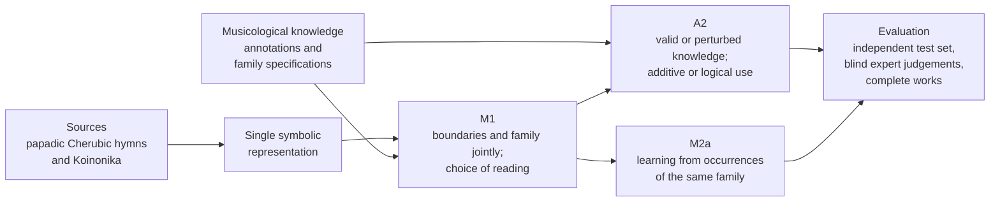

# Summary of the core research

<!-- language-switch:start -->
**Language / Γλώσσα:** [Ελληνικά](../../../docs/start/research-summary.md) · **English**
<!-- language-switch:end -->

[Home](../../README.md) · [Core research plan (PDF, Greek)](../../../documents/core-research-plan.pdf) · [Preliminary corpus inventory](../research/corpus/README.md) · [Detailed M1 design](../research/m1-selection-decision.md) · [A2](../research/a2-knowledge-design.md) · [M2a/M2b](../research/m2-eise-research-design.md)

This summary covers M1, A2 and M2a, together with the historical study M2b, whose confirmatory evaluation depends on sufficient source and performance evidence. The [detailed proposal (PDF, Greek)](../../../documents/analytical-proposal.pdf) develops the musicological foundations. The linked study pages explain the revised designs and technical checks. The corpus targets will be reviewed after the pilot.

## The musical problem

Byzantine chant is the monophonic vocal music of Orthodox worship, transmitted for centuries through written tradition and oral teaching together. Its melodies draw on a vocabulary of traditional formations, the **melodic formulae** (θέσεις): melodic formations of variable length that recur from work to work, adapted to the mode (echos, the modal framework of the melody), to the scale degree and to the poetic text. Occurrences that share the same identity form a **family** of formulae.

The identity of a formula is not the same as surface similarity. Related melodic paths may belong to different families, the same formula unfolds with different length and shape, and its boundaries within continuous notation are not always unambiguous. The musicological question is therefore also a demanding problem of symbolic music information retrieval (MIR) and machine learning: a system must locate units of variable length, recognise their family and abstain when the evidence is insufficient.

The proposal approaches the problem through **musicology-informed machine learning**. Musicology defines the unit of analysis and the criteria of each family. How much this knowledge is worth, and how the model uses it, are examined as controlled experimental variables. The repertoire is the papadic Cherubic hymns and Koinonika of the New Method, the analytical notation established in 1814. These are slow, melismatic chants of the Divine Liturgy, where formulae are long and hard cases are frequent.

## 1. Research questions

> **Central question.** How can a melodic formula and its family be recognised within continuous notation when their realisation varies, and what does the musicological knowledge that defines the family contribute to this recognition?

The question is divided into three studies that use the same corpus and the same symbolic infrastructure.

**RQ1 — How the notation should be read (M1).** A formula can be read as a sequence of written signs, of elementary melodic movements or of neume groups, with or without information on timing, mode and text. Which reading allows the boundaries and the family of a formula to be estimated jointly? And how many boundaries are already explained by general melodic segmentation cues that know nothing about families?

**RQ2 — What musicological knowledge contributes (A2).** A family specification may require a particular cadence, allow one of several internal developments and exclude a modal change. Does the valid specification improve recognition compared with a deliberately perturbed specification of the same form? And does logically combining these relations add anything beyond using them additively?

**RQ3 — Identity and realisation (M2a).** Does learning from pairs of real occurrences of the same family, in different works, help to recognise the family? And does it do so without losing the musically important information of the particular realisation?

**Historical question (M2b/EISE).** What does learning from two historically documented exegeses of the **same passage** add to learning from occurrences of the same family in different works? For each condition, the learned profile of written variation is compared with timing variability across independent chanters in the corresponding musical regions.

## 2. Proposed approach

### Data

The works are encoded from files of Neanes, open-source software for writing Byzantine notation. The public *Papadic Formulae* catalogue of St Anthony's Monastery in Arizona, with formulae from 758 compositions, serves as a guide for locating material and candidate families. It is not, however, a ready corpus of complete works, so the inventory of available works, sources and licences is the first step of the work.

The [preliminary inventory](../research/corpus/README.md) records metadata from Gheorghiță’s (2009) study of **42 Sunday Koinonika** and **11 formulaic formations**. It catalogues **338 rows across 68 tables**, which help locate passages for M1 and document candidate family specifications for A2. **Thirty-five rows record separate renderings by Gregorios and Chourmouzios** across Daniel’s eight Koinonika. Eligibility for M2b depends on identifying the witnesses and passages and checking historical dependencies. Complete works will be encoded from New Method sources.

The target is 40–60 complete works with 8–12 families and at least 25–30 occurrences per family from at least five independent works. Experts annotate the boundaries and the family of each occurrence, and at least 30% of occurrences, together with all hard cases, are annotated blind by a second expert. The pilot study of the first six months tests the whole chain on three candidate families, the parakletike, the kylisma and the piasma, starting from Gheorghiță's comparisons in Koinonika. It also measures annotation time and expert agreement, so that the scale of the corpus is decided on the basis of measurements.

### Representing the music

Each work is converted into a single symbolic form: a sequence of atomic melodic events, linked in both directions to the written signs, so that every automatic decision can be checked in the passage that produced it. An initial conversion infrastructure already exists. It will be tested on real works by restoring the original notation from the symbolic form.

On this form M1 compares twelve readings of the notation. It combines three input units (written sign, atomic melodic event, neume group) with four cumulative layers of information: notational, temporal, modal (echos, martyriai, phthorai) and textual (syllable, word, stress). The reading selected in M1 becomes the shared input of A2 and M2a.

### Models

**M1** uses as its main model a semi-CRF, a probabilistic model that scores whole candidate segments rather than single signs. It therefore decides jointly where a formula begins and ends and to which family it belongs. The model is compared with two-stage solutions that first find boundaries and then the family. It is also compared with an event-level Transformer, with general segmentation cues (local discontinuities as in LBDM, unexpectedness as in IDyOM, repetition of melodic structures) and with unsupervised statistical segmentation. Rule J selects the representation that best recognises complete formulae, subject to a minimum requirement for family recognition given the boundaries. [M1 methodology and synthetic checks](../research/m1-selection-decision.md)

**A2** uses the same trained M1 base in all four experimental conditions within each run. Family specifications combine concepts extracted from the notation, such as cadence, internal development or modal change. The experiment crosses valid or deliberately perturbed specifications with additive or structured logical use. Perturbations preserve the structure and overlaps of the specifications and match concepts with similar frequencies. [A2 research design](../research/a2-knowledge-design.md) · [Technical protocol and synthetic checks](../appendices/k.md)

**M2a** uses a symbolic reference model with fixed features and compares two neural conditions. The first learns to locate and recognise formulae and reconstruct features of their realisation. The second adds learning from pairs of occurrences of the same family in different works. Recognition is evaluated alongside the preservation of differences between realisations.

**M2b** compares EISE with a matched family-based condition using the same architecture, initialisation and training protocol. EISE uses verified co-exegeses of the same passage as positive pairs. The family-based condition uses pairs of occurrences from the same family in different works. [Detailed M2a and M2b design](../research/m2-eise-research-design.md)

### Evaluation

Works that share historical material, e.g. copies or renderings of the same passage, are always placed in the same part of the data. Performance is therefore not artificially raised by near-identical material in training and testing. An independent test set is defined early and opened once, after all choices have been made.

M1 measures how many occurrences are found with acceptable boundaries and the correct family. A2 and M2a measure how well the model ranks the real occurrences of each family, with average precision. M2a also measures how much information of the realisation is kept in the representations.

Independent experts judge, blind to the source of the proposals, the recognitions and the hard cases (M3a). Finally, the final model is applied to complete works outside training to map how formulae are organised (M5-min). A statistical test is prespecified for the main comparisons of A2. If the data are insufficient, results are reported as estimates with their uncertainty.

Pilot training for **M2b** requires eligible historical pairs. The confirmatory comparison additionally requires sufficient independent performances of the corresponding passages (M4-min) and checks of statistical adequacy. The inventory of historical relationships remains a deliverable in its own right.

### The approach at a glance

## 3. Expected contributions

### For MIR and machine learning

The thesis defines a new, standardised symbolic MIR task: joint segmentation and recognition of melodic formulae within continuous notation, with several acceptable segmentations, unknown families and the option to abstain. The task comes with an evaluation corpus and reference models.

A2 offers a controlled way to measure what expert knowledge adds to a machine-learning model. It separates the value of the content of the knowledge from the value of the way it is used, by comparison with perturbed knowledge of the same form. The design transfers to any field where experts state testable category criteria.

M2a examines how the identity of a category can be learned without erasing its internal variation, a central issue for every musical tradition organised in melodic types.

### For Byzantine musicology

The work states explicit, testable specifications of formula families and documents which occurrences belong to the same formula, by mode, genre and form. It records where the written variation of each family is concentrated and collects the hard cases with full notational references. The specifications are tested empirically. Where the data disagree with a specification, the disagreement is a musicological finding and not simply a model error. The inventory of historical exegeses of the same passage is a deliverable in its own right, useful beyond the thesis.

### Concrete results and tools

- an open conversion chain from Neanes files to a single symbolic form, with a reconstruction check;
- an annotated evaluation corpus with its annotation protocol, published where licences allow;
- a register of tested formula-family specifications;
- trained models, code and reference models for the new task;
- maps of how formulae are organised in complete works;
- publications in MIR conferences and journals and in musicology journals.

---

[Home](../../README.md) · [Core research plan (PDF, Greek)](../../../documents/core-research-plan.pdf) · [Feedback and scientific discussion (Greek)](../../../docs/review/feedback.md)
