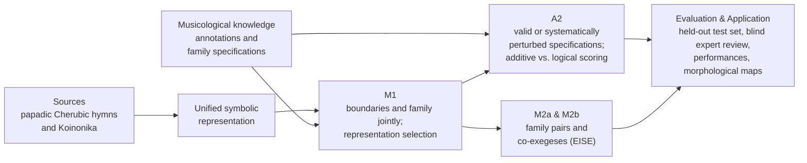

# Summary of the core research

<!-- language-switch:start -->
**Language / Γλώσσα:** [Ελληνικά](../../../docs/start/research-summary.md) · **English**
<!-- language-switch:end -->

[Home](../../README.md) · [Core research plan (PDF, Greek)](../../../documents/core-research-plan.pdf) · [Preliminary corpus inventory](../research/corpus/README.md) · [ByzCorpus (in development)](../research/byzcorpus/README.md) · [Detailed M1 design](../research/m1-selection-decision.md) · [M1-X](../research/m1-x-design.md) · [A2](../research/a2-knowledge-design.md) · [M2a/M2b](../research/m2-eise-research-design.md)

This page summarises the core design of the PhD research: symbolic representation selection for joint boundary detection and formula recognition (**M1**), the experimental evaluation of musicological knowledge (**A2**), and representation learning from family and historical relationships (**M2a** and **M2b**, where confirmatory evaluation of M2b depends on sufficient source and performance data). The [detailed proposal (PDF, Greek)](../../../documents/analytical-proposal.pdf) sets out the musicological foundations, while the linked technical pages present the protocols and synthetic checks. Final corpus targets will be set after the pilot phase.

## The musical problem

Byzantine chant is the monophonic vocal music of Orthodox worship, transmitted over centuries through the interplay of written notation and oral teaching. Its melodies draw on a rich vocabulary of traditional melodic types, the **musical formulae** (*theseis*, θέσεις): variable-length formations that recur across works, adapted to the mode (*echos*, the modal framework), the scale degree and the poetic text. Individual occurrences that share the same structural identity form a **family** of formulae.

The identity of a formula, however, does not reduce to surface melodic similarity. Similar interval sequences may belong to different families, the same formula can unfold at different lengths and levels of elaboration, and its boundaries within continuous notation are not always clear-cut. Consequently, the musicological question of the *thesis* is also a demanding problem in symbolic music information retrieval (Symbolic MIR) and machine learning: a computational model must locate variable-length units, identify their family and abstain when the evidence is ambiguous.

The research addresses this problem through **musicology-guided machine learning**. Musicological analysis defines the structural unit and the diagnostic criteria of each family, while both the validity of this domain knowledge and the way it is integrated into the model are tested as explicit experimental variables. The empirical focus is on the papadic Cherubic hymns and Koinonika of the New Method, the analytical notation introduced in 1814. These are slow, richly melismatic chants of the Divine Liturgy, in which consecutive formulae often unfold within a single syllable and morphological ambiguities are frequent.

**Related data-infrastructure initiative.** [ByzCorpus](../research/byzcorpus/README.md) organises the symbolic data model, source and licence documentation, and a separate pilot protocol for expert boundary agreement and statistical segmentation (NHPYLM). It is developed in parallel and leaves the core M1–A2–M2 study design unchanged.

## 1. Research questions

> **Central question.** How can a computational model locate the boundaries of a musical formula and recognise its family within continuous notation when its realisation varies, and what does explicit musicological knowledge contribute to this recognition?

The central question is addressed through three complementary studies sharing the same corpus and symbolic infrastructure:

**RQ1 — How the notation should be represented (M1).** The chant score can be encoded as a sequence of written signs, atomic melodic events or neume groups, progressively enriched with temporal, modal and textual information. Which representation supports the most accurate joint estimation of formula boundaries and family identity? And to what extent are these boundaries already accounted for by general melodic segmentation cues without any knowledge of formula families?

**Complementary M1-X — Family structure and formula boundaries.** After M1 selects the operational representation, this self-contained extension evaluates the contribution of family-informed boundary parameterisation against the strong factorised C_fac comparator, using matched supervision and decoding procedures. With sufficient parameterisation capacity, the two probabilistic forms can represent the same distributions; the experiment measures the consequences of their inductive biases for learning and generalisation. [M1-X methodological protocol](../research/m1-x-design.md).

**RQ2 — How musicological knowledge affects learning (A2).** A family specification may require a particular cadence, allow alternative internal developments and rule out certain modal changes. Does a musicologically valid specification improve recognition compared with a controlled perturbation of the exact same logical form? And what does structured logical composition add beyond simple additive scoring of the same diagnostic concepts?

**RQ3 — Family identity and preservation of realisation (M2a).** Does supervision from pairs of occurrences of the same family across different works improve recognition on unseen pieces? And how can this shared identity be learned without discarding the melodic and temporal details that characterise each individual realisation?

**Historical question — Parallel exegeses as supervision (M2b / EISE).** What additional information is gained by learning from independent historical transcriptions (*exegeses*) of the **same passage** (co-exegeses), compared with learning from occurrences of the same family across different works? To evaluate this externally, the profile of written variation learned under each condition is compared against timing variability across audio recordings by different chanters in the corresponding regions of the formula.

## 2. Proposed approach

### Data and musicological documentation

Works are encoded from structured files created in Neanes, an open-source editor for Byzantine notation. The public *Papadic Formulae* catalogue of St Anthony's Monastery in Arizona (covering formulae from 758 compositions) serves as an index for locating material and candidate families; because it is not a corpus of complete scores, compiling a verified inventory of sources and licences is the first step of the project.

The [preliminary inventory](../research/corpus/README.md) compiles metadata from Gheorghiță’s (2010) comparative study of **42 Sunday Koinonika** and **11 historical melodic formations**. It records **338 entries across 68 comparative tables**, which guide passage selection for M1 and the drafting of family specifications for A2. Among these, **35 entries document parallel exegeses by Gregorios Protopsaltes and Chourmouzios Chartophylax** across the eight Koinonika of Daniel Protopsaltes. Their eligibility for M2b will be finalised after verifying manuscripts, folios and transmission dependencies.

The initial target is 40–60 complete works and 8–12 formula families (with at least 25–30 occurrences per family across at least five independent works). Experts annotate the boundaries and family membership of each occurrence, while at least 30% of the material—along with all ambiguous cases—is double-annotated blind by a second specialist. A six-month pilot tests the entire workflow on three candidate families (*parakletike*, *kylisma*, *piasma*), measuring annotation time and inter-annotator agreement so that the final scale of the corpus can be set empirically.

### Symbolic representation

Each work is converted into a unified symbolic sequence of atomic melodic events linked bidirectionally to the written neumes and their exact locus in the source, allowing every model prediction to be inspected directly on the score. The conversion pipeline is verified through lossless round-trip reconstruction of the original notation.

On this common event axis, M1 evaluates twelve input combinations ($3\times 4$): three input granularities (written sign, atomic melodic event, neume group) crossed with four cumulative layers of information—base notation, rhythmic durations, modal indications (*echos*, *martyriai*, *phthorai*) and textual features (syllable, word, stress). The best-performing representation in M1 serves as the shared input for A2 and M2.

### Modelling

In **M1**, a neural encoder contextualises the melodic events and a semi-Markov conditional random field (joint semi-CRF) scores candidate start boundaries, end boundaries and family labels simultaneously, taking alternative acceptable segmentations into account during training. This joint model is compared against two-stage pipelines (which detect boundaries first and classify segments second), an autoregressive event-level Transformer, local boundary and melodic parallelism baselines (LBDM, IDyOM) and unsupervised Bayesian segmentation via Pitman–Yor processes (NHPYLM). Selection rule J chooses the representation with the highest full-recognition score under architecture A, subject to a minimum recall threshold on known families. [M1 methodology and synthetic checks](../research/m1-selection-decision.md)

The complementary **M1-X** study compares A against **C_fac**, a factorised model with a shared trainable encoder and free boundary-scoring head. It separates the effects of parameterisation from the effects of search through marginal boundary decisions, K-best rescoring and global joint decoding. M1-X uses the representation selected by J; the architecture and input passed to A2/M2 remain unchanged. [Detailed M1-X design](../research/m1-x-design.md).

**A2** keeps the trained M1 neural backbone fixed within each experimental replication and evaluates family specifications in a $2\times 2$ factorial design: valid versus systematically perturbed specifications, crossed with simple additive versus structured logical scoring of the same diagnostic concepts (such as cadence, internal development and modal change). Perturbations preserve the logical skeleton and overlaps of the specifications, matching concept frequencies and missingness rates within the prespecified tolerance. [A2 research design](../research/a2-knowledge-design.md) · [Technical protocol and synthetic checks](../appendices/k.md)

**M2a** contrasts a non-neural symbolic baseline (B0) with two neural conditions: a base model (B1) trained on boundary/family recognition and masked feature reconstruction, and a family-supervised condition (B2) that adds relational supervision from pairs of occurrences of the same family across different works. Recognition gains are evaluated alongside the preservation of realization-specific details (via reconstruction and linear probing).

**M2b** compares the **EISE** (Exegesis-Invariant Segmental Encoder), where positive pairs come from verified co-exegeses of the same historical passage, against a matched model trained on same-family pairs from different works under identical architecture, initialisation and computational budget. [Detailed M2a and M2b design](../research/m2-eise-research-design.md)

### Evaluation

To prevent data leakage, related works, copies and co-exegeses of the same chant are grouped together before splitting into training, validation and test sets. A locked held-out test set is set aside early and evaluated only once, after all modelling choices have been fixed.

M1 is evaluated using full-recognition $F_1$ (requiring agreement on both acceptable boundaries and family identity), while A2 and M2a use macro Average Precision (macro AP) per family alongside realization-preservation probes. In addition, independent specialists evaluate model predictions and borderline cases blind to their origin (M3a), and the final model is applied to complete unseen works to generate morphological maps of formula organisation (M5-min).

In **M2b**, external evaluation compares the profile of internal formula regions where historical exegeses diverge most against timing variability across audio recordings by different chanters (M4-min), after timing normalisation. The systematic inventory of co-exegeses remains a standalone musicological deliverable regardless of sample size.

### The approach at a glance

## 3. Expected contributions

### For symbolic MIR and machine learning

The thesis defines a new, reproducible symbolic MIR task: joint segmentation and recognition of variable-length melodic units in continuous melismatic notation, accommodating multiple valid boundary placements, unknown families and explicit abstention, accompanied by a curated benchmark corpus and reference baselines.

At the same time, study A2 introduces a tightly controlled experimental design for measuring the contribution of domain knowledge in machine learning, disentangling the substantive validity of expert criteria from their structured logical composition. Finally, studies M2a and M2b investigate how representation learning can align the shared identity of a musical unit while preserving its internal variation.

### For Byzantine musicology

The research develops an operational, empirically testable ontology of the musical *thesis*, documenting identity criteria, acceptable realisations and borderline cases across modes and genres. Where source occurrences diverge from a theoretical specification, that divergence is recorded as a substantive musicological finding rather than treated merely as a classification error. Moreover, the systematic register of parallel historical exegeses and the morphological maps of complete works provide new resources for comparative analysis of composition and exegesis.

### Deliverables and research resources

- an open conversion pipeline from Neanes files to a unified symbolic representation, with automated round-trip reconstruction checks;
- an annotated benchmark corpus and annotation protocol (released in accordance with source licences);
- a documented register of formula-family specifications and historical co-exegeses;
- open-source code, trained models and reproducible experimental checks;
- morphological maps of formula organisation across complete papadic works;
- publications in international MIR / machine-learning venues and musicological journals.

---

[Home](../../README.md) · [Core research plan (PDF, Greek)](../../../documents/core-research-plan.pdf) · [Feedback and scientific discussion (Greek)](../../../docs/review/feedback.md)
